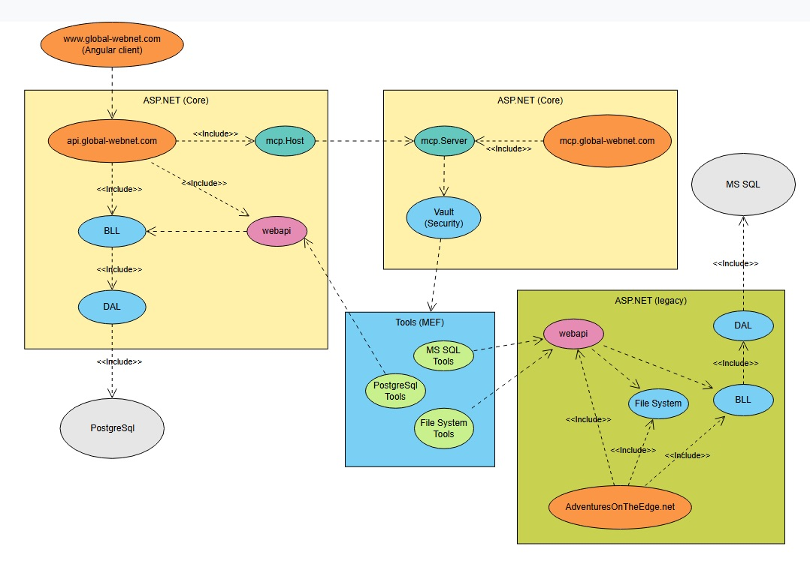

# ai-research-blog

**An AI starter kit for developers, and a complete blog built on it.** The mission is to give every
developer a working foundation for building with AI, so that one person can run something with the
potential to succeed for less than $35 a month, without depending on expensive identity, data or AI
service providers.

> **What the money buys, and from whom.** We do not provide hosting or AI services. The figures are
> what the other parties charge: shared Windows hosting from [SmarterASP.NET](https://www.smarterasp.net)
> (about $38 per quarter on the plan this project runs on, billed by SmarterASP.NET) and an AI
> subscription from the AI provider of your choice (about $20 a month). You can run the whole
> application, including its free HTTPS, on that one hosting plan.

- **The kit is the `Adventures.*` libraries** in
  [Adventures.Foundation](https://github.com/BillKrat/Adventures.Foundation): self-hosted security (JWT
  and machine-to-machine sign-in, no external identity provider), a tenant-scoped data store,
  identity and login, a dynamic entity model, a plug-in and widget seam, a tool manifest, and request
  hardening.
- **This repository is the worked example.** One complete blog application (Angular client, ASP.NET
  Core API, a separate MCP server, Aspire for local composition) that shows how the libraries fit
  together and uses every feature the kit offers today.
- **Scope.** The public work is deliberately one complete, working blog, not a platform. Use it to
  learn from, to start your own, and to run your own site.

It is also an early-stage replacement for [AdventuresOnTheEdge.net](https://AdventuresOnTheEdge.net),
currently powered by a legacy forked project [BlogEngine.NET](https://github.com/BillKrat/BlogAI).
[AGENTS.md](AGENTS.md) is the AI context index for this repository (state, per-AI sections, docs index).

## What it does today

The application is live at [www.global-webnet.com](https://www.global-webnet.com) (API at
[api.global-webnet.com](https://api.global-webnet.com/api/health), MCP server at `mcp.global-webnet.com`).

**Reading**
- Posts, pages (the site menu is the page tree), categories, tags and a tag cloud, a front page you pin,
  basic search, and an RSS feed. Old BlogEngine post addresses redirect to their new ones.
- Posts are Markdown (with [Mermaid](https://mermaid.js.org) diagrams, loaded only when a post uses
  one) or HTML written in the Word-like document editor; HTML is sanitised on save and on serve.
- Visitor comments with approval: an anonymous form (honeypot and rate limit), moderation in the admin,
  a site-wide switch and a per-post switch.
- A dark or light site setting with a visitor toggle, a phone layout, and every button an icon with
  hover text taken from per-site language files.

**Writing and running the site (Admin)**
- A server-supplied menu filtered by your rights, and schema-driven forms and grids (paging, sorting,
  column choice). Screens: Dashboard (counts, quick draft, latest comments, health), Posts, Pages,
  Categories, Tags, Comments, Collaboration, Decisions, Users, Roles, Exceptions, Settings, Plugins,
  E-mail, Widgets, Languages, Tenants, Maintenance (export, clear cache).
- Publishing is deliberate: a draft stays a draft until an administrator publishes it. A published post
  is changed through a **revision** (a hidden copy you apply or discard), never in place by a tool.
- Image upload with validation, a tracking-script setting, and per-site settings for title, feed,
  comments and mail.

**Security**
- Rights, not roles: every admin route asks for the exact right it needs (a guard test fails a route
  without one), roles are bundles of rights, and the last administrator cannot be removed.
- Self-hosted JWT and machine-to-machine client credentials, a first-sign-in password change that is
  enforced, e-mail address verification, "forgot my password", per-IP rate limits, security headers,
  AES-GCM encrypted settings (write-only secrets), and trusted-proxy handling for a CDN in front.
- No audit trail is kept (see "Not for regulated use" below).

**Many sites, one install (tenants)**
- The host name picks the tenant, and each tenant has its own data graph, users, rights, settings,
  language files and widgets. A platform administrator adds sites and host aliases, and can switch
  which site they are working in. The first request to a fresh install creates the first site.

**Working with an AI**
- **Human and AI collaboration:** the AI writes its work up as a draft that only a person can see; the
  person approves, sends it back or decides; every question and decision is kept in the conversation
  under the item. The AI can propose but never publish, and can never record a decision. See
  [the post](https://www.global-webnet.com/post/human-and-ai-collaboration-a-research-and-development-channel-built-into-the-blog)
  and its source, [docs/content/Claude-post-human-ai-collaboration.md](docs/content/Claude-post-human-ai-collaboration.md).
- **Observability for humans and AIs:** every request carries a correlation id; exceptions are grouped
  into kinds with a status; **Diagnose** explains an entry with live checks, **Ask Claude** sends a
  scrubbed report to Anthropic for an assessment, and **Prompt Claude** builds a ready-made prompt for
  your own AI session. Browser errors are reported too.
- **The MCP server** (see below) lets an AI client trace a request, write drafts, and read and answer
  collaboration items, under scoped machine identities.

**MCP server**
- JSON-RPC over one HTTP endpoint. Its tool list is built from the API's tool manifest (one declaration
  per tool: name, description, input schema, scope, route), so a tool is a few lines, and a plug-in can
  add tools. Calls are forwarded to the API with the caller's own token, so the API stays the one place
  that decides what is allowed.
- Scopes: diagnostics (read-only), content drafts (authoring, comments, collaboration, language-file
  proposals), and read-only research tools over a legacy BlogEngine database. There is deliberately no
  publish tool.

**Extending it**
- **Plug-ins** (the `Adventures.MEF` seam): discovered from the host and from an approved folder of plug-in
  DLLs (a SHA-256 allow list, each in its own load context), switched on or off per tenant on the Plugins
  page, with a Customize screen for their settings, an in-process event bus, and their own API routes
  and tools under fixed rules. HTML sanitising is itself a default-on plug-in.
- **Widgets** in four zones (header, footer, left, right; header and footer only on a phone): a text box,
  tag cloud and category list are built in, and a widget is a small class that returns HTML.
- **Languages:** every label and server message is keyed; a site picks a language file, and Claude can
  propose a new one that you review before it is served.

**Storage and operations**
- All data lives in an N-Quad store on PostgreSQL, with two layouts behind one interface: the original
  text table and a hybrid dictionary layout that is about half the size for the same content, with
  tools to back up, restore and copy between them. Settings and content are seeded from numbered seed
  files, and a new install uses an install seed with no people and no content.
- Clients: the Angular app is built from five packaged libraries (`core`, `entity-ui`, `collaboration`,
  `blog-reader`, `admin`), and a WPF desktop client shows the same entities through the same API.
- A legacy mode reads a BlogEngine SQL database through the same interfaces, for migration.

## Install it on your own SmarterASP.NET account

The step-by-step guide is [docs/Claude-install-guide-smarterasp.md](docs/Claude-install-guide-smarterasp.md).
Three layouts are written up. The first two were proved on a real second host; the third is how this project itself runs:

1. **One site, one address (the easiest way to try it).** One SmarterASP.NET site where the API serves the
   client, running on the site's own temporary address with its free certificate. No domain needed.
2. **Three sites on temporary addresses.** A web site, an API site and an MCP site, each on its own
   temporary address with its free certificate. Nothing to buy, and you can attach your own domain to the
   web site afterwards.
3. **Your own domain** for each site, with free certificates, as this project's own hosting is set up.

The guide also lists the traps found on the first real installs (pool settings, the database port,
replacing files on a running site, certificates and CDNs). For running the stack locally and deploying
from GitHub Actions to inexpensive hosting, see [docs/Claude-developer-setup-guide.md](docs/Claude-developer-setup-guide.md). Status: the one-site and three-site layouts
are proved on real hosting (the one-site layout with a locally built upload, since its GitHub workflow has not
been run end to end yet); the one-click listing and a fully scripted installer are not done.

## Run it locally

```bash
dotnet restore AiBlogResearch.slnx
dotnet run --project src/AiBlogResearch.AppHost     # the API and the Angular client (port 4200)
dotnet test                                          # on the solution or any test project
```

The solution also references the sibling `Adventures.Foundation` repository by relative path, so clone
it next to this one on the same branch. Live-Postgres tests are opt-in and need a `ConnectionStrings:Postgres`
user-secret. `LocalTriage.slnx` starts just the two APIs with no Aspire.

## Built with Claude Code

Much of this project, including a new site's DNS record, free certificate, application pool and
deployment workflow on 2026-09-23, was built through natural-language requests to
[Claude Code](https://claude.com/claude-code) talking to SmarterASP.NET's MCP server integration, with the
application code written, tested and deployed in the same sittings. Claude Code's own safety layer blocked
the three risky actions in that session (overwriting a live secret, deleting a secret, and writing a signing
key to a scratch file) and a human finished them by hand, which is the intended division of labour. The
engineering rules that came out of it (tests first, rights not roles, secrets never in a prompt or a commit,
an AI proposes and a person decides) are written down in [AGENTS.md](AGENTS.md).

## Where it is going

Beta first: a schema site that documents the data model, release notes, an accessibility pass, and the
install guide proved end to end. Then researcher collaboration (a research library with vetted sources)
on the same foundation, and an API that acts as an MCP host over independently developed tool modules,
each keeping its own data access and credentials.



## Not for regulated use

This software is a general-purpose starter kit. It is **not designed, validated or licensed for regulated use**: health care and life sciences (including clinical or other human-subjects research), financial services, safety-critical or critical-infrastructure systems, government or defence compliance regimes, or any setting that needs a validated system, an audit trail, electronic signatures or a compliance certification. It has no regulatory approval and makes no compliance claim, and it keeps no audit trail. Production use in a regulated field is outside the licence, and no commercial licence is offered for it. We also do not accept contributions whose purpose is to make it usable in a regulated environment (see [CONTRIBUTING.md](CONTRIBUTING.md)), so please do not spend effort on that. The exact terms are in [NOTICE](NOTICE) (Regulatory disclaimer and field of use) and the Additional Use Grant in [LICENSE](LICENSE).

## License

Source-available under the Business Source License 1.1, with an additional use grant for small operators, changing to AGPL-3.0 after four years. Read [LICENSE](LICENSE) and [NOTICE](NOTICE) for the exact terms; they govern, not this summary.
