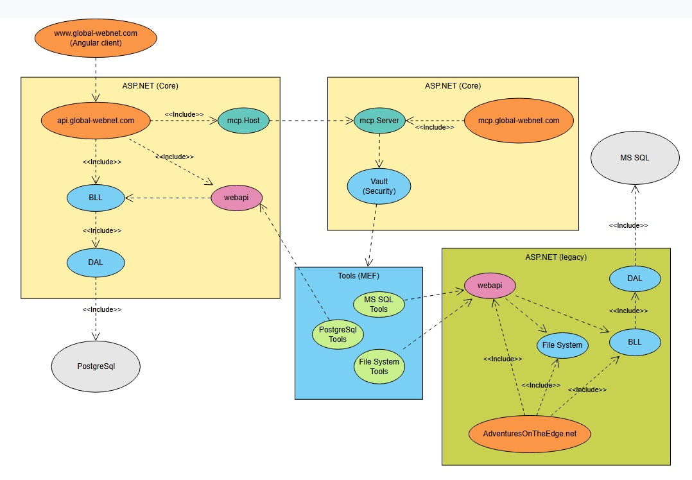
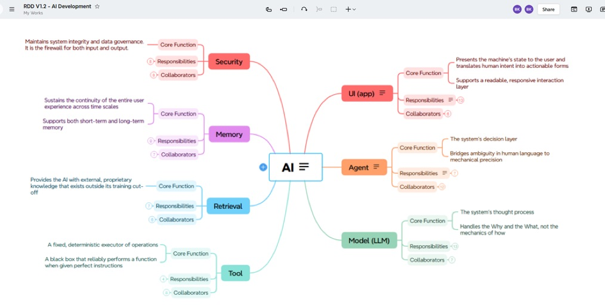

# ai-research-blog

**An AI starter kit for developers.** Our mission is to give every developer a fully functional
foundation for building with AI, so that one person can build something with the potential to
succeed for as little as about $60 a month (hosting, a domain and an AI subscription), without
depending on expensive identity, data or AI service providers.

- **The kit is the `Adventures.*` libraries.** Self-hosted security (JWT and machine-to-machine
  authentication, no external identity provider), a tenant-scoped data store, identity and login,
  a dynamic entity model, and request hardening live in
  [Adventures.Foundation](https://github.com/BillKrat/Adventures.Foundation) as reusable NuGet
  packages.
- **This repository is the worked example.** `ai-research-blog` is a single blog application
  (Angular client, ASP.NET Core API, a separate MCP server, Aspire for local composition) that
  shows how the libraries fit together and demonstrates every feature the kit offers today,
  including the human and AI collaboration channel below. Researcher collaboration, a research
  library with vetted sources, comes next on the same foundation.
- **Scope.** The public work is deliberately one complete, working blog, not a platform. Use it to
  learn from, to start your own, and to run your own site.
- **License.** Business Source License 1.1: free production use for a pre-scale operator (one
  individual, under $100,000 in annual revenue and in outside funding, not offering a competing
  hosted platform), non-production use always free, and each version becomes AGPL-3.0 after four
  years. See [LICENSE](LICENSE) and [NOTICE](NOTICE). These terms are under attorney review and may
  change for future versions.

It is also an early-stage replacement for [AdventuresOnTheEdge.net](https://AdventuresOnTheEdge.net),
currently powered by a legacy private [BlogEngine.NET fork](https://github.com/BillKrat/BlogAI).

- [AGENTS.md](AGENTS.md) — AI context index: repo state, per-AI sections, docs index

## Human and AI collaboration

The feature this project is built around: a **review channel between a person and an AI**, for software development or any research that needs both. The AI writes its work up as a draft post that only the person can see; the person approves it, sends it back, or decides; every question, answer and decision is kept under the post, and the AI reads that record at the start of its next session. The AI can propose but never publish, and it can never record a decision.

The post [Human and AI collaboration - a research and development channel built into the blog](https://www.global-webnet.com/post/human-and-ai-collaboration-a-research-and-development-channel-built-into-the-blog) has an executive summary, a detailed section for the researcher or developer (what works today and where it is going), and a prompt that briefs an AI on the context and the rules. Its source is in the repository: [docs/content/Claude-post-human-ai-collaboration.md](docs/content/Claude-post-human-ai-collaboration.md).

## Current State

The foundation is running today: an Angular client is deployed at
[www.global-webnet.com](https://www.global-webnet.com), backed by the ASP.NET Core API at
[api.global-webnet.com](https://api.global-webnet.com/api/health). The application includes
health monitoring, JWT-based user authentication, and machine-to-machine client-credentials
support. Reusable identity, security, and PostgreSQL data-access capabilities live in the
separate `Adventures.Foundation` packages.

A second site, `mcp.global-webnet.com`, is the MCP server. It began on 2026-09-23 as a scoped-down
pipeline shakedown (a single M2M-authenticated "hello world" endpoint) that proved the
provisioning, deployment, and cross-site authentication mechanics. Since then it has become a real
server: diagnostics tools that let an AI trace a production request, drafts-only authoring tools
(an AI can write a post draft or propose a revision of a published post, and a human publishes),
and read-only tools over the legacy BlogEngine database for the migration. The site itself is a
working blog today: a public reader, an admin for posts, pages, categories, tags, users and roles,
and built-in exception tracking.

## Vision

The API will evolve into an MCP Host that coordinates AI-assisted research and authoring. It will
call a separate, consolidated MCP Server over scoped machine-to-machine authentication. That
server will load independently developed tool modules -- such as PostgreSQL, SQL Server, and file
search -- so each tool retains control of its own data access and credentials.

### Security Across MCP Components

The MCP Host and Server will trust each other through short-lived, scoped machine-to-machine
tokens. The Host authenticates as its own client identity, requests only the scopes required for a
tool operation, and sends the resulting bearer token to the MCP Server. The server validates the
token and scope before invoking a tool; database, file-system, and other sensitive credentials
remain within the tool server and are never passed through the Host or exposed to the client.

Over time, the product will provide a modern research and blogging experience, while the related
BlogAI vision explores reviewable, searchable development narratives for AI-assisted code changes.

The following is a screenshot of the [AI research](https://app.xmind.com/ftOSfVNH?xid=qMtMXB9B) that will be used in design of MCP Host and Servers

## How this gets deployed: SmarterASP.NET + Claude Code

Worth an honorable mention: on 2026-09-23, the entire `mcp.global-webnet.com` shakedown described
above — a new hosted site, its DNS record, a free SSL certificate, a dedicated IIS application
pool, a scoped FTP account, and a new GitHub Actions deployment workflow — was provisioned and
shipped in a single evening session, almost entirely through natural-language requests to
[Claude Code](https://claude.com/claude-code) talking directly to SmarterASP.NET's new MCP server
integration. No manual clicking through the hosting control panel for the routine parts: create
the site, attach the domain, request the certificate, create the FTP user, check on provisioning
status — all of it happened as tool calls in a chat session, with the actual application code (the
`McpServer.WebApi` project, its tests, and the machine-to-machine auth wiring in
`AiBlogResearch.WebApi`) written, tested, committed, and deployed the same sitting.

**The guardrails did their job too, worth calling out honestly rather than glossing over.** Two
writes were blocked outright by Claude Code's own safety layer, independent of anything
SmarterASP.NET itself would have allowed: overwriting an already-live production secret, and
deleting a secret at all. A third attempt — minting a test token with the real signing key written
into a scratch file — was blocked as credential leakage before it ever touched disk. All three
required a human to finish by hand in the SmarterASP.NET panel. That's the system working as
intended: an AI agent with real infrastructure access, but with hard lines it won't cross on its
own around live credentials.

For a solo or small-team developer, the combination is genuinely inexpensive: a SmarterASP.NET
Windows hosting plan (around $38/qtr in this project's own case) that supports
[.NET Aspire](https://learn.microsoft.com/dotnet/aspire/) for local development composition and
deploys straight from GitHub Actions to that same hosting account, alongside a Claude
subscription doing the actual engineering work. That's a full multi-site .NET hosting environment
with real CI/CD, for less than the cost of a lot of single-purpose SaaS tools combined.

### Installing this on your own SmarterASP.NET account

If you would like to download this project and run it on your own SmarterASP.NET hosting, the aim is
to give you comprehensive documentation for the whole path: the hosting plan and sites, DNS and the
free SSL certificates, the database and its secrets, the FTP user, the GitHub Actions secrets, the
first deploy, and seeding. That documentation is not finished yet. The plan is to prove each step
in collaboration with SmarterASP.NET, so that every later installation is repeatable and the
guide reflects what actually works rather than what we assume. The starting point is
[docs/Claude-developer-setup-guide.md](docs/Claude-developer-setup-guide.md) (Aspire locally to
automated CI/CD deploy on inexpensive hosting).

If you're evaluating SmarterASP.NET,
[this link](https://www.smarterasp.net/index?r=billkrat) supports this project.

## License

Business Source License 1.1 (see [LICENSE](LICENSE) and [NOTICE](NOTICE)). Free production use for a pre-scale operator (one individual, under $100,000 gross annual revenue and under $100,000 outside funding) that does not offer a competing hosted platform; non-production use is always free; everyone else needs a commercial license or subscription from Diane Kratochvil, doing business as Adventures On The Edge. Each version converts to AGPL-3.0 after four years. These terms are under attorney review and may change for future versions. Versions published before 2026-10-24 remain under MIT. Outside contributions: see [CONTRIBUTING.md](CONTRIBUTING.md).
