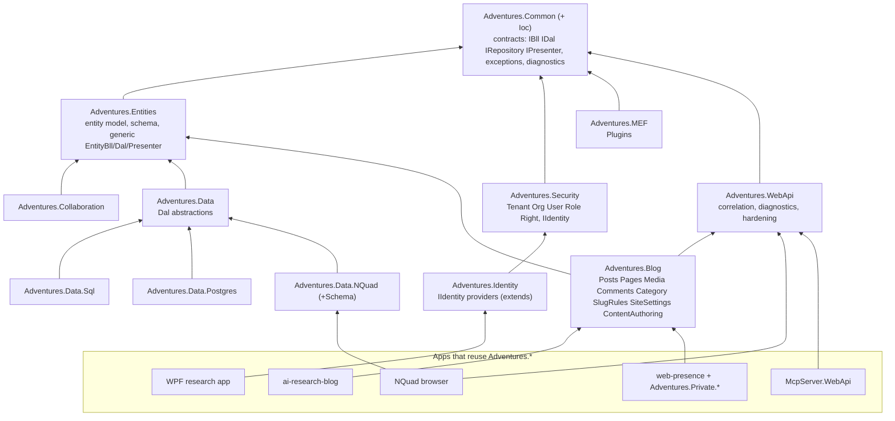

# Architecture reference — Adventures.* and its apps

**Status:** v1, decisions D1-D7 resolved 2026-10-31, S0 under review. Living document: read it before any development work, update it when the framework changes, and make it shorter as the framework gets smaller. It replaces Claude's training as the source of design truth for this workspace. [Claude-architecture-principles.md](Claude-architecture-principles.md) (stable IDs A1-E) stays as the review checklist; this file is the target design and the rules that produce it.

## 1. Sources and what was actually read

| Source | Read in this session | Standing |
|---|---|---|
| MSDN Magazine, Dec 2011, *MVPVM Design Pattern* (Kratochvil) | whole article (no code listings; figures are images) | Source of truth |
| `docs/architecture/AppArchGuide2.0.pdf` (patterns & practices) | Ch. 3 (guidelines), 9 (layers and tiers), 10 (presentation), 11 (business), 12 (data access) in full | Source of truth |
| `PotelPaper.pdf` (Taligent MVP, 1996) | whole; the last paragraph of the file is scraped web text with errors and is ignored | Reference |
| `TwistingTheTriad.PDF` (Bower, McGlashan, 2000) | whole | Reference |

**Not read this session:** AppArch Ch. 4-8 (design process, deployment, styles, quality attributes, communication), 13 (service layer), 15 (web archetype), 17 (rich client). The 2026-10-11 principles doc cites Ch. 15. Read Ch. 17 before the WPF stage and Ch. 13 before any service-interface work, and record the rules here.

## 2. Rules, distilled (cite as R-n)

**Layering and dependency direction**
- **R1.** Layers: Presenter → Bll → Dal → Repository/store. Calls go down only; no upstream dependency; a lower layer never names a higher one. (AppArch 3, 9, 11; MVPVM)
- **R2.** Depend on abstractions at every layer seam (dependency inversion); concrete classes meet only in the composition root. (AppArch 3, 11, 12)
- **R3.** Shared business entities sit in their own assembly that both the Bll and the Dal reference, so neither depends on the other's internals. (AppArch 9, Fig. 5)
- **R4.** Do not add a layer you do not need; do not add a tier you do not need. Layers are logical; tiers are physical. (AppArch 9)
- **R5.** One pattern per layer. The Dal uses Repository or Table Data Gateway, not both. (AppArch 3)

**Responsibilities**
- **R6.** Bll: business rules, validation, policy, orchestration. Works with domain objects and interfaces only; never a connection, file or query. (MVPVM; AppArch 11)
- **R7.** Dal: owns retrieval details (SQL, N-Quads, files, REST), maps storage shape to domain objects, handles data-source exceptions and connections. Contains no business decisions. It **uses** a repository; a repository is not a substitute for a Dal. (MVPVM; AppArch 12; human, 2026-10-31)
- **R8.** Presenter: the application behaviour of one screen or use case. Depends on its View, ViewModel and Bll interfaces; is the only tightly coupled piece; not designed for reuse. Reusable behaviour is packaged as a module behind interfaces and resolved by DI. (MVPVM; Potel; Twisting the Triad)
- **R9.** ViewModel: data and change notification only, no business logic, not bound to one View. View: no code-behind logic, binds through DataContext. (MVPVM)
- **R10.** Model/domain objects know nothing of the UI or of storage. (Twisting the Triad; MVPVM)
- **R11.** Cross-cutting code (security, logging, validation, exceptions, configuration) is centralised and kept out of business logic. (AppArch 3)

**Composition and reuse**
- **R12.** Prefer composition over inheritance. Extend a library without touching it: by registration (replace a service), by decoration, or by a plug-in that adds services. A base class with a hundred members is a "Blob". (AppArch 3; human, 2026-10-31)
- **R13.** Plug-ins and modules register themselves through one entry point (`AddXxx(...)`) and declare what they need as interfaces; the host never reaches into them. (MVPVM modules; AppArch 10 composition)
- **R14.** Presentation components with hard-coded dependencies cannot be reused; resolve through DI and use publish/subscribe between modules. (AppArch 10)
- **R15.** Web: a message-based interface (DTOs, coarse-grained) between presentation and business, even in one process. (AppArch 3, 9)

**Hygiene**
- **R16.** Naming states the role: `XxxBll`, `IXxxBll`, `XxxDal`, `IXxxDal`, `XxxRepository`, `XxxPresenter`, `XxxViewModel`. The same type name never exists in two namespaces. (AppArch 3; human)
- **R17.** No source files at a project root; folders are named for what they hold. (human, 2026-10-31)
- **R18.** Exceptions are caught at layer boundaries, business errors differ from system errors, nothing internal reaches the user. (AppArch 3, 10-12)
- **R19.** Validate at every trust boundary and again in the Bll. (AppArch 3, 11)

## 3. Target architecture

From the refactor diagram. Arrows read "depends on".

**Dependency rules that must hold (each becomes an automated test, section 5):**

1. `Common` references nothing of ours. `Entities` references `Common` only.
2. `Security` and `Identity` reference no storage project. Identity's storage is an interface (`IUserCredentialStore`); the Postgres implementation lives in `Data.Postgres`.
3. `Data` (abstractions) references `Entities` and `Common`. Each store project (`Sql`, `Postgres`, `NQuad`) references `Data`, never another store, except `Data.NQuad.Postgres` (the Postgres-backed N-Quad store) which may reference both.
4. `Blog` and `Collaboration` reference `Entities`/`Common`, never a store project. Their Dals are interfaces implemented by a store project or by the host.
5. `WebApi` references no store project. Probes and diagnostics go through interfaces.
6. `Security` core has no ASP.NET Core package; JWT bearer wiring lives in a `Security.AspNetCore` extension, so a desktop app can take Security.
7. An app's `Program.cs` is composition only: `AddAdventures...()` calls and configuration, no hand-built repositories.

**The data seam (what makes "swap the DAL" real).** Today the Bll is generic over `DynamicEntity` and reaches `IEntityRepository<T>` directly, and `DynamicEntity` is shaped like an N-Quad field bag (field IDs, dirty fields). A SQL Dal for the legacy blog tables cannot appear without a decision on the currency between Bll and Dal (decision D1 in section 6). The rule either way: **the Bll sees only `IXxxDal` and domain objects; the Dal owns the mapping from its storage; the Dal is built from repositories/executors, never the reverse.**

**Mode switch.** `Mode=Legacy|New` selects registrations only: `New` registers the NQuad/Postgres Dals and the Collaboration module; `Legacy` registers the SQL Dals for Posts, Pages, Users, Categories, Tags, Comments and does not register Collaboration (the existing Admin > Plugins switch already hides a disabled plug-in's menu entry, endpoints and MCP tools, which is the mechanism to reuse). No `if (mode)` appears in a Bll, Presenter or controller.

## 4. Where the code stands (facts from reading it, 2026-10-31)

| Fact | Where | Breaks |
|---|---|---|
| `Adventures.Entities` holds 67 files flat: the generic entity model, plus Blog content (Post, Page, Category, Tag, Comment, Media, SiteSetting, SlugRules, PublicContent, ContentAuthoring), Collaboration, Diagnostics (ExceptionLog*, DiagnosticsReader), and security entities (User, Role, Rights, Tenant, Organization) | `src/Adventures.Entities/` | R17, kitchen sink, rules 1 and 4 |
| `Adventures.Data.NQuad` and `Adventures.Data` both define `IEntityRepository` (different shapes) | Data, Entities | R16 |
| No Dal layer exists: `EntityBll<T>` calls `IEntityRepository<T>` directly | `EntityBll.cs`, `PostBll.cs` | R1, R7 |
| `Adventures.Identity` references `Adventures.Data` (a Postgres credential store inside Identity) | `Identity.csproj` | rule 2 |
| `Adventures.WebApi` references `Data.NQuad` and `Entities` | `WebApi.csproj`, `DependencyProbes.cs` | rule 5 |
| `Adventures.Security` references `Microsoft.AspNetCore.Authentication.JwtBearer` | `Security.csproj` | rule 6 |
| App `Program.cs` is 429 lines of hand registrations (Postgres executor, NQuad store, every Bll and presenter) | `Program.cs` | rule 7, R13 |
| Controllers for Blog content and Collaboration live in the app, not in a reusable module | `AiBlogResearch.WebApi/Controllers/` | R13 |

Already sound and kept: Security's hashing/JWT/rights model, Ioc lifetime markers, Common exceptions and diagnostics, the form/grid contract, the plug-in switch.

## 5. How the refactor is held in place

- **Red-green at the architecture level.** The architecture test project (`Adventures.Foundation/test/Adventures.Architecture.Tests`, S0, built) reads the `.csproj` project and package references and encodes the dependency rules. Stage 0 records today's graph as an allow-list (green), and each stage first tightens the rule (red) then moves code until green.
- **Behaviour is pinned by the existing suites** (Foundation all, app API 101, McpServer 82, client 122 at last count). No stage merges with a failing test; a bug found by a move gets its own failing test first.
- **One branch per stage**, cut from the latest `main`, committed as it goes, merged after the human's approval, deleted locally and on origin the same session (human, 2026-10-31; the 2026-10-27 per-session branch model is superseded for this refactor). Foundation merges before the app.
- **Apps never break between stages**: every stage ends with both repos building, all suites green, and the app running locally.
- **Namespace moves are mechanical and separate from behaviour changes**; where a type moves assembly, a `[TypeForwardedTo]` is not needed (same solution, no external consumers beyond our own repos), but the NuGet package versions on nuget.org are a consideration (see decision D5).

## 6. Decisions (resolved by the human, 2026-10-31)
All six taken as recommended below; the human also chose one branch per stage (D7) and this refactor supersedes the 2026-10-29 maintenance-mode direction while it runs (D6).

- **D1. Currency between Bll and Dal.** (a) Keep `DynamicEntity` and make the SQL Dal fill it from the legacy tables using the entity schema; schema-driven forms keep working, one code path. (b) Typed domain objects (`Post`, `Page`...) owned by `Adventures.Blog`, Dals map to them, and the schema-driven forms get a mapper. Recommendation: **(a) for the first SQL Dal** (smallest change, proves the seam), then revisit (b) per entity only if the SQL shape fights it.
- **D2. Where blog controllers live.** `Adventures.Blog.WebApi` (reusable, `MapBlogEndpoints()`) versus staying in each app. Recommendation: a reusable project; web-presence needs them without copy-paste.
- **D3. WPF data access.** The WPF app talks to the API through a remote Dal (`HttpXxxDal`) with a desktop `IIdentity` provider, versus direct database access. Recommendation: remote Dal; the Presenters and Bll stay identical, only registrations differ.
- **D4. Presenter placement for Angular.** Already decided 2026-10-11: server-side presenter, thin client. The Angular reuse work (S10) therefore packages views and services, not presenters.
- **D5. NuGet packages.** Early `Adventures.*` versions are on nuget.org; splitting assemblies changes package contents. Recommendation: stay on project references through the refactor and decide packaging after S9.
- **D6. Beta direction.** The 2026-10-29 direction put Foundation and this app in maintenance mode with new multi-blog work in a private repo. This refactor is architectural debt work inside them. Confirmed: it supersedes that direction for its duration.
- **D7. Branching.** One branch per stage, `refactor-sN-<topic>`, cut from the latest `main` in both repos, merged after the Admin > Collaboration item is Approved, then deleted locally and on origin. This supersedes the per-session branch model for the refactor and may become the model going forward.

## 7. Stage plan

Sizes: S under half a day, M about a day, L multi-day (my estimate; no stage is time-boxed by the calendar, each is done when green and reviewed).

| Stage | Branch | What | Done when | Size |
|---|---|---|---|---|
| **S0** | `refactor-s0-guard` | This document approved; architecture-test project with today's graph as allow-list; baseline: build and run all suites, record counts | Tests green; counts recorded (built: 8 tests, red proven by mutation; Foundation suite 542 green) | S |
| **S1** | `refactor-s1-folders` | Folder structure and naming inside existing projects, no behaviour change: `Entities/{Core,Schema,Security,Blog,Collaboration,Diagnostics}`, nothing at project roots; rename clashes (`IEntityRepository` in Data) | R16/R17 rule tests green; suites green | M (DONE 2026-10-31, awaiting review) |
| **S2** | `refactor-s2-dal` | Introduce the Dal layer: `IDal<T>`/`EntityDal<T>` in Common/Entities; `EntityBll<T>` depends on `IEntityDal<T>`; the N-Quad repository becomes what the Dal uses; Postgres side follows | Bll has no repository reference; suites green | M-L |
| **S3** | `refactor-s3-blog` | Extract `Adventures.Blog` (entities, Bll, presenters, SlugRules, SiteSettings, PublicContent, ContentAuthoring, Media) with `AddBlog()`; move blog controllers to `Adventures.Blog.WebApi` (D2) | `Entities` has no blog types; app uses `AddBlog()`; suites green | L |
| **S4** | `refactor-s4-collab` | Extract `Adventures.Collaboration` and `Adventures.MEF`/Plugins seam with `AddCollaboration()` | Collaboration absent from Entities; plug-in switch intact | M |
| **S5** | `refactor-s5-data` | Split Data: abstractions, `Data.Postgres`, `Data.NQuad`(+Schema); Identity's Postgres store moves out; `WebApi` loses its store reference (probes by interface) | Rules 2, 3, 5 green | L |
| **S6** | `refactor-s6-security` | `Security` core without ASP.NET; `Security.AspNetCore`; `IIdentity` abstraction | Rule 6 green; a console project references Security alone | M |
| **S7** | `refactor-s7-sql-legacy` | `Adventures.Data.Sql` and `Mode=Legacy\|New` by registration only; read the legacy BlogEngine tables for Posts, Pages, Users, Categories, Tags, Comments; collaboration off in Legacy; SELECT-only against the LocalDB copy first | Same app, flag flipped, legacy blog renders; no Bll/controller changed | L |
| **S8** | `refactor-s8-nquad-browser` | NQuad browser app in this repo referencing no Blog project | Reference graph test proves it; browses and edits schemas/entities | M |
| **S9** | `refactor-s9-wpf` | WPF research app: remote Dal (D3), desktop `IIdentity`, Presenters/ViewModels shared | App signs in, lists and edits an entity | L |
| **S10** | `refactor-s10-angular-libs` | Package the Angular admin shell, entity form/grid, collaboration and blog reader as reusable workspace libraries; app consumes them | App unchanged to users; client suite green | L |
| **S11** | in `web-presence` | web-presence repo consumes the libraries and `Adventures.*`; `Adventures.Private.*` extend through registration/plug-ins, no copy-paste | Builds and runs from the shared pieces only | L |

Each stage ends with: suites green in both repos, app running locally, a stage review in `docs/artifacts/` with a Mermaid diagram, an Admin > Collaboration item with Run line and test steps, this document updated for what moved, and a draft blog post when it helps another developer.

## 8. Living-document log

- 2026-10-31: first version from the four sources and a read of the code.
- 2026-10-31 (S1): every library project now keeps its source in folders (none at a project root); namespaces were deliberately left unchanged so no consumer changes; the Data-side `IEntityRepository` is now `IEntityRecordRepository`; guard tests: root files must be 0, public type names unique (10 tests; also every project lives under src or test). Folder maps: see the S1 stage review.
