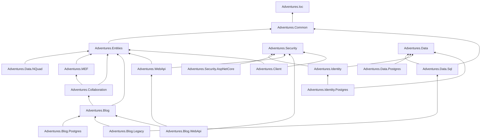
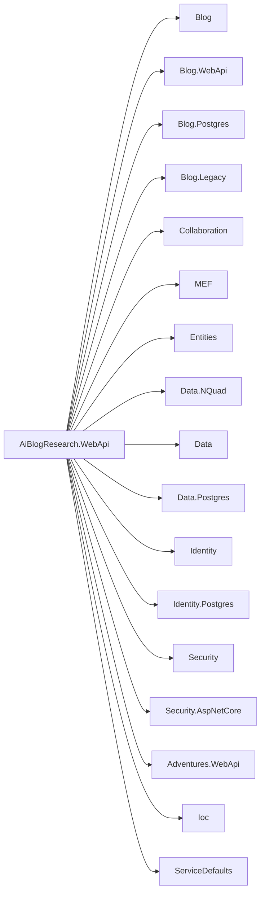
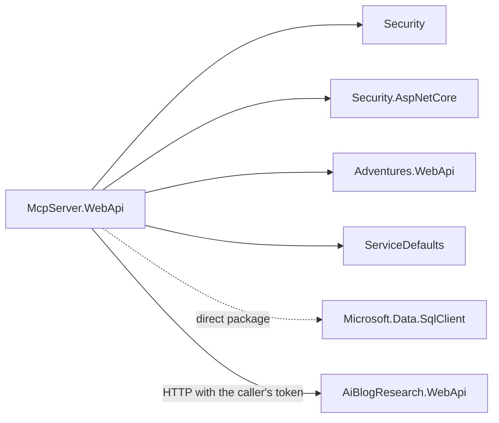
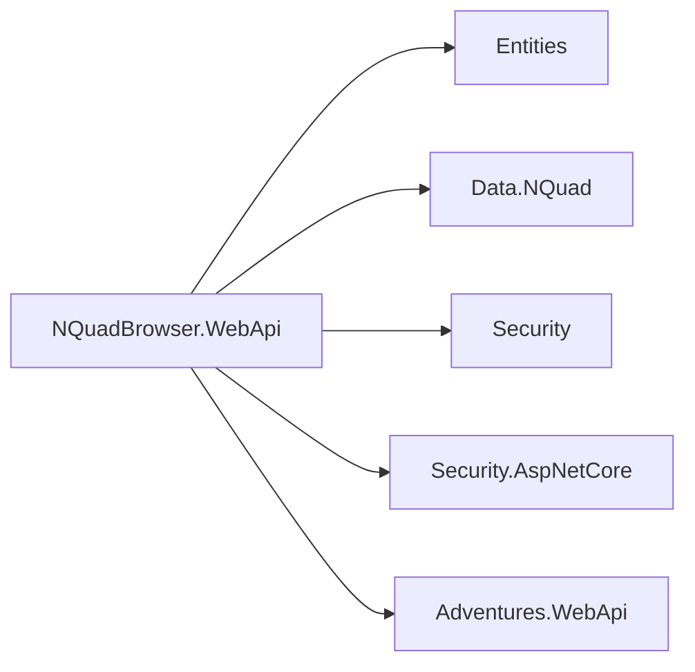
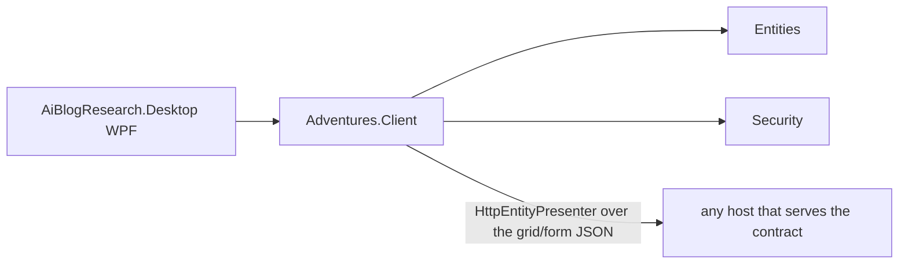
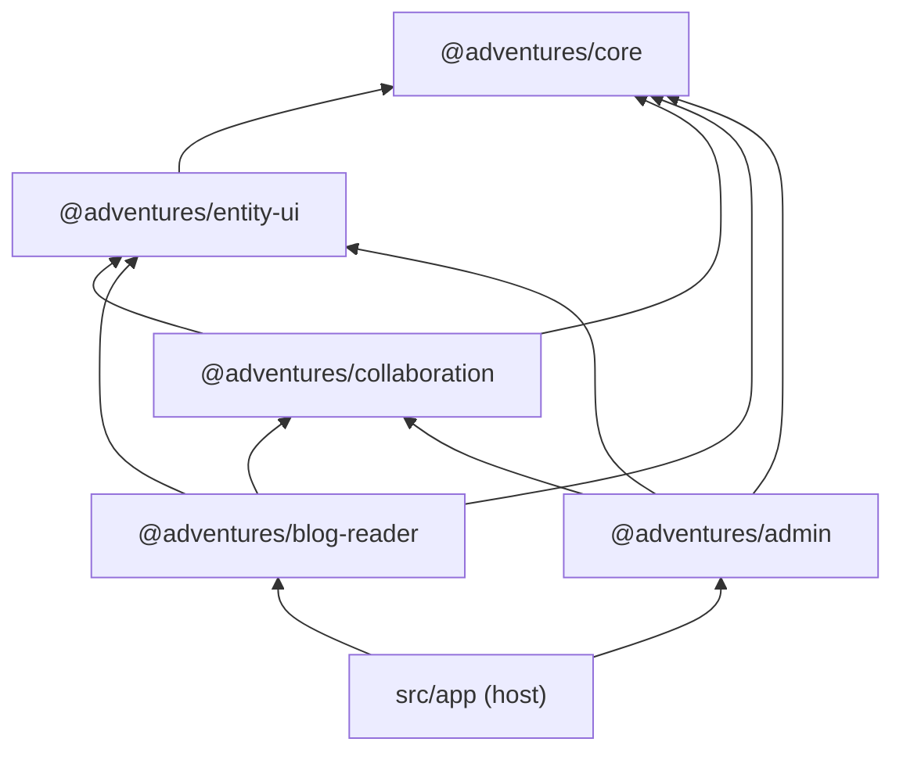
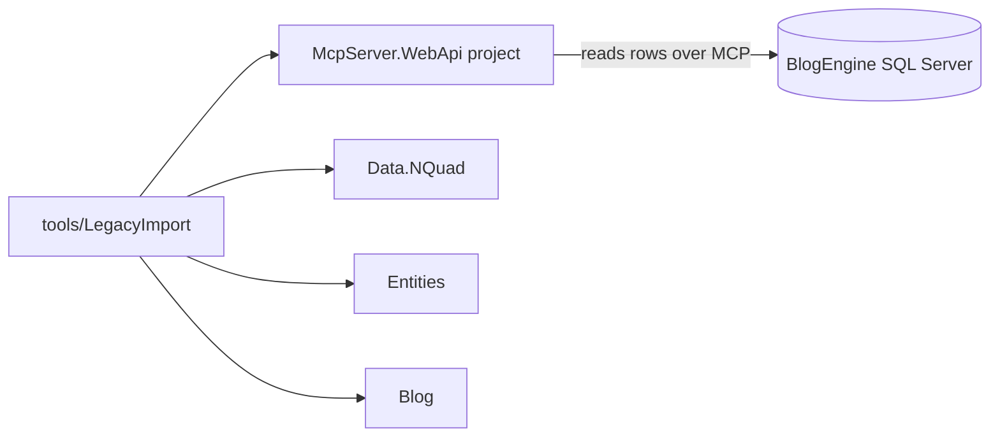

# Blog material: one post per application, and how each uses Adventures.Foundation (captured 2026-11-02)

Source for later draft posts (Development log; the human publishes). Facts below come from each project's `.csproj` references and the stated purpose in its files, read during the scan in [Claude-review-2026-11-foundation-scan.md](Claude-review-2026-11-foundation-scan.md). Where that review proposes a move, the diagram shows **today's** references. Re-draw after the pre-beta structure fixes, and write the posts then (a before and after is the value).

## The shared picture: how the Foundation layers

Reading it: `Ioc` and `Security` stand alone; `Entities` is the schema-driven entity model every feature builds on; features (`Blog`, `Collaboration`) sit on it; stores (`Data.NQuad`, `Data.Postgres`, `Data.Sql`) and web layers (`WebApi`, `Blog.WebApi`) plug in on the sides.

## Post 1. AiBlogResearch.WebApi, the main API (the blog and its admin)

**Purpose.** The site's API: public reader endpoints, the admin API (posts, pages, users, roles, rights, exceptions, collaboration, plug-ins), sign-in, health and diagnostics. It is the composition root: `Program.cs` (473 lines) wires 17 Foundation projects.

**Own code.** Auth, M2M auth, Users, Roles, Profile, Lookups, Tenant, Plugins, Collaboration and Conversation controllers, Health (+ snapshot cache), AdminDiagnostics, AdminExceptions, ClientErrors, AdminMenu, ReviewQueue, StartupChecks, LiveDataMode, LegacyUserProvisioning. **Pattern to teach:** one `AddXxx` call per feature; controllers on the generic `AdminEntityControllerBase<T>`; rights on every route (guard test). **Candid note for the post:** most of these controllers are reusable and are listed in review finding F10.

## Post 2. McpServer.WebApi, the MCP server

**Purpose.** The Model Context Protocol endpoint (JSON-RPC 2.0 on one POST) that gives Claude diagnostics, drafts-only authoring, collaboration tools and read-only legacy database tools. Machine identities only (client credentials), scopes per tool group.

**Own code.** `McpController` (508 lines), `DiagnosticsApiClient` (forwards a question to the API), the BlogAi catalogue/reader/tables and `LegacySchemaSeed`. **Pattern to teach:** the tool answers by calling the API with the caller's own token, so rights stay in one place. **Candid note:** it reads SQL Server through its own code, not `Adventures.Data.Sql` (finding F11).

## Post 3. NQuadBrowser.WebApi, the smallest host (proof of reuse)

**Purpose.** Browse and edit schemas and entities in the N-Quad store; no blog. One controller (`BrowserController`, 75 lines), a 55-line `Program.cs`, a security-headers class and a catalogue of entity types.

**Why it matters.** Its test states the rule: it must build from the reusable libraries alone. Best first post for a developer new to the kit: five references and you have a signed-in, schema-driven admin for any entity type.

## Post 4. AiBlogResearch.Desktop, the WPF client

**Purpose.** A Windows rich client that signs in to the API and lists and edits entities. Composition root and XAML views only; behaviour is in the Foundation's `Adventures.Client`.

**Pattern to teach:** the view model binds to `IEntityPresenter<T>` and the desktop registers a remote one (rule R21), so the same server-side presenter feeds Angular and WPF. **Candid note:** the generic views live in the app (finding F12).

## Post 5. The Angular client and its five libraries

**Purpose.** `@adventures/core` (HTTP, auth, interceptors, entity API), `entity-ui` (form, grid, relation grid, Markdown), `collaboration` (conversation, approval badge, decisions), `blog-reader` (public pages), `admin` (shell, login, profile, exceptions, plug-ins, roles), plus a thin host app. A layering spec keeps the order.

(Imports read from the source on 2026-11-02; the host's imports were not read, so its arrows are from the layering test's purpose, to be verified when the post is written.) **Candid note:** the libraries are Foundation-shaped but live in the app repo (finding F14).

## Post 6. LegacyImport and the legacy mirror (tool)

**Purpose.** One-way import of the old BlogEngine database into the mirror schemas and the live content; a command-line tool, not a service.

**Candid note:** the tool references a web host project (finding F11) and defines a second `LegacyIds` (F13). Closed 2026-10-24; a post only as a "how we migrated" story.

## Post 7 (overview). The AppHost and ServiceDefaults

**Purpose.** `AiBlogResearch.AppHost` (Aspire) starts the API, the MCP server and Angular together; `ServiceDefaults` is the shared telemetry, health and resilience setup (the standard Aspire shape). Reference: AppHost to `AiBlogResearch.WebApi`, `McpServer.WebApi`.

## Suggested order and reading level

1. NQuadBrowser (smallest, proves the idea). 2. The Foundation layer picture. 3. Main API. 4. MCP. 5. Desktop. 6. Angular. Write 3 to 6 after the structure fixes so the diagrams show the cleaned references; write 1 to 2 now if the human wants an early "how it fits" post.
