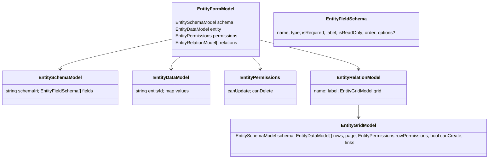

# Decision: server-driven forms and grids (D-1)

**Status:** direction agreed in chat 2026-10-11 (the Angular app is as light as possible; the server does the work; any layer replaceable without a refactor). The *contract shape* below is Claude's proposal for the human to review. Nothing here is built yet except the current `EntityFormModel`.

## The pattern, mapped from MVPVM to Angular + ASP.NET Core

MVPVM is WPF-specific; the sources (Potel, Twisting the Triad) describe the underlying roles. For this stack the roles land like this:

| Role (MVPVM) | Here | Lives in |
|---|---|---|
| Model (domain objects) | `DynamicEntity`-derived types (`User`, ...) | `Adventures.Entities` |
| DAL | `IEntityRepository<T>` over the N-Quad store | `Adventures.Entities` (contract), `Adventures.Data.NQuad` (implementation) |
| BLL | `IEntityBll<T>` and entity-specific Blls (`IUserBll`) | `Adventures.Entities` |
| Presenter | `EntityPresenter<T>` / `IUserPresenter`: validates input, applies it, builds the ViewModel | `Adventures.Entities` |
| ViewModel | `EntityFormModel`, `EntityDataModel`, and the grid/relation models below: plain JSON-shaped DTOs, no logic | `Adventures.Entities` |
| View | Angular components: render a ViewModel, report what the user did | `client/` |

This is **Passive View** (App Arch Guide, ch. 10): the View is reduced to the minimum and the Presenter owns all behaviour. It is the classic web split Potel describes (view and interactor on the client, presenter and everything else on the server). The View never knows a rule, a URL pattern or an entity type; the ViewModel never knows a View (MVPVM: the View and ViewModel stay decoupled, only the Presenter couples them). Swapping Angular for anything else means writing a renderer for the same JSON contract, nothing else.

**Test of the design:** adding an entity type (Roles, Posts, Pages) requires zero TypeScript. If a change to a rule or a field needs a client release, the boundary is in the wrong place.

## The contract (proposed)

JSON over the existing API, described by OpenAPI. Names follow the current C# records.

- **Field metadata, server-computed.** `label`, `isReadOnly`, `order`, `type` and (later) `options` for a lookup come from the schema *and the caller's role*, resolved at materialisation (decisions doc, entity-model point 5): a field the caller may not see is never sent, a field they may not change is `isReadOnly`. The client does not decide.
- **Permissions, server-computed.** `canUpdate`/`canDelete` (and `canCreate` on a grid) tell the renderer which buttons to show. The server still enforces them; the flags are for rendering only.
- **Grids.** `GET /api/users?page=1&pageSize=25&sort=UserName` returns an `EntityGridModel` (columns = `schema.fields` filtered to the list-visible ones, `rows`, paging, links). Paging, sorting and filtering are server-side (App Arch: data paging, no chatty or oversized payloads). Today's `List` returns a bare `EntityDataModel[]`; it evolves into this.
- **Parent/child.** A parent's `EntityFormModel.relations` carries one `EntityRelationModel` per child collection (for example a User's Roles), each holding an `EntityGridModel`. Selecting a child row follows that row's link to a child `EntityFormModel`. **Each entity keeps its own CRUDL endpoints and Bll rules**: a child row is saved, added or removed through its own endpoint (`/api/users/{id}/roles`, or `/api/roles/{id}`), never as one aggregate PUT of the whole parent. That keeps every rule in exactly one Bll (A3, B1).
- **Links.** The server supplies the URLs (`self`, `create`, row links). The client follows links and holds no URL templates, so routes can move without a client change. (Hypermedia-lite, not full HATEOAS: only the links a renderer needs.)
- **Errors.** Validation failures already return `ValidationProblemDetails` keyed by field name; the renderer maps `errors[field]` onto the matching control generically. Business-rule refusals are 409 with a message to display. Nothing else leaks.
- **Relationships in the schema.** A relationship is declared in the N-Quad schema (proposal: field types `ref:<Schema>` for one and `refs:<Schema>` for many, with the predicate linking the two subjects), so the presenter discovers parent/child structure from data, the same way it discovers fields today. This is the part most worth the human's eye before it is built: it also decides how the Tenant/Org role model (design page, D6) is expressed.
- **Versioning.** The model carries a `contractVersion`; a client that does not understand it refuses cleanly. This is the UI-side twin of the versioned-BLL requirement (D3).

## Angular side (deliberately small)

- `EntityForm` (exists) renders `schema.fields` + `entity.values`, typed controls (date picker for `date`, checkbox for `bool`, number input, `isReadOnly` honoured), shows server field errors.
- `EntityGrid` (new): renders a grid model, emits `select`, `page`, `sort`, `add`, `delete` events; knows nothing about what a row is.
- `EntityScreen` (new): a route-driven container: takes a link, fetches the model, renders form + relation grids, follows links on events. One screen component for every entity.
- One thin `ApiClient`. No per-entity services, models or components; the existing `ProfileService` becomes "fetch this link".
- Auth stays as is (JWT interceptor, guard). Role-aware navigation later comes from a server-supplied menu model, not client role checks.

## Staging (each stage reviewable on its own)

1. **Field metadata and permissions** (label, read-only, order, `canUpdate`/`canDelete`), typed controls in `EntityForm`. Smallest step; improves the live profile page.
2. **Grid contract** with server-side paging/sorting; `EntityGrid`; Admin > Users list on it.
3. **Relations**: schema relationship types, parent/child, the Users → Roles screen. First real test of the contract; also where the Tenant/Org role design is settled.
4. **Role-based field filtering** at materialisation.
5. Then the BlogEngine entity set (Posts, Pages, Categories, Tags, Comments, Settings) as schemas only, per the design page, with no new client code.

## Open questions for the human

- Relationship syntax in the N-Quad schema (`ref:`/`refs:` field types, or an explicit relationship entity)?
- Where do list-visible columns come from: a schema flag per field, or a separate "list view" definition (BlogEngine's grids show fewer columns than its edit forms)?
- Menu/navigation as a server-supplied model now, or after Users and Roles work?
