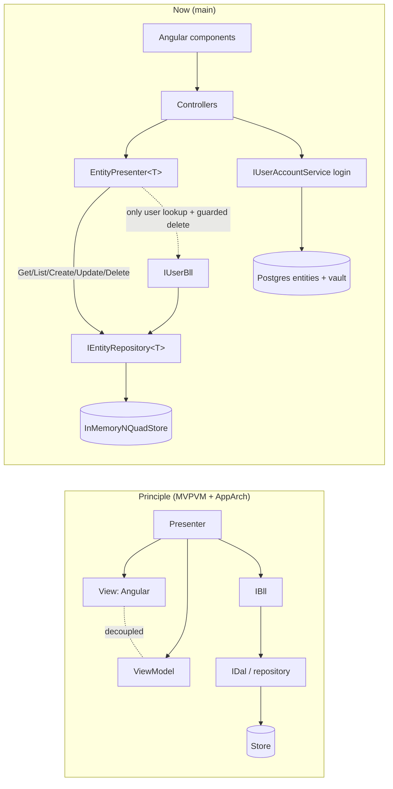

# Architecture baseline review — 2026-10-11

**Target:** the code as it stands on `main` (`ai-research-blog`, `Adventures.Foundation`), plus `claude-session-notes-2026-10-11` (docs only). **Against:** [Claude-architecture-principles.md](Claude-architecture-principles.md). **By:** Claude. **Status:** findings only, nothing changed; every item below is a candidate for the human + Claude discussion (refactor, or leave with a comment saying why).

**Method.** Read all `src/` C# in both repos (about 3,600 lines), the Angular client's non-spec TypeScript, and `Program.cs`. Foundation tests run green (57 in `Adventures.Data.NQuad.Tests` plus the Ioc, Common and WebApi suites). Two read-only probes against production (empty login body, unauthenticated `/api/users`) confirmed F-6 and part of F-8. Findings marked *by reading* were not exercised.

## Overall

The shape is already close to MVPVM: Presenter → BLL → repository, DTO-style `EntityFormModel`, interface-first registration, tombstone/supersede data model, solid hashing and lockout. The gaps are mostly (1) the presenter skipping the BLL, (2) the host app knowing too much about the DAL, (3) no validation or authorization yet, (4) two parallel user stores, and (5) the design page's headline items (MEF, versioned BLL/DAL, Tenant/Org, BlogEngine schemas) not started. That matches the current stage, so most of this is "known and scheduled", not "wrong".

## Findings

Severity: **H** fix before real data/users, **M** fix in the next phase, **L** note or comment only. "Principle" cites IDs in the principles doc.

| # | Sev | Principle | Finding | Evidence |
|---|---|---|---|---|
| F-1 | H | A1, A3, A4 | **Presenter bypasses the BLL.** `EntityPresenter<T>` depends on `IEntityRepository<T>` (the DAL) and calls it directly for Get, List, Create, Update and Delete. Only the user lookup and the guarded delete go through `IUserBll`. Any business rule added to a BLL is skipped by four of the five operations. | `Adventures.Entities/EntityPresenter.cs:116-166`, `UserPresenter.cs:274-285` |
| F-2 | H | C3 | **No authorization beyond "logged in".** `UsersController` is `[Authorize]` with no role policy, so any authenticated user can list, create, edit or delete every user. `roles` is issued in the JWT but nothing reads it. Seeded `Admin`/`Editor` roles are not enforced. | `UsersController.cs:17`, `UserAccountService.cs` (claims) |
| F-3 | H | C1 | **No input validation at any trust boundary.** Declared scope for the stage ("No validation yet") but now that users can be edited it is a gap: `EntityPresenter.ApplyValues` writes any submitted field name/value; `EntityFormModel` shows `isRequired` as a visual hint only. | `EntityPresenter.cs:168-196`, `entity-form.ts:10-20` |
| F-4 | H | C4 | **`GuardedAsync` turns every `InvalidOperationException` into a 409 with the exception's message as the body.** Unrelated system errors (missing schema, "Entity has no id", duplicate id) use the same exception type, so internals (IRIs, ids) can reach the client, and business rules are signalled by exceptions. Needs a dedicated business-rule exception or result type plus exception shielding. | `Adventures.WebApi/ApiControllerBase.cs:533-543`, `UserBll.cs:260-268` |
| F-5 | M | A2, C10 | **Host app knows DAL internals.** `Program.cs` builds three `NQuadEntityRepository<T>` instances by hand with base IRI, type IRI, graph and seed path, and loads the seed file itself. Same 8-line block three times (note the Schema entities use `EntityConstants.User.DefaultGraph`). Belongs behind one extension (`AddNQuadEntity<T>(…)`) in the DAL project. | `Program.cs:92-133` |
| F-6 | M | C1, C4 | **Empty or missing credentials return 500.** `LoginAsync` calls `ArgumentException.ThrowIfNullOrWhiteSpace`; `AuthController` has no validation, so `{"userName":"","password":""}` surfaces as an unhandled exception. *Verified:* production returns 500; it should be 400. | `UserAccountService.cs:25-27`, `AuthController.cs:27-38` |
| F-7 | M | B1, A9 | **Two parallel entity/user stores.** `Adventures.Data.IEntityRepository` (Guid, Postgres JSONB, used by login) and `Adventures.Entities.IEntityRepository<T>` (string id, N-Quad, used by profile/users) share a name and a job; login and profile are bridged by username, GUIDs deliberately differ. The design page says N-Quad only for the new app. | `Adventures.Data/IEntityRepository.cs`, `Adventures.Entities/IEntityRepository.cs`, `ProfileController.cs` comment |
| F-8 | M | C5 | **Audit actor is always `"system"`.** `NQuadEntityRepository` records `changedBy`, but `Program.cs` never passes the current user, so the audit trail cannot say who changed what. No user-management events are logged either. | `NQuadEntityRepository.cs:26,37`, `Program.cs:102` |
| F-9 | M | C6, C7 | **User data lives in an in-memory singleton store seeded at startup.** Profile edits are lost on every restart or app-pool recycle, and would diverge across instances. A Postgres-backed `INQuadStore` already exists (`NpgsqlNQuadStore`). Intentional for the stage; must change before data updates matter. | `Program.cs:92-96` |
| F-10 | M | A7 | **A generic presenter is reused across entities.** MVPVM says presenters are not meant to be reused; the reuse here is justified by the design page's schema-generated dynamic forms (D5), but it is a deliberate deviation worth recording. | `EntityPresenter.cs` |
| F-11 | M | A2, C10 | **Query logic in the BLL.** `FindByUserNameAsync` lists every user and filters in memory; a full scan with no DAL query method. Fine at POC scale (noted in the decisions doc), a problem with real data. | `UserBll.cs:240-246` |
| F-12 | M | D4 | **MEF not started.** Plugins/Widgets (D4) and the MCP tool sets are meant to be MEF with a monitored folder. Today's composition is `Adventures.Ioc` reflection scan over *every loaded assembly*, which already needed a lazy-registration workaround. | `Adventures.Ioc/Extensions/ServiceCollectionExtensions.cs`, `Program.cs:99-100,111-117` |
| F-13 | M | D3 | **Versioned BLL/DAL: foundation only.** Keyed DI and a `MockBllV2` test exist, but no record carries a version stamp and nothing selects a BLL by version. | `Adventures.Tests/Mocks/MvpVm/MockBllV2.cs`, `Adventures.Ioc` |
| F-14 | M | D2, D6 | **Tenant/Org and BlogEngine schemas not modelled.** Entities have one hardcoded graph; `Auth:Tenant` falls back to a literal in the controller; no Org/Blog entity, no tenant-scoped roles; none of the BlogEngine tables (Posts, Pages, Categories, Tags, Comments, Settings…) exist as N-Quad schemas. Expected: the design page defines this as the next phase. | `AuthController.cs`, seed.nq |
| F-15 | M | A5, C8 | **Client-side structure undecided.** Components call services directly and hold save/delete state machines; `EntityForm` renders every field as a text input (no types, no read-only, no parent/child grid, which D5 requires). No role-aware navigation. | `profile.ts`, `entity-form.ts`, `app.routes.ts` |
| F-16 | L | C2 | **Default `Admin`/`Admin` and `Claude`/`Claude` are live in production.** Accepted by the human on 2026-10-11 until the app can update data. The `mustChangePassword` flag is returned and ignored; the form caption and "Update password" action are planned, not built. Lockout (5 tries / 15 min) and PBKDF2 hashing are in place. | `auth.service.ts` (`_mustChangePassword`), `UserAccountService.cs:20-22` |
| F-17 | L | B1 | **Repeated blocks.** `ProfileController` repeats resolve-username/lookup/NotFound three times; `Program.cs` repeats the repository registration (F-5). | `ProfileController.cs:28-76` |
| F-18 | L | C2 | **Token in `sessionStorage`.** Normal SPA trade-off (XSS exposure, no refresh token). Worth a comment, not a change now. | `auth.service.ts` |
| F-19 | L | B3 | **Same type name in two namespaces** (`IEntityRepository`); folds into F-7. | — |

**What conforms (so it is not re-litigated):** A2 for the N-Quad path (only `NQuadEntityRepository`/stores touch persisted quads); A8 (controllers exchange `EntityFormModel`/`EntityDataModel` DTOs with the presenter); A6 (`EntityFormModel` carries no business logic); A9 (interface per layer, DI registration); C2 (PBKDF2 hashing, constant-time verify, lockout, no distinction between unknown user, locked or disabled in the 401); C4 partly (global exception handler with generic problem body in production, bootstrap logger); C5 partly (Serilog, file and console); C9 (secrets in user-secrets/host secret store, not committed); CORS limited to configured origins; Foundation tests green; staged, reviewable history.

## Discussion items for the human

- **D-1. Where does the Presenter live for the Angular app?** Today: on the server, producing the form model. Alternative: a thin server (BLL + DTOs) and a presenter in the Angular layer (component or service per screen). The sources do not decide this. It drives F-10 and F-15 and the dynamic-forms work (D5).
- **D-2. Fix the presenter→BLL skip (F-1) now?** Recommended: yes, before anything new. Smallest change: give `IEntityPresenter<T>` a generic `IEntityBll<T>` (create/get/list/update/delete, rules hook) that `EntityPresenter<T>` depends on instead of the repository, per decisions-doc "Option B" (`GenericBll<T>`). This also makes F-11 and F-13 natural to address.
- **D-3. Retire the Postgres entities store (F-7)?** Recommended: plan it, don't do it yet. Login keeps working; move user lookup to the N-Quad user, keep the credential vault.
- **D-4. Persistence (F-9):** switch the user store to `NpgsqlNQuadStore` before Admin > Users is used for anything real?
- **D-5. Authorization model (F-2):** adopt the Tenant/Org role design from the page (D6) and add policies to `UsersController` now, or interim `Admin`-role check?
- **D-6. Exceptions (F-4):** agree the business-rule error type; fits the pending "exception-handling design" decision in Foundation's docs.
- **D-7. MEF (F-12):** `System.Composition` (MEF2, in .NET) vs the older `System.ComponentModel.Composition`; monitored-folder loading is the deciding requirement.

## Proposed disposition (for the discussion, not a decision)

| Disposition | Items |
|---|---|
| Refactor next, before new features | F-1, F-2, F-3, F-4, F-6, F-8 |
| Refactor during Admin > Users build | F-5, F-9, F-11, F-15, F-17 |
| Plan with the design phase | F-7, F-12, F-13, F-14 |
| Leave, with a comment recording why | F-10, F-16, F-18 |

## Merge readiness

`main` in `Adventures.Foundation` already holds everything (merged and deployed 2026-10-02; tests green). `ai-research-blog`'s `main` is missing only three docs commits on `claude-session-notes-2026-10-11` (this review, the principles doc and `AGENTS.md` notes): no code change, so merging deploys nothing new beyond whatever the deploy workflow does on any `main` push. The root workspace repo's `standard-updates` branch is docs/tooling only. No code on any branch is waiting to merge.

## Resolution (2026-10-11, branch `claude-architecture-alignment` in both repos)

The human agreed the findings, the D-1 direction (thin Angular client, server does the work) and D-2 (fix F-1 now), and asked Claude to resolve what applies. Foundation: 238 tests pass; app: 31 (plus 3 in the MCP server). Each fix was also exercised against a locally run API (admin, a second user, unauthenticated; bad input; delete-own), which caught one bug the unit tests missed (JWT bearer remaps the `roles` claim to `ClaimTypes.Role`).

| # | Outcome |
|---|---|
| F-1 | **Fixed.** `IEntityBll<T>`/`EntityBll<T>`; `EntityPresenter<T>` and `UserPresenter` depend on the Bll only; `UserBll` derives from the generic one. A user can no longer be deleted without an acting user at any layer. |
| F-2 | **Fixed.** `RoleAuthorizationHandler`/`AddRoleAuthorization`; `UsersController` requires the `TenantAdmin` role (403 otherwise). Tenant/Org-scoped roles remain F-14. |
| F-3 | **Fixed for entities.** `EntityInputValidator` rejects unknown fields and wrong types with our own messages, and missing required fields on create; `EntityBll` enforces required on create and update. Field length/range rules are not in the schema yet and are not enforced. |
| F-4 | **Fixed.** `BusinessRuleException` (409, message shown) and `InputValidationException` (400, field errors); `GuardedAsync` catches only those. System exceptions reach the global handler. Create and update are guarded too. |
| F-5 | **Fixed.** `AddNQuadEntityRepository<T>` in `Adventures.Data.NQuad`; `Program.cs` no longer knows IRIs or builds repositories. |
| F-6 | **Fixed.** Blank credentials return 400 (was 500). |
| F-8 | **Fixed.** The audit actor is the signed-in user's name per request (`system` outside a request). User-management events are covered by that audit trail; no separate application log line yet. |
| F-17 | **Fixed.** `ProfileController` lookup extracted. |
| F-10, F-18 | **Left, with comments** in `EntityPresenter` and `auth.service.ts`. |
| F-16 | **Left** (accepted by the human). The password-change caption and "Update password" action are planned for when data updates are real. |
| F-11 | **Left**, already commented in `UserBll`; replace with a Dal query with the Postgres store. |
| F-9 | **Deferred**: next. Switch the user store to `NpgsqlNQuadStore` (seeded on first start only). |
| F-7, F-12, F-13, F-14 | **Deferred**: they are the design-phase items (retire the Postgres entities store, MEF, version-keyed Bll, Tenant/Org and the BlogEngine schemas). |
| F-15 | **Designed, not built**: [Claude-decision-2026-10-server-driven-forms.md](Claude-decision-2026-10-server-driven-forms.md). |
