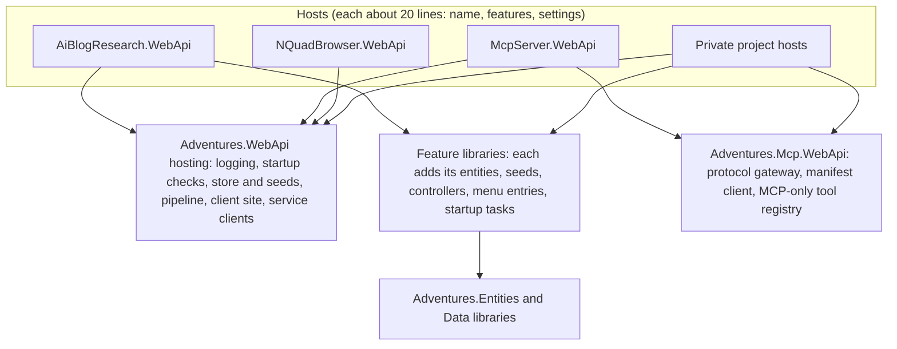

# Review: reuse in `AiBlogResearch.WebApi` and `McpServer.WebApi` (2026-11-23)

**Question (human, 2026-11-23):** two projects will now reuse this code. For each class in the two hosts, would a second project have to copy and paste it, so that an improvement needs making twice? Which classes and controllers can land in `Adventures.Foundation`? **Priority (human): ahead of the remaining beta work. Nothing was changed; this is the assessment, to act on at the start of the next session.**

**Method:** every `.cs` file in both projects was read (1,570 lines in 20 files in the API host, 1,176 in 12 files in the MCP host), plus the sizes of the third host (`NQuadBrowser.WebApi`, 212 lines in 4 files), `AiBlogResearch.ServiceDefaults` (128) and the AppHost (30). The Foundation's seed layout and the scope strings were checked by search.

**Status (2026-11-24):** decisions agreed by the human; R1 (shared hosting), R2 (features own registrations, seeds, start-up tasks), R4 (MCP gateway library, observable MCP host) R3 (menu, dashboard, counts as contributions) and R5 (optional legacy research module) are built, see `docs/artifacts/Claude-2026-11-24-r5-legacy-research-module.md`, `docs/artifacts/Claude-2026-11-24-r1-shared-hosting.md`, `...-r2-features-own-their-registrations.md`, `...-r4-mcp-gateway.md`, `...-r3-menu-and-dashboard-contributions.md`; R6 remains.

## Headline

1. **The hosts are almost entirely generic composition, not application code.** What is app-specific is the *choice* of features and the name. The rest is a recipe (logging, startup checks, store and seeds, entity registrations, CORS, JWT, hardening, pipeline order, the client site) that a second project would copy line for line, and it already has been copied twice inside this repository (see "Drift" below).
2. **The MCP protocol gateway** (`McpController`, 273 lines, with `DiagnosticsApiClient` and the MCP-only tool registry) is a complete, tested, reusable component sitting in an app project. A private MCP server would copy it, and a protocol or security fix would then need making in both.
3. **The two biggest copy-paste risks are not code-heavy but list-heavy:** `AppEntityServices` (165 lines registering the Foundation's own entity types) and `StartupSeeds` (27 seed names in order). Both lists must stay in step with Foundation schemas, so they belong beside the schemas in the feature libraries, not in a host.

## File by file

| File (lines) | What it is | Verdict | Where it should live |
|---|---|---|---|
| `Api/Program.cs` (182) | composition root: bootstrap logger, startup checks, live-data switch, data mode, store choice, seeding, plug-in and event wiring, failure journal | ~80% generic orchestration | Foundation `AddAdventuresHost` options; the host keeps only its feature list |
| `Api/StartupChecks.cs` (114) | required-setting checks and the 503 "reporting app" | generic (the MCP host has none of it) | Foundation hosting; each host or feature declares its requirements |
| `Api/LiveDataMode.cs` (66), `Controllers/RuntimeController.cs` (20) | local run on the live store, and the banner fact | generic dev-workflow feature | Foundation hosting / Diagnostics.WebApi |
| `Api/Startup/AppEntityServices.cs` (165) | registers 30-odd entity repositories for Foundation types (identity, content, collaboration, plug-ins, widgets, languages, site settings) plus tenancy, rights, mail | **belongs to the libraries that own those types** | `AddIdentityEntities`, `AddBlogEntities`, `AddCollaborationEntities`, `AddPluginEntities` (each takes the schema quads) |
| `Api/Startup/StartupSeeds.cs` (106) | the ordered list of 27 named seeds and the paths | **list belongs beside the files**: the 26 seed files already live in Foundation feature projects | each feature exposes its seed manifest; one generic runner applies them in order |
| `Api/Startup/SeedProfile.cs` (28) | dev or install baseline file | generic | with the seed runner |
| `Api/Startup/AppPlatformServices.cs` (98) | CORS, controller libraries, JWT, hardening, M2M, health cache, MCP and AI-triage HTTP clients | generic (only the list of `AddXxxControllers` and the scope names are choices) | Foundation `AddAdventuresApi(options)` |
| `Api/Startup/AppPipeline.cs` (109) | middleware order, dev-only throw endpoint, root 200 rule, client fallback | generic | Foundation `UseAdventuresApi(options)` |
| `Api/Startup/AppIdentityServices.cs` (58) | Postgres or Legacy identity wiring | generic | Foundation `AddAdventuresIdentity(mode)` |
| `Api/Startup/AppLogging.cs` (52) | Serilog text and JSON files with the correlation id | generic (and **absent from the MCP host**) | Foundation hosting, used by every host |
| `Api/Startup/AppStartupUpgrades.cs` (63) | role-rights upgrade, identity schema init, first platform administrator | generic startup tasks | `IStartupTask` contributed by Entities.Identity |
| `Api/Startup/ClientSite.cs` (118) | single-site mode: serves the Angular build with a hash-based CSP, cache rules, fallback | self-contained and generic | Foundation hosting (any host that serves a client) |
| `Api/Startup/AppAssemblies.cs` (38) | loads referenced libraries before the DI scan; host list for plug-in discovery | generic, but hard-codes the `AiBlogResearch` name prefix | Foundation hosting, prefix as a parameter |
| `Api/Startup/LegacyModePlugins.cs` (29), `Api/LegacyUserProvisioning.cs` (15) | Legacy-mode stand-ins | belong to Legacy mode | registered by `AddBlogLegacy` |
| `Api/RequestGraphScope.cs` (18) | the tenant of the request as the graph scope | generic for any tenant-aware host | Foundation tenancy |
| `Api/Controllers/AdminMenuController.cs` (118) | menu definitions (18 entries with routes and rights), localisation, badges, plug-in contribution | mechanism generic; **entries belong to the features that own the screens** | each feature contributes its entries and badge; one controller in Foundation |
| `Api/Controllers/DashboardController.cs` (138), `ReviewQueue.cs` (35) | dashboard counts, drafts, latest comments, Quick draft; review counts | blog and collaboration specific | `Adventures.Blog.WebApi` (counts from contributors) and `Adventures.Collaboration` |
| `Mcp/Controllers/McpController.cs` (273) | JSON-RPC protocol, manifest fetch and cache, scope granting, request building from the manifest, forwarding | **fully generic** except the server name, the instruction text and three scope names | new `Adventures.Mcp.WebApi` |
| `Mcp/DiagnosticsApiClient.cs` (49) | the forwarder to the API (misnamed: it forwards anything) | generic | with the gateway, renamed `ApiForwardingClient` |
| `Mcp/Controllers/DiagnosticsController.cs` (42) | REST pass-through of three diagnostics routes | duplicate of what the manifest already offers; **already drifting** | remove, or serve through the generic pass-through |
| `Mcp/Controllers/HelloController.cs` (26), `HealthController.cs` (15) | the cross-site proof endpoint and a stub health | generic (the API's health probe calls `hello`) | with the gateway |
| `Mcp/Program.cs` (75) | MCP host composition and pipeline | a trimmed copy of the API's | the same shared host builder |
| `Mcp/Tools/McpOnlyTool.cs` (61) | the MCP-only tool contract and registry | generic | with the gateway |
| `Mcp/Tools/ResearchTools.cs` (130), `BlogAi/BlogAiCatalog.cs` (187), `BlogAiReader.cs` (127), `BlogAiTables.cs` (104) | read-only research tools over the legacy BlogEngine database | app-specific to the migration, but they **overlap `Adventures.Data.Sql` and `Adventures.Blog.Legacy`** (same database, a second connection setting, a second table list and reader) | an optional module on top of the legacy library, not part of the default MCP host |
| `Mcp/BlogAi/LegacySchemaSeed.cs` (87) | generates a Foundation seed file from the MCP project's table list | **dependency pointing the wrong way** (an app project writes a Foundation file) | a generator and test in `Adventures.Blog.Legacy` |

## Drift that already exists (evidence that copy-paste has a price)

1. **The REST diagnostics proxy lags the manifest.** `McpServer.WebApi/Controllers/DiagnosticsController` forwards three routes by hand; the API's manifest also has `get_exception` (`api/diagnostics/exception/{id}`), which the REST proxy lacks. The two will keep diverging.
2. **The MCP host is less observable than the API host.** It has no file logging (`stdout` only), no exception recording to the exception log, no startup-configuration check (a missing setting shows only as the host's own error, not as the API's readable 503), and it never calls `UseRateLimiter` although it registers the hardening. Each difference was an accident of copying, and each breaks the "no silent errors" rule for the MCP site.
3. **The pipeline preamble exists twice, with different details:** trusted proxies, correlation id, security headers, https redirect that spares "/", the root 200 rule (its comment says "same rule as AiBlogResearch.WebApi"), and the exception handler (the API's logs and records; the MCP's returns a bare 500). The NQuad browser has a third arrangement and its own `SecurityHeaders` class (33 lines) beside the Foundation's.
4. **Scope names are repeated as strings across two repositories:** `content.draft` (Foundation `AuthoringController` and `CollaborationControllers`, and `McpController.AuthoringScope`), `mcp.diagnostics.read` (Foundation and `DiagnosticsController`), `blogai.read`. The API also registers two scopes nothing uses (`mcp.postgres.query`, `mcp.filesearch.search`), a leftover of the first hello-world.
5. **The two outgoing HTTP clients** (API to MCP, MCP to API) repeat the same base-address, timeout and correlation-handler recipe.
6. **Every startup file carries the same 25 `using` lines**, left over from moving code verbatim. It is harmless, but it shows these files were cut from one block, not designed as units.

## Smaller findings

- **Cost per call:** `AdminMenuController` runs `ReviewQueue.CountAsync` (pages through posts with drafts) and `CountItemsAsync` (lists every collaboration item) on **every menu load**, and the Dashboard lists all posts and pages. Fine at beta size; the counts should come from one cached contributor call.
- **Names:** `AiBlogResearch.ServiceDefaults` is the standard Aspire defaults project under an app name; `DiagnosticsApiClient` forwards everything; the `AiBlogResearch` prefix is hard-coded in plug-in discovery.
- **Tests will move with the code:** `AiBlogResearch.WebApi.Tests` (77) and the host tests (51) cover several of these classes (dashboard summary, menu, startup checks, client site), so moving a class means moving its tests first.

## Proposed target

## Stages (small, tests first, behaviour unchanged at every step)

1. **R1, shared hosting (largest win):** move logging, startup checks and the reporting app, live-data mode, assembly loader, client site, seed profile, the service-client helper and the pipeline into Foundation hosting with options (service name, assembly prefix, client site on or off). Move their tests with them. The API host drops to a feature list.
2. **R2, features own their registrations:** `AddXxxEntities(quads)` and a seed manifest per feature library, one generic seed runner, `IStartupTask` for the upgrades. Delete `AppEntityServices`, `StartupSeeds` and `AppStartupUpgrades` from the host. A guard test fails if a seed file in a feature library is not in its manifest.
3. **R3, admin menu, dashboard and badges as contributions:** feature libraries contribute menu entries and badge counts; the menu controller moves to Foundation; the dashboard and Quick draft move to `Adventures.Blog.WebApi`; the review counts become one cached call.
4. **R4, the MCP gateway:** a new `Adventures.Mcp.WebApi` (protocol, manifest client, forwarding, MCP-only tool contract, hello and health), the MCP host rebuilt on the shared host (so it gains file logging, exception recording, startup checks and the rate limiter), the REST diagnostics proxy removed or generated, shared scope constants in `Adventures.Security`, and the vestigial scopes deleted.
5. **R5, the legacy research module:** the BlogEngine research tools become an optional module on `Adventures.Blog.Legacy`/`Adventures.Data.Sql`; one table list; the seed generator moves into Foundation; the MCP host no longer references SQL Server by default.
6. **R6, thin-host ratchet:** a guard test that each host stays under a line budget and references no store project, so the copies cannot grow back.

**Risks to manage:** seed order must not change (named seeds apply once, by name); the DI scan and plug-in discovery depend on which assemblies are loaded (the reason `AppAssemblies` exists), so R1 needs its own test; Legacy mode and live-data mode must keep passing their host tests; each stage ends with the full Foundation and app suites and a live `Claude-verify.ps1`.

## Decisions for the human (recommendation first)

1. **Project names:** put hosting in `Adventures.WebApi` (a new `Hosting` folder) and the gateway in a new `Adventures.Mcp.WebApi` (yes), or a separate `Adventures.Hosting` project.
2. **Order:** R1, R2, R4, R3, R5, R6 (the MCP host gains observability at R4; the dashboard and menu are the gentlest and can follow).
3. **The BlogEngine research tools** stay in this repository as an optional module rather than moving into the shared default (yes).
4. **Remove the REST diagnostics proxy** once `Claude-diagnose.ps1` calls the MCP endpoint instead (yes; it is the only user I found, to be re-checked by search before the delete).
