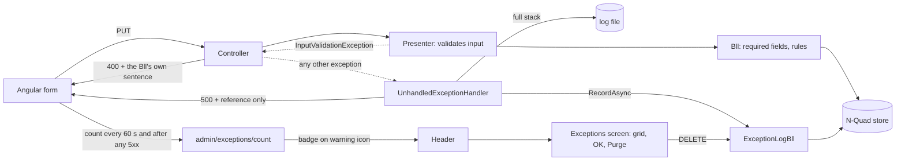

# Stage review: friendly errors and the exception log

**Branch:** `claude-users-roles` (both repos). **Tests:** Foundation 281, app 39, Angular 12, all passing. **Checked live:** API and Angular dev server run locally against the dev database; a deliberate exception went through the handler, log, header icon, grid, details and purge.

## What prompted it

The human's profile save said only "Couldn't save your profile. Try again." Reproduced: the form showed `DOB` as `11/19/1961` (a culture-formatted date) while the API only accepted ISO-style dates, so the form could not save a value it had itself displayed, and the real reason (a 400 with a field message) was thrown away by the client.

## What was built

| Piece | Behaviour |
|---|---|
| **Friendly messages** | The presenter/Bll writes the sentence, e.g. "The DOB field is not in the right format. Expected a date such as 1961-11-19." The client shows every message in a caption bar above Save (`describeApiError` picks them from the response: 400 field errors, 409 rule message, 500 shielded text plus reference). |
| **Dates** | Always sent as `yyyy-MM-dd` whatever the server's locale; `11/19/1961`, `1/5/1961` and `11-19-1961` are accepted on input. Stored date-times keep full precision (the exception log sorts on it). |
| **Exception log** | An ordinary entity (`ExceptionLog`, schema in `seed-002-exception-log.nq`, applied once by name): time, type, message, full stack trace with inner exceptions, request, user. `RecordAsync` never throws. Purge is the standard soft delete. |
| **Handler** | One handler in every environment: full exception to the Serilog file and the exception log; the client gets only a friendly title and the entry's reference. A cancelled request is not logged. |
| **Admin UI** | A warning icon with a badge appears in the header when the active count is above zero (administrators only; the first refusal stops polling). It opens **Exceptions**: a grid, newest first, click a row for every field including the stack trace, **OK** to leave, **Purge** to retire all (with a confirmation). |
| **Grid** | `EntityGridModel` and a generic `EntityGrid` component: the first, minimal form of the planned grid contract, so the next grid needs no new component. |
| **Test aid** | `GET /api/dev/throw` (Development only, administrators only) throws on purpose so you can see the whole flow. It is not mapped in production. |

## A performance finding worth knowing about

Verifying purge live exposed that the Postgres store inserted **one row per round trip** (Dapper runs an INSERT per list element). Against the remote database, recording one exception took about 2.8 s and purging ten about 25 s. Fixed in `NpgsqlNQuadStore.InsertManyAsync` (one `INSERT ... SELECT FROM unnest(arrays)`), plus a bulk `DeleteManyAsync` in the repository so a purge reads and writes in a constant number of calls. Measured after: record 0.22 s, purge of ten 0.37 s, a profile save 0.43 s. The Foundation store suite went from 31 s to 4 s for the same tests. This affects every save in the app, not just this feature.

## Notes

- The exception log's own failures (for example the database being unreachable) cannot be recorded in the database; they still reach the log file. During testing the dev database timed out for about a minute and those exceptions were recorded once it recovered.
- Validation errors (bad input) are not written to the exception log: they are user mistakes, not exceptions, and would drown the real ones.
- Per-field messages under the field (instead of the caption bar) are deferred to the form-design work, as agreed.
- Purge confirmation uses the browser's own dialog for now.
- The warning icon lives in the header because there is no Admin menu yet; it moves into that menu when it exists (and later onto the Dashboard).
