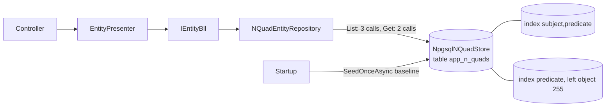

# Stage review: persistent N-Quad store (Users and Roles phase, stage 0)

**Branch:** `claude-users-roles` in `Adventures.Foundation` and `ai-research-blog`. **Tests:** Foundation 254 passing (76 in the store suite, including the live-Postgres contract on a scratch table); app 31. **Checked live:** the API run locally against the dev database, restarted, edit still there.

## What was built

User, Schema and SchemaField data now lives in PostgreSQL instead of an in-memory singleton, so edits survive restarts and app-pool recycles. Getting there exposed three performance and correctness problems in the repository, fixed in the same stage because they only matter once the store is remote:

| Change | Why |
|---|---|
| `INQuadStore.QueryBySubjectsAsync` (one round trip) | The bulk read the entity layer needed. |
| `ListAsync` costs 3 store calls, `GetAsync` 2, however many entities exist | Before, listing was one query per entity plus a scan of **every** superseded marker per entity: fine in memory, seconds against a remote database. A test counts the calls. |
| `NpgsqlNQuadStore` builds its `WHERE` from supplied terms only; new `(subject, predicate)` and `(predicate, left(object, 255))` indexes | The `(@x IS NULL OR col = @x)` form can stop PostgreSQL using an index; `object` can be a whole post body, which cannot go in a b-tree, so its first 255 characters are indexed and queries repeat that test. These are the lookups relationships need (see the decision doc). |
| `SeedOnceAsync`: seed applied once, recorded by a marker quad | A re-merge on every start would resurrect values users have edited. A seed change will ship as a new, named seed file. |
| App uses its own table `app_n_quads` (config `NQuadStore:Table`) | The Foundation tests purge and reseed `n_quads`. `NQuadStore:Provider = Memory` opts out for offline work. |
| Presenter: an empty value for a field that has one **clears** it; a value equal to the current one is skipped | Without the first, a user could never remove a phone number. Without the second, every save rewrote every field: a new quad and audit row per field per save. |

## Verified

Started the API against the dev database: table created, baseline seed applied. Edited a profile, restarted: "already applied", edit present, two users listed. Cleared the field: `null`. Saving an unchanged form: 200 in about 0.3 s over the remote database; listing users about 0.15 s.

## What to know before accepting

- **A local run persists to the shared dev database** (the same one production uses), so testing from your machine edits real profile data. Set `NQuadStore:Provider` to `Memory` in user-secrets for throwaway testing.
- **First deploy creates `app_n_quads` and seeds it.** Anything edited on production before this point (it was only in memory) resets to the seed; the profile fields (First, Last, Phone and so on) start as in `seed.nq`.
- **Startup still loads every quad** to read the schema definitions. Fine now; with posts and pages it must become a targeted read. Noted for the relations stage.
- **The password-change caption and "Update password"** are still not built.

## Next stage

Server-driven forms stage 1: field metadata (label, read-only, order, `isListVisible`) and permissions in the form model, typed controls in `EntityForm`.
