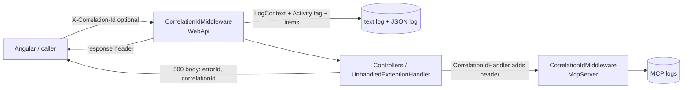

# Stage review: CorrelationId, stage 1 (2026-10-18)

Plan: [Claude-decision-2026-10-correlation-id-and-exception-signature.md](../Claude-decision-2026-10-correlation-id-and-exception-signature.md). Branch `claude-users-roles` in both repos.

## What was built

- `Adventures.WebApi` (Foundation): `CorrelationIdMiddleware`, `CorrelationIdHandler`, `AddCorrelationId` / `UseCorrelationId` / `AddCorrelationIdHandler`. 20 tests in `Adventures.WebApi.Tests` pass.
- The id is the caller's `X-Correlation-Id` if well formed (letters, digits, `-`, `_`, at most 64), else the OpenTelemetry trace id, else a new GUID. It goes into: every log line, the request's Activity tag `correlation.id`, `HttpContext.Items`, the response header (also on 401/500), and the 500 body (`correlationId`).
- WebApi: middleware first in the pipeline; console and text log lines now read `[LEVEL] [CorrelationId] message`; a second compact-JSON log (`logs/webapi-.json.log`, one object per line) for tools; the API-to-MCP call forwards the id; CORS exposes the header to Angular.
- McpServer: same middleware, id in its error body.
- Exception log, signature grouping and Angular are NOT in this stage (stages 2 and 3).

## How to test (about 5 minutes)

1. Start the WebApi (Aspire or `LocalTriage.slnx`). Open `https://localhost:7052/api/health` in the browser, then DevTools, Network: the response has `X-Correlation-Id`.
2. Open today's `logs/webapi-<date>.log` in `src/AiBlogResearch.WebApi/bin/Debug/net10.0/`: every line of that request shares the id in the second bracket, including the outbound mcp lines.
3. As admin, call `/api/dev/throw`: the 500 body has `errorId` and `correlationId`; the log entry of the exception carries the same id.
4. Optional: `curl -H "X-Correlation-Id: my-test-1" https://localhost:7052/api/health -k -i` returns that same id.
5. The health call still shows the mcp TLS failure until OI-1 is fixed; its four retry lines now share one id, which is a good first use.

## Defaults I chose (change if you disagree)

- Signature entity will be named `ExceptionSignature`; old `ExceptionLog` rows are not backfilled.
- The JSON log lives beside the text log, same 14-day retention.

## Questions for you

- Does the id position in the log line suit you, or do you want it first?
- Ready for stage 2 (signature table, occurrence rows carry CorrelationId; needs a new seed file that deploys with the next merge)?
