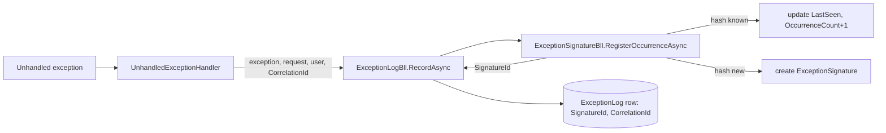

# Stage review: exception signature, stage 2 (2026-10-18)

Plan: [Claude-decision-2026-10-correlation-id-and-exception-signature.md](../Claude-decision-2026-10-correlation-id-and-exception-signature.md). Branch `claude-users-roles` in both repos. Stage 1: [correlation id](Claude-2026-10-18-correlation-id-stage-1.md).

## What was built

- **Signature** (`ExceptionSignature`, Foundation `Adventures.Entities`): hash of outer exception type, root-cause type, the message with values replaced (GUIDs `{guid}`, long hex `{hex}`, quoted text `'{value}'`, numbers `{n}`) and the first non-System/Microsoft stack frame as `Type.Method` (no line numbers, async state machines mapped back to their method).
- **`ExceptionSignature` entity** + `ExceptionSignatureBll.RegisterOccurrenceAsync`: find by hash or create; every occurrence updates `LastSeen` and `OccurrenceCount`. Fields: Hash, ExceptionType, MessagePattern, TopFrame, FirstSeen, LastSeen, OccurrenceCount, Status (`New`).
- **Seed `seed-003-exception-signature.nq`** (applied once, named `003-exception-signature`): defines the new schema at `https://schema.global-webnet.com/exception/ExceptionSignature` (the schema-host convention) and adds `SignatureId` and `CorrelationId` fields to the `ExceptionLog` schema. Existing log rows are not changed.
- **Log entries** now carry `CorrelationId` and `SignatureId`; if grouping fails the entry is still recorded without a signature (never masks the original error).
- `UnhandledExceptionHandler` passes the request's correlation id to the log.
- **mcp TLS (OI-1):** McpServer now answers 200 on `/` over HTTP; see below.
- Tests: Foundation 79 Entities tests (7 new), ai-research-blog all green (McpServer 6, WebApi 40). A live smoke run (in-memory store, port 5099) started cleanly with the new registrations and showed `[smoke-1]` in the log lines and response header.

## mcp TLS finding (OI-1)

SmarterASP lists `mcp.global-webnet.com` as `sslStatus: not_configured`. I tried `ssl_request`; it was refused (`ssl_preflight_failed`: the domain must answer HTTP 200 at its root, and the MCP site returned 404 and redirected everything to https). The McpServer fix is committed, but it only reaches production when `claude-users-roles` is merged to `main` and deployed. After that deploy, one `ssl_request` call (I will do it) issues the free cert and the API-to-MCP health call works. This merge also deploys seed 003 to the production database (additive: one new schema, two new fields).

## How to test (about 5 minutes)

1. Run the app, sign in as Admin, call `/api/dev/throw` twice (different calls, same failure). Open the Exceptions screen: both rows exist; with the grid's columns you can see `SignatureId` (same on both) and `CorrelationId` (different).
2. Look at the JSON log `logs/webapi-<date>.json.log`: the two request lines and exception lines share the matching `CorrelationId`.
3. The signature itself has no screen yet (stage 3); it is in the store (`ExceptionSignature` rows, `OccurrenceCount` 2).

## Defaults I chose

- Scan-by-hash lookup (signatures are few); an index/lookup query goes in the backlog if volume ever demands it.
- A race of two identical first-time exceptions could create two signatures; tolerated, the lookup takes the first.
- Status values: `New` only for now (acknowledged/fixed come with the grid actions in stage 3).

## Questions for you

- Merge `claude-users-roles` to `main` now (deploys the Users/Roles stage 0 work, exception log, CorrelationId, signatures, and the mcp fix), or keep testing first?
- Stage 3 next: Angular interceptor + reference in errors + grid grouped by signature with counts and an acknowledge action?
