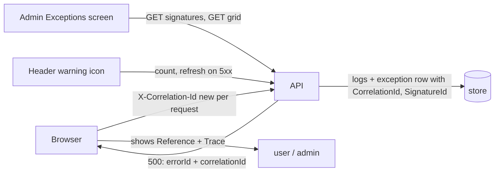

# Stage review: observability stage 3, Angular and grouped view (2026-10-18)

Branch `claude-observability` (both repos, cut from `main` after the merge/deploy of stages 1-2). Plan: [Claude-decision-2026-10-correlation-id-and-exception-signature.md](../Claude-decision-2026-10-correlation-id-and-exception-signature.md).

## Where stages 1-2 stand in production

Merged to `main` and deployed (api and Angular succeeded; `https://api.global-webnet.com/api/health` returns `X-Correlation-Id`). The mcp deploy ran but its HTTPS smoke test fails, because `mcp.global-webnet.com` still has no certificate: the SSL preflight now passes (root answers 200 over http) but SmarterASP's `ssl_request` returns "did not queue the SSL request". Details and next steps: OI-1 in [Claude-open-issues.md](../Claude-open-issues.md).

## What was built

- **Angular `correlationInterceptor`:** every request to our API gets its own `X-Correlation-Id` (32 hex characters); first in the chain, never sent to other sites. 3 specs.
- **Error text:** a 500 now reads `... Reference: <exception id>. Trace: <correlation id>.` (body first, response header as fallback, so even a failure that could not be stored shows its trace id). 1 new spec.
- **Server:** `GET /api/admin/exceptions/signatures` (admin only) returns each kind of failure with type, message pattern, top frame, first/last seen, occurrence count, status, most recent first (`ExceptionSignatureBll.ListSummariesAsync`, 1 new test).
- **Exceptions screen:** a "Kinds of failure" table above the occurrences grid (the grid already shows `SignatureId` and `CorrelationId`). The header warning icon for administrators already existed (count of active exceptions, refreshes on any 5xx).
- Tests: Foundation Entities 80, ai-research-blog .NET all green, Angular 16 specs green, `ng build` clean.

## How to test (about 5 minutes)

1. Run the app, sign in as Admin. In the browser DevTools Network tab any API call shows a request `X-Correlation-Id` and the same value on the response.
2. Call `/api/dev/throw` twice. The header icon shows a count; on the Exceptions screen "Kinds of failure" shows one row with Seen = 2, and the occurrences below carry the same SignatureId but different CorrelationIds.
3. Find one occurrence's CorrelationId in `logs/webapi-<date>.log`: every line of that request is there.

## Not done (in the backlog, "no silent errors")

The audit of paths that never reach the exception log: the health probe's swallowed mcp failure, browser-side errors, startup and background failures. I did not build them because each needs a rule about what counts toward the admin icon, so health pollers (and the deploy smoke test) cannot flood it. That rule is the one open question below.

## Questions for you

- Should a failed dependency probe (mcp down) raise the admin icon once per outage (my suggestion: record one exception per signature per hour, so it is visible but never floods), or stay a warning in the log only?
- Next stage: client-side error reporting (`POST /api/client-errors`) and the probe rule above, then the `IDiagnosticsReader` MCP seam?
