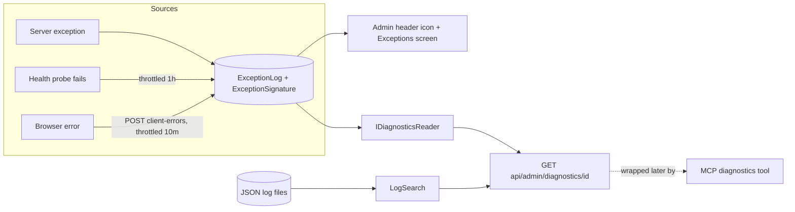

# Stage review: observability stage 4, no silent errors and the diagnostics seam (2026-10-18)

Branch `claude-observability` (both repos). Builds on [stage 3](Claude-2026-10-18-observability-stage-3.md). Your decision applied: a failing dependency probe reaches the exception log at most once per signature per hour.

## What was built

- **Throttled recording** (`IExceptionLogBll.RecordThrottledAsync`, per process): one entry per signature per window; suppressed repeats return null (the warning is still logged).
- **Health probe**: an unreachable mcp (exception) or an mcp error status is recorded as `health probe: mcp`, throttled to 1 hour, so it raises the admin icon once per outage instead of on every poll or deploy smoke test. A healthy probe records nothing.
- **Client-error reporting**: Angular `ClientErrorHandler` (global `ErrorHandler`) still writes to the console and now POSTs to `POST /api/client-errors` (signed-in users only; message/stack/page trimmed to 2,000 characters; one entry per kind per 10 minutes; 30 per minute cap). Stored as `ClientReportedException` with the browser's stack and the request's CorrelationId. Anonymous reporting is deliberately off so the store cannot be filled by strangers (login-page errors still show to the user and in the console).
- **`IDiagnosticsReader`** (Foundation, the MCP seam): `FindByCorrelationIdAsync`, `ListRecentAsync`, `ListSignaturesAsync`; read-only.
- **`GET /api/admin/diagnostics/{correlationId}`** (admin only): the recorded exceptions for that request, their kinds of failure, and the request's log lines from the JSON log files (`LogSearch`). `GET /api/admin/diagnostics/recent` lists recent exceptions. This is what an MCP diagnostics tool will wrap: today an admin or I can call it with a token; the MCP tool module (M2M scope, e.g. `mcp.diagnostics.read`) is the next step and is only a thin wrapper.
- Tests: Foundation Entities 84, WebApi 46, McpServer 6, Angular 19 specs; `ng build` clean; a live start (in-memory store) resolved all new registrations and the health call recorded the unreachable mcp.

## How to test (about 5 minutes)

1. Sign in as Admin. In the browser console run `setTimeout(() => { throw new Error('console test') })`: after a moment the header icon count rises and the Exceptions screen shows a `ClientReportedException` row (page `client: /...`). Run it again: no second row for ten minutes (throttled).
2. While `mcp.` has no certificate, `GET /api/health` records `health probe: mcp` once; the next hour of polls add nothing.
3. Take any CorrelationId from the Exceptions grid and open `/api/admin/diagnostics/<id>` (needs your Bearer token; for example from DevTools): you get the exceptions and the request's log lines.

## Not done / next

- MCP tool module on the McpServer that calls the diagnostics endpoint (needs a scope and an M2M client for me); decide the scope name.
- Anonymous client errors (login page), startup/background failure reporting, Status actions (acknowledge/fixed) on a signature: backlog.
- Throttle state is per process (resets on restart); fine for a single instance.

## Questions for you

- OK to build the MCP diagnostics tool next (scope `mcp.diagnostics.read`, M2M client for Claude), so I can read production logs and exceptions myself?
