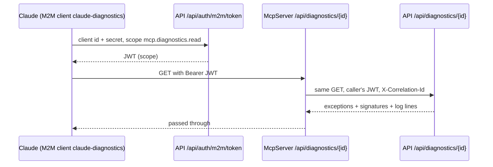

# Stage review: MCP diagnostics tool, stage 5 (2026-10-19)

Branch `claude-observability` (stacked on stages 1-4, nothing deployed). Goal: Claude (or any authorized machine caller) reads the system's exceptions and request logs itself, read-only.

## What was built

- **API** `AiBlogResearch.WebApi`: `McpDiagnosticsController` at `/api/diagnostics/{correlationId}`, `/recent`, `/signatures`, protected by the scope `mcp.diagnostics.read`. Same answers as the admin endpoint (shared `DiagnosticsLookup`): the request's recorded exceptions, their kinds of failure, and its log lines.
- **McpServer** `DiagnosticsController` (the tool): same three routes, scope `mcp.diagnostics.read`; forwards to the API (`Api:BaseUrl`) with the caller's own token (both sites validate the same issuer and key), passes the answer and status through, and returns 502 with a correlation id if the API is unreachable. The correlation id travels on the forwarded call, so the tool's own log lines join the request's trail.
- **M2M client** `claude-diagnostics` (scope `mcp.diagnostics.read`) in `appsettings.json` at index 3 (appended: secrets bind by index, inserting would have shifted `mcp-server-filesearch`). With no secret set the client is inactive, so merging this changes nothing in production until you set one.
- **Dev secret path**: `docs/Claude-secret-targets.json` (root repo) now maps vault secret `m2m/claude-diagnostics/claude-diagnostics` to the user-secret `M2MClients:Clients:3:Secret`.
- Tests: McpServer 10 (4 new: forwarding with the caller's token, API refusal passed through, 502 when unreachable, scope 403/401), WebApi 46, all green.

## What you need to do to switch it on (secrets are yours, I never see them)

1. Dev: `powershell -File docs\Claude-secret.ps1 set m2m/claude-diagnostics/claude-diagnostics` (pick a long random value), then `.\docs\Claude-secret.ps1 sync`.
2. Production, after the merge and deploy: in the SmarterASP panel set the API site's environment secret `M2MClients__Clients__3__Secret` to the same value, restart the API site. (Not through an AI-visible tool parameter.)
3. Then I can run: token request through `Claude-secret.ps1 run ... -EnvVar` and call `https://mcp.global-webnet.com/api/diagnostics/<id>`. The mcp site needs its certificate first (OI-1).

## Limits to know

- The tool is HTTP/JSON with an OAuth token, not yet the MCP wire protocol (tool listing for an MCP client); it is the same seam, and wrapping it in the protocol is a thin later step.
- Log lines come from the API site's own JSON log files only (the MCP server's logs are separate files on its own site).
- The list endpoints read the whole exception log (fine at today's volume; indexing is a backlog item if it grows).

## Questions for you

- Merge `claude-observability` (stages 1-5) after you test? Merging deploys with the Claude client inactive until you set the secret.
