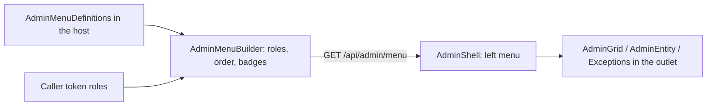

# Stage review: server-supplied admin menu and shell (2026-10-20)

Branch `admin-menu` in both repos. Not deployed: it waits for your user test. First step toward the BlogEngine-style admin; the findings that shaped it are in [the BlogEngine admin review](../Claude-review-2026-10-blogengine-admin-pages-posts.md).

## What was built

- **The menu is data from the API.** `GET /api/admin/menu` returns the sections and items the caller may see, in order, with a count badge where one applies. The host declares the entries once (`AdminMenuDefinitions`); `AdminMenuBuilder` (Adventures.WebApi) filters them by the caller's roles (the same two claim spellings the role policies accept), orders them, and attaches badges. A caller with no admin role gets an empty menu; the client then shows no admin link.
- **The whole destination is listed from the start.** Dashboard, Content (Posts, Comments, Pages, Categories, Tags, Blogs), Users (Users, Roles, Contacts) and System (Exceptions) are declared; the ones without a screen are marked not available and shown dimmed with "soon". Each future slice flips a flag and gives the item a route, with no client change.
- **Admin shell.** `/admin` is a frame with the server menu on the left and the screen on the right. Users, Roles and Exceptions are its child screens (same URLs as before); `/admin` itself opens Users. The account menu now has one **Admin** entry (instead of separate Users, Roles and Exceptions entries), shown only when the server sent a menu. The header warning icon still opens the exception log.
- **Exceptions** now always appear in the admin menu for administrators, with the active count as a badge (before, the link only showed once something had been recorded).

## Tests

Foundation WebApi 57 (3 new for the builder: order, role filtering, both claim spellings, badges, anonymous). Angular 48 (the menu service and the shell: headings, links, badge, dimmed items, the empty case); `ng build` clean; all .NET projects pass.

## How to test

Sign in as Admin: the account menu shows **Admin**. It opens the admin area with the menu on the left: Dashboard, Posts, Comments, Pages, Categories, Tags, Blogs and Contacts are dimmed with "soon"; Users, Roles and Exceptions are links (Exceptions with a red count when there are active exceptions). Users and Roles work as before; the Back button on a user returns to the Users list. A signed-in non-administrator sees no Admin entry.

## Not done / later

- The dimmed items become real in this order (from the review): Pages and Posts schemas with read-only lists, then their editors (rich text, same-schema pointer for the page parent, front-page rule, publish/unpublish, categories and tags), then the Dashboard stats and comments.
- The icons are Material icon names the server picks; if you prefer BlogEngine's own look, only the shell template changes.
