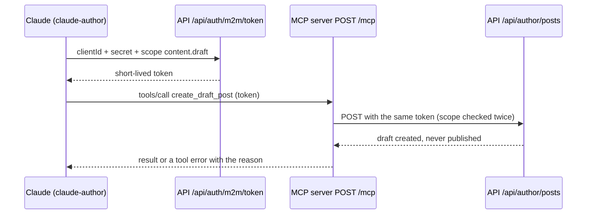

# Stage review: Claude as an author, over the MCP server (2026-10-20)

Branch `content-authoring` in both repos, stacked on the deployed Posts editors. Local runs cannot reach the shared database (IP allow-list), so I write to **production** through the MCP server, under a machine identity that can only create drafts. Nothing is active until you set one secret.

## What was built

- **A drafts-only authoring surface.** `IContentAuthoring` (Adventures.Entities) creates a post as a draft under a fixed author (the Claude user), revises it while it is still a draft, lists the author's own posts, and finds or creates categories and tags **by name** (any case). It has no way to publish, to change a published post, or to touch someone else's post (409 with the reason); everything else is the ordinary Post rules (draft by default, slug from the title, pointers must exist).
- **The API.** `api/author/...` (posts: list, create, update; categories and tags: list, ensure by name), protected by the single scope `content.draft`. Added a machine client **`claude-author`** (appended at index 4 of `M2MClients`; no secret configured means inactive).
- **MCP write tools.** On `POST /mcp` at the mcp site, beside the read-only diagnostics tools: `list_my_posts`, `create_draft_post`, `update_draft_post`, `list_categories`, `list_tags`, `create_category`, `create_tag`. `tools/list` shows a caller only the tools its scopes allow; `tools/call` checks the scope per tool again (a token without it gets a tool error and nothing is forwarded); a call forwards to the API with the caller's own token, so the API's rules are the only rules.
- **A helper.** `docs/Claude-author.ps1` (workspace root) turns a Markdown file with a small header (title, description, categories, tags, slug) into a draft, or revises a draft, through the MCP endpoint; the secret reaches it only through the vault tool.
- **Two posts written and ready as the first drafts** (`docs/content/`): *The MCP server in this app, end to end* (the wire protocol, how a tool is declared and forwarded, scopes, the identity, what to reuse at work; categories MCP and Development log) and *Getting around the admin* (Help). They are Markdown files with headers, ready for `Claude-author.ps1 -Action post`.

## Tests

Foundation Entities 125 (new: draft under the author and filed by name, taxonomy deduplicated by name and case, revising only the named fields, a published or foreign post refused, unknown author refused). App: authoring controller (scope, no publish route, author from configuration, 201/404/409/400), MCP 20 (new: tools filtered by scope, create forwards a POST with the caller's token, update strips the id and surfaces the API's refusal, a tool of another scope is refused and nothing is forwarded); all .NET projects pass; the API boots with the new registrations.

## What I need from you (two steps, the secret is yours)

1. **Vault, hidden prompt:** `powershell -File docs\Claude-secret.ps1 set m2m/claude-author/claude-author` (pick a long random value).
2. **Production:** in the SmarterASP panel, API site, environment secrets: `M2MClients__Clients__4__Secret` = the same value; restart the API site. (For a local API, `.\docs\Claude-secret.ps1 sync m2m/claude-author/claude-author` writes it to the dev user-secrets; give the name, because a bare `sync` also rewrites the local database connection string.)

Then tell me, and I run `docs/Claude-author.ps1 -Action tools` (proves the connection and the scope), post the two drafts above, and you publish them from Admin > Posts.

## Not done / later

- **Editing published posts.** Today a published post is changed in the admin only. A revision flow (a draft that replaces a published post when an administrator approves it) is the next step for "update the help when a feature changes".
- Public rendering of posts by slug (the new front end), so published posts have somewhere to be read; comments and the import of your BlogEngine posts.
- A Markdown mermaid renderer in the blog, so the diagrams in the posts draw instead of showing as code.
