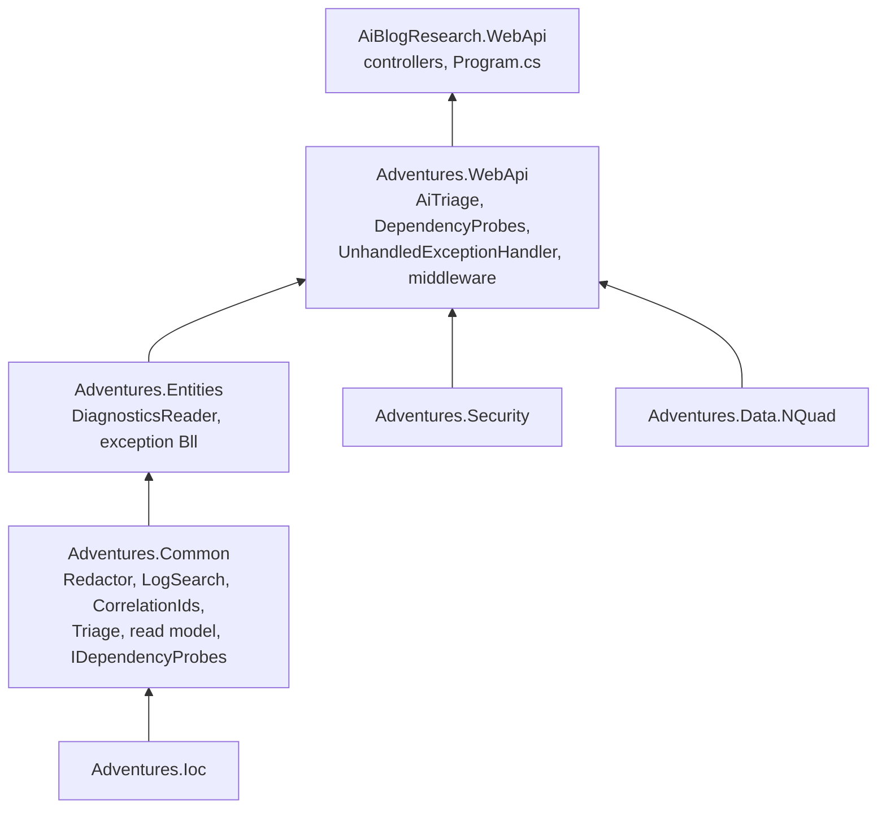

# Stage review: diagnostics classes move down into Adventures.Foundation (2026-10-20)

Branches `cleanup-move-to-foundation` (this repo) and `cleanup-move-from-webapi` (Adventures.Foundation); keep them in step. No behaviour change; every test that passed before passes now (Foundation 6/5/85/83/20 became 28 Common, 50 WebApi, 67 NQuad; this repo's WebApi tests 91 became 43 because 48 moved with their classes).

## What moved, and why there

The rule: put each class in the lowest project that can hold it without a framework or a layer it should not know about. Where a class was stuck only because of a type it used, that type moved down too.

| Class | Was | Now | Why it can live there |
|---|---|---|---|
| `Redactor` | app WebApi | **Common** | pure text (regex) |
| `LogSearch` | app WebApi | **Common** | only needed the correlation id's *rules*, not the ASP.NET middleware |
| `CorrelationIds` (new) | inside the middleware | **Common** | header/log names and `IsWellFormed`; the middleware now delegates to it, so the log reader and the middleware no longer depend on each other |
| `Triage`, `TriageResult`, `TriageFinding` | app WebApi | **Common** | pure once its inputs moved |
| `ExceptionOccurrence`, `ExceptionSignatureSummary`, `CorrelationReport`, `IDiagnosticsReader` | **Entities** | **Common** | the circular reference: Triage needed them, they only needed `IBll` (already Common). `DiagnosticsReader` stays in Entities |
| `IDependencyProbes`, `ProbeResult` | app WebApi | **Common** | an interface and a record |
| `DependencyProbes` | app WebApi | **Adventures.WebApi** | needs `IHttpClientFactory`, `IJwtTokenService`, `INQuadStore` (WebApi now references Security and Data.NQuad) |
| `AiTriage`, `AnthropicOptions` | app WebApi | **Adventures.WebApi** | HTTP, options, hosting, and `IExceptionLogBll` (Entities). Common would need a narrower recorder interface plus hosting packages; not worth it for a class that talks to one vendor |
| `UnhandledExceptionHandler` | app WebApi | **Adventures.WebApi** | HttpContext; the Serilog static call became `ILoggerFactory`, so the library no longer needs Serilog |

Stays in the app: `Program.cs`, the controllers (routes, policies and the mcp-specific health roll-up are the app's), `HealthController`.

## Two cleanups done alongside

- **Shared probes.** `HealthController` had its own copy of the mcp and database checks; it now takes `IDependencyProbes`, the same object the Diagnose button uses. `ProbeResult` carries the short code, the hello message and the failure to record, so the health endpoint keeps its exception-log recording and its responses are unchanged (all health tests pass untouched in meaning).
- **Cheap exception count.** `IEntityRepository.CountAsync(includeDeleted)` reads the type quads and the tombstones (2 store calls, or 1) and materialises nothing. The admin count (polled by the header icon) no longer loads every entry with its stack twice. A test pins the call count and checks the numbers equal `ListAsync`.

## How to test

Nothing visible changes. Run the app, sign in as Admin: the Exceptions icon count, the grid, Diagnose and Ask Claude behave as before. `/api/health` returns the same shape.

## Not done / later

- `Adventures.WebApi` now carries the Anthropic client; if a second product wants triage without the AI, split `AiTriage` into its own project then.
- `HealthController` could move too once the "mcp" dependency becomes a configurable list of named probes.
