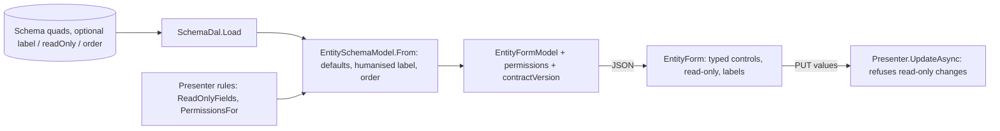

# Stage review: form contract stage 1, field metadata and permissions (2026-10-20)

Branch `form-contract-stage-1` in both repos (`ai-research-blog`, `Adventures.Foundation`); merge both together. Stage 1 of [the server-driven forms decision](../Claude-decision-2026-10-server-driven-forms.md). Nothing here is deployed yet: it waits for your user test.

## What was built

- **Field metadata, computed by the server.** Every field in a form's schema now carries `label`, `isReadOnly`, `order` and `isListVisible`. A schema can declare them with optional quads on the field (`schema#label`, `#readOnly`, `#order`, `#listVisible`, and `#required`, which the loader ignored before); when absent the server fills sensible defaults: the label is the field name split into words ("DisplayName" becomes "Display name"), the order is the schema position, `Id` is always read-only. No seed file changed, so the seed triad is still in step.
- **Permissions.** A form model carries `permissions { canUpdate, canDelete }`. The presenter decides (`PermissionsFor`); the default is full. Your own profile is updatable but not deletable (the delete-own-account guard). The server still enforces every rule; the flags only tell the renderer which buttons to draw.
- **Read-only is enforced, not just drawn.** The presenter refuses a changed value for a read-only field on update (400, "User name cannot be changed.") but accepts it sent back unchanged, which is what a browser posts. `UserName` is read-only for the user presenter: it is the identity the token and the profile lookup rely on.
- **Contract version.** `contractVersion: 1` on the model. A client that meets a higher number shows "reload the page" instead of guessing.
- **Typed controls in `EntityForm`.** The control comes from the server's type name: a date picker for `Date`, a checkbox for `Bool`, a number input for `Int`/`Long`/`Double`/`Decimal`, text otherwise. Labels and order come from the server; a read-only field is disabled but still posted back unchanged; booleans travel as `true`/`false` text.
- **Profile page.** Save shows only when `canUpdate`; the "Delete my account" button shows only when `canDelete`, which for your own profile is never. The guard itself is untouched on the server (`DELETE /api/profile/me` still refuses), but the button that existed to demonstrate it is no longer drawn. If you want the demonstration back, say so and I will keep the button behind a development-only flag.

## Tests

Foundation: Entities 97, NQuad 68, plus the existing suites; new cases cover label humanising, order, defaults, `SchemaDal` optional quads, permissions, contract version, and read-only enforcement on update. App: all 10 .NET test projects pass; Angular 30 specs (3 new) and `ng build` clean.

## How to test

Sign in and open Profile: labels read "Display name", "User name", "First"...; User name and Id are greyed out; Date of birth is a date picker; there is no Delete button. Change First and Save: it saves. Optionally, in the browser developer tools, replay the PUT with a different `UserName`: the server answers 400 with the message above.

## Not done / later

- The grid keeps its own columns for now; `isListVisible` is sent but the gear and server-side paging are stage 2.
- Per-role field filtering (stage 4) and the relation contract (stage 3).
- Declaring metadata in the seed files for User (for example a real label for `DOB`): defaults work, so I left the seeds alone; adding quads there also means updating `mock-data.txt` and `validated.csv` in `poc`.
