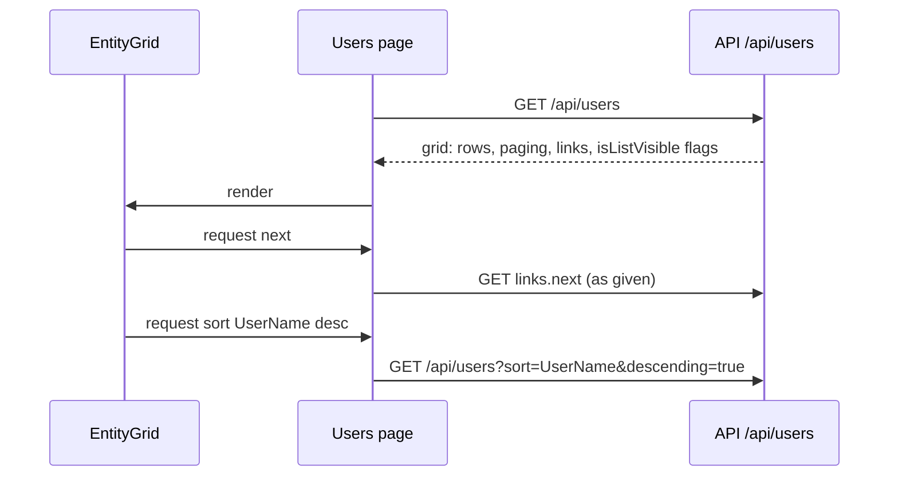

# Stage review: form contract stage 2, the grid contract and Admin > Users (2026-10-20)

Branch `form-contract-stage-2` in both repos (stacked on the merged stage 1). Not deployed: it waits for your user test. Stage 2 of [the server-driven forms decision](../Claude-decision-2026-10-server-driven-forms.md).

## What was built

- **The grid contract.** `EntityGridModel` now carries `paging` (page, pageSize, totalCount, totalPages, sort, descending), `canCreate`, `rowPermissions`, `links` (self, create, next, previous) and `contractVersion`. The client sends `?page=&pageSize=&sort=&descending=`; the server normalises it (page at least 1, page size 1 to 100, unknown sort field ignored) so nobody can ask for everything.
- **Server-supplied links.** The host builds the links from the request path (`EntityControllerBase.GridAsync`), so the client follows them as given. The one URL the client knows is the collection (`/api/users`).
- **Default columns.** Fields carry `isListVisible`; the base presenter hides `Id`, the exception log also hides `StackTrace`. The client no longer has a hardcoded "hide Id" rule.
- **`EntityGrid` grew up.** Sortable headers (click to sort, click again to reverse, `aria-sort` set), a pager drawn from the server paging with Previous/Next disabled when the server gave no link, labels from the server, and a **Columns** gear that lists every field with its type and lets you show or hide any of them (for this page view; a stored per-user preference is a later piece). The grid never fetches: it emits a request and the host acts.
- **Admin > Users.** `GET /api/users` now returns a grid (it returned a bare list before; nothing else used it). A new page at `/admin/users` and a **Users** item in the account menu (administrators only, the server still enforces) render it with the reusable grid. Adding Roles or Posts later is the same page with another collection path.

## Honest limit

Sorting and paging happen **in memory over the list the Bll returns**: the N-Quad store has no paged or sorted query yet. The payload the client gets is bounded (one page), but the server still reads every user to produce it. That is fine for users; it is not fine for thousands of posts. A store-level query (sort and page on the predicate) belongs with the performance work in the backlog, and the contract does not need to change when it lands.

## Tests

Foundation: Entities 100 (new: sort, paging, clamping, unknown sort field, hidden Id column, create and row permissions). App: Users controller test for the links, all .NET projects pass; Angular 37 specs (7 new for the grid and the users service), `ng build` clean.

## How to test

Sign in as Admin, account menu, **Users**. You see the users with readable headers and no Id column. Click **User name** to sort (arrow shows direction), click again to reverse. Open **Columns**, tick Id: the column appears. With only a few users the pager shows "Page 1 of 1" and both buttons are disabled; to see paging, call `GET /api/users?pageSize=1` from the browser tools or create a couple of users. The Exceptions page should look as before, with readable headers.

## Not done / later

- Row selection (following a row link to its form) and the Add button: they arrive with the relations stage, when a grid row leads somewhere.
- Filtering, and a stored per-user column preference.
- Store-level paging (see above).
