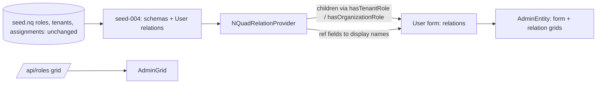

# Stage review: form contract stage 3a, relations (read-only) and Roles (2026-10-20)

Branch `form-contract-stage-3a` in both repos (stacked on the merged stage 2). Not deployed: it waits for your user test. Slice 3a of [the server-driven forms decision](../Claude-decision-2026-10-server-driven-forms.md); 3b (adding and removing assignments) follows. Your two choices for this stage: keep the existing data shape, and read first, edit second.

## What was built

- **Relations in the schema, as data.** A schema can declare child collections: a relation node names the collection, its child schema, the linking predicate and the direction (forward: the parent points at each child; reverse: each child points back). `SchemaDal` reads them; no class, no client code. Both directions are one indexed lookup.
- **Pointer fields.** Field types `ref:<SchemaIri>` / `refs:<SchemaIri>` hold another entity id (stored as the other entity IRI through the existing value-prefix mechanism, so the data on disk is unchanged). The model tells the client which schema a field points at (`refSchema`), ready for the lookup control in 3b.
- **The relation provider** (`NQuadRelationProvider`): for a parent it finds the children, builds a grid for each, and resolves pointer fields to display text (`display` beside `values`, which keep the ids so a form can save them). The naming field is the schema's `displayField`, else Name, DisplayName, UserName; a pointer chain resolves one level further, which is how an organization is shown by its blog name.
- **The existing role data, described not moved.** `seed-004-identity.nq` adds schemas for Role, Tenant, Blog, Organization, TenantRoleAssignment and OrganizationRoleAssignment under the schema host (`https://schema.global-webnet.com/identity/...`), mapped onto the predicates already in `seed.nq`, and two relations on the User schema (Tenant roles, Organization roles) via `hasTenantRole` / `hasOrganizationRole`. `seed.nq` and the poc triad are untouched; production applies it once at startup under the seed name `004-identity`.
- **User form with relations.** A user's form (`GET /api/users/{id}`, and your profile) now carries `relations`: one read-only grid per declared collection, with names ("DEV Main", "Administrators") rather than ids.
- **Roles.** `GET /api/roles` (administrators): the four existing roles as a grid on the stage 2 contract, read-only (no create, update or delete offered).
- **Row links.** Grid models carry the form URL of each row (`links.rows`), so the client follows links instead of building URLs.
- **Client: two generic screens.** `AdminGrid` (any collection, from route data) and `AdminEntity` (any single entity: form, Save when permitted, then one read-only grid per relation) replace the Users-specific page, and one thin `EntityApiService` replaces the Users service. Users and Roles are one route each; the grid gained an **Open** button (when the server gave a link) and shows display text instead of raw ids. The account menu has Users and Roles for administrators.

## Tests

Foundation: Entities 104 (new: a user form carries tenant and organization role assignments with names, a user with none still has the columns, roles read from the existing seed). Angular 40 specs (display text, Open link, the service); all .NET projects pass. The API boots with the new registrations (checked locally against the in-memory store); I could not call the authenticated endpoints without your password, so the UI path is yours to test.

## How to test

Sign in as Admin, account menu, **Users**, expand a row, **Open**: the form (User name greyed out) and under it "Tenant roles" (for the seeded Admin user: two rows, for example Tenant "DEV Main", Role "Admin") and "Organization roles" (Organization "BlogAI", Role "Developer"). **Roles** in the menu lists Admin, Editor, Reviewer, Developer; Open one to see its form (read-only, no Save). Production data may differ from the dev seed: whatever assignments exist for a user are what it shows.

## Not done / later (3b and after)

- **3b:** add and remove assignments through their own endpoints and rules (Bll guard so the last administrator cannot be removed), the lookup control for choosing a role, tenant or organization from `refSchema`.
- The relation provider lists all entities of the child type then filters to the parent links; fine for tens of assignments, to be replaced by a keyed read when it matters (see the performance item in the backlog).
- Role-based field filtering (stage 4) and the Tenant/Org role design questions it raises (which role grants what) stay open.
