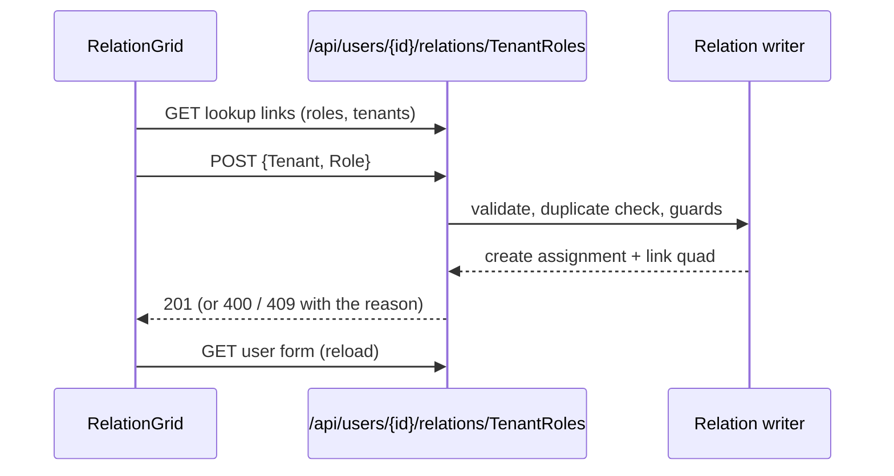

# Stage review: form contract stage 3b, add and remove role assignments (2026-10-20)

Branch `form-contract-stage-3b` in both repos (stacked on the merged 3a). Not deployed: it waits for your user test. Completes stage 3 of [the server-driven forms decision](../Claude-decision-2026-10-server-driven-forms.md): the Users and Roles screens now change data, not only show it.

## What was built

- **Add and remove, through the child own rules.** `POST /api/users/{id}/relations/{name}` adds a child and `DELETE /api/users/{id}/relations/{name}/{childId}` removes one. Nothing saves a user and its assignments as one write. Adding validates the values against the child schema (the tenant and role are required, and must exist), refuses a duplicate (409 "This entry already exists."), asks the guards, then creates the assignment through its own repository (ordinary audit trail) and writes the one link quad from the user. Removing tombstones the assignment; the relation no longer lists it.
- **The last administrator guard.** Removing the last "Admin" assignment of a tenant is refused (409, "A tenant must keep at least one administrator..."). Guards are a small seam (`IRelationChangeGuard`), so the next rule is a class, not a controller change.
- **Lookups.** `GET /api/lookups?schema=...` (administrators) returns id and display text for a pointer field's choices (roles, tenants, organizations). The URL of each lookup is supplied by the server in the form model, like the add and remove URLs, which now ride on the relation grids as links (`create`, per-row `rows`, per-field `lookups`).
- **Editable only where it should be.** The relation grids carry `canCreate` and per-row delete permission. An administrator opening a user (`/admin/users/{id}`) gets an editable Roles section; the profile page (your own form) stays read-only.
- **Client.** A reusable `RelationGrid` shows the relation grid and, when the server permits, an Add row (one select per pointer field, filled from the lookup links) and a Remove button per row; server refusals show in plain words. `AdminEntity` reloads the user after a change. Nothing in it knows what an assignment is.
- **Seed 005** marks the assignment pointer fields required (seed 004 was already applied in production, and a named seed applies once, so this is its own small file).

## Important to know

**These assignments are data; they do not yet decide access.** What an administrator may do on the API still comes from the identity roles in the sign-in token (the Postgres identity store), not from the tenant and role assignments edited here. So adding or removing "Admin" here changes what the Users screen shows and what the guard protects, but not who can call the admin endpoints. Joining the two is the identity-migration work; the guard protects the data until then.

## Tests

Foundation: Entities 110 (new: add shows on the form, duplicate refused, missing and non-existent pointers refused with field errors, removal, the last-administrator rule and the way past it, lookups). App: Users controller tests for POST and DELETE (201, 404 for an unknown relation or parent, 400, 409, 204); Angular 44 specs (4 new for the relation grid); all .NET projects pass. The API boots with the new registrations (local, in-memory store); I could not drive the authenticated endpoints myself.

## How to test

Sign in as Admin, account menu, **Users**, open a user, scroll to "Tenant roles": choose a tenant and a role, **Add**: the row appears with names. Add the same pair again: "This entry already exists." Choose **Remove** on a row you added: it disappears. Try removing the Admin assignment of the tenant that has only one: it is refused with the reason. "Organization roles" works the same way. Your own profile page shows the same sections without Add or Remove.

## Not done / later

- Joining these assignments to the identity roles (access control), and Tenant/Org scoping of what the admin screens may show.
- Editing the Roles themselves (create, rename, delete) and the Tenant, Organization screens: one route each on the generic screens when wanted.
- A keyed read instead of listing every assignment, and removing the orphan link quad on remove (harmless today).
