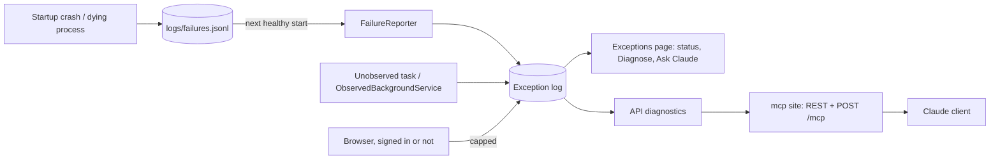

# Stage review: the observability track is complete (2026-10-20)

Branches `cleanup-move-to-foundation` here and `cleanup-move-from-webapi` in Adventures.Foundation (one deploy unit; merge both). Builds on [the move to Foundation](Claude-2026-10-20-diagnostics-moved-to-foundation.md).

## What was built

1. **Anonymous browser errors.** `POST /api/client-errors` is open to anyone (the login page can fail before anyone is signed in). Because anyone can call it: the same error is stored once per 10 minutes, signed-in callers 30 a minute, anonymous callers 10 a minute and 200 a day; an anonymous report carries no user name.
2. **Startup and process failures.** A crash while starting is written to `logs/failures.jsonl` (no database or DI needed) and to `logs/startup-*.log` (the bootstrap logger used to write to the console only, which IIS discards). On the next healthy start `FailureReporter` moves the entries into the exception log (`PersistedFailureException`, request `startup at <time>`) and renames the file `failures-reported-*.jsonl` (kept). A dying process (unhandled exception) is journaled the same way.
3. **Background work.** Unobserved task exceptions are recorded (once an hour per kind). `ObservedBackgroundService` is the base class for any future worker: its failure is logged, journaled, recorded and rethrown.
4. **Acknowledge / Fixed.** Each kind of failure on the Exceptions page has a status select (New, Acknowledged, Fixed). A Fixed kind that happens again turns **Regressed** by itself and is shown in red.
5. **MCP wire protocol.** `POST /mcp` on the mcp site speaks JSON-RPC: `initialize`, `tools/list`, `tools/call` with the tools `diagnose_request`, `recent_exceptions`, `exception_signatures`. Same scope (`mcp.diagnostics.read`) and the same forwarding as the REST routes; an API refusal or outage comes back as a tool error. The REST routes still work.
6. **Triage rule** for startup and background failures (a new kind of exception, so a new rule).

## Tests

Foundation: Common 30, WebApi 54, Entities 87, NQuad 67 (offline). App: WebApi 45, McpServer 16, Angular 27 specs, `ng build` clean.

## How to test (your user test)

- **Anonymous error:** signed out, open the browser console on the login page and run `fetch('<api>/api/client-errors',{method:'POST',headers:{'Content-Type':'application/json'},body:JSON.stringify({message:'TypeError: test from login',url:'/login'})})`. Sign in as Admin: the Exceptions icon counts it; Url `client: /login`, no user.
- **Status:** Exceptions page, "Kinds of failure": pick Acknowledged, reload (it stays); pick Fixed, then trigger the same exception again (the Admin dev throw route `/api/dev/throw` in Development): the kind shows Regressed.
- **Startup journal:** stop the api, put one line `{"At":"2026-10-20T10:00:00+00:00","Source":"startup","Type":"System.InvalidOperationException","Message":"test","Stack":"at X"}` in `logs/failures.jsonl` beside the exe, start it: an exception "startup at ..." appears and the file is renamed.
- **MCP:** with a token for the `claude-diagnostics` client, `POST https://mcp.global-webnet.com/mcp` body `{"jsonrpc":"2.0","id":1,"method":"tools/list"}` returns the three tools. (Registering it in a Claude client needs the client secret, which stays yours.)

## Not done / later

- A handled 4xx counter and the deploy smoke tests inside the app (reasons in `docs/Claude-backlog.md`).
- A Dashboard with per-day counts and signature-to-occurrence links; McpServer has no exception store.
- The deploy does not touch `logs/`; if you ever clean the site folder, `failures.jsonl` is what to keep.
