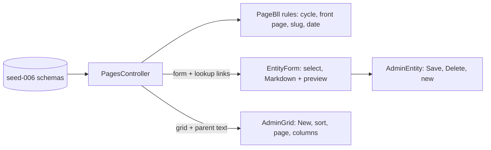

# Stage review: Pages editor (2026-10-20)

Branch `content-pages` in both repos (stacked on `admin-menu`, which is still awaiting your test, so merging this merges that too). The first content slice of the BlogEngine admin port: Pages, on the generic form, grid and menu machinery. Posts, Categories and Tags follow in the same way; the AI authoring after them.

## What was built

- **The content model.** `seed-006-content.nq` describes four new entity types under the schema host (`https://schema.global-webnet.com/content/...`): **Page**, **Post**, **Category**, **Tag**. Page has what BlogEngine's editor has: Title, Slug, Description, Keywords, Content, Parent, Sort order, Date published, Show in list, Front page, Published, Author. Post, Category and Tag are described now (used in the next slice). New entities, new IRIs: nothing existing is touched.
- **Page rules (`PageBll`).** A page cannot be its own parent or move under one of its own sub-pages; only one page is the front page (setting it on one clears the others); an empty slug is made from the title ("Direct Corpus Interaction" becomes `direct-corpus-interaction`); a new page gets a publication date. These are server rules, so any future client or tool gets them.
- **Create, edit, delete in the generic screens.** The grid shows **New** when the server says the caller may create; **New** opens the empty form (schema defaults: shown in list on, published off); saving creates the page and moves to its own screen; **Delete** appears when the server permits. The Users grid has no New yet (creating a user needs a credential the form does not collect).
- **Form controls from the types.** A pointer field is a select filled from the server's lookup link (the page **Parent**, which excludes the page being edited); **Markdown** content is a text area with an Edit/Preview toggle (rendered by `marked`, then sanitised by Angular when bound); `Html` fields work the same way without the Markdown step. Pointer fields show their target by text ("Parent: Article"), in forms and in grids, never as an id.
- **Pages in the menu.** Content > Pages is now a link (the rest of Content stays "soon"), with the list columns Title, Parent, Sort order, Date published, Show in list and Published; the Slug, Description, Keywords, Content, Front page and Author columns are hidden by default (the Columns gear shows them).

## Tests

Foundation: Entities 116 (new: slug and date defaults, title required, no self parent or cycle while moving a leaf is fine, one front page, blank form defaults, parent shown by title in form and grid, lookup excludes self). Angular 50 specs (new: pointer select filled from the lookup with the current value, Markdown edit and rendered preview); all .NET projects pass; the API boots with the new registrations.

## How to test

Admin, **Pages**: the list is empty (these are new entities; your BlogEngine pages are not migrated yet). **New**: give a title only and Save: it opens the page with a generated slug and a date. Create a second page, set its **Parent** to the first and its Sort order; the list shows the parent by title. Edit the first page and try to make the second its parent: refused with the reason. Tick **Front page** on one, then on the other: only the last keeps it. Write some Markdown in Content and press **Preview**. **Delete** removes a page from the list.

## Not done / later

- **Migrating the existing BlogEngine pages and posts** into these entities (a one-time import from BlogAI's database or its XML export); the new site starts empty on purpose.
- **Publish/unpublish as an action** (today Published is a plain checkbox) and the public rendering of a page by slug; both come with the Posts slice and the public site.
- Rich text beyond Markdown (a WYSIWYG) and the date-time picker (backlog items); Author is not filled in yet (the AI authoring slice sets it).
