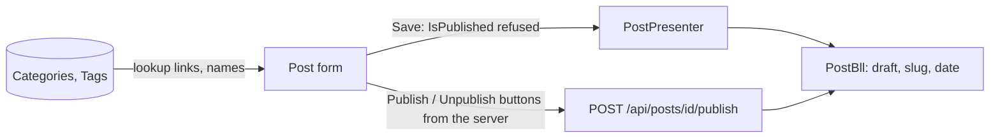

# Stage review: Posts, Categories and Tags editors (2026-10-20)

Branch `content-posts` in both repos (on top of the merged and deployed Pages editor). The second content slice: the Post editor with categories, tags and a guarded publish action. After your test, the AI authoring slice builds on exactly this.

## What was built

- **Posts, Categories, Tags in the admin.** Content > Posts, Categories and Tags are links now (Comments and Blogs stay "soon"). Each is the generic list and editor: New, Open, Save, Delete, sort, page. Post fields as in BlogEngine: Title, Slug, Description, Content (Markdown with preview), Date published, Enable comments, Author, Categories, Tags.
- **Multi-valued pointers.** Categories and Tags are `refs:` fields: on the wire one comma-separated list of ids, in the form a checkbox list over the server lookup, in grids and forms shown by name ("Angular, CLI"). Sending the same set back changes nothing; a different set replaces the old one; empty clears it. Every pointer is checked to exist (400 "refers to something that does not exist").
- **Publishing is an action, not a field.** The publish state is shown but the form can never change it: a create or update that tries is refused (400), so a draft cannot be made public by editing. A new post is always a draft. The server offers one button on a saved post, **Publish** or **Unpublish** (with a confirmation), through `POST /api/posts/{id}/publish` and `/unpublish`; the first publish stamps the date. This is the seam the AI drafts-only identity will use: it can create and edit drafts but has no route to publish.
- **Author.** A post created in the admin is authored by the signed-in user unless the form names one.
- **Less code per entity.** `AdminEntityControllerBase<T>` gives any entity the six standard admin actions (list, new, get, create, update, delete) with lookups; Pages, Categories, Tags and Posts are one-line controllers plus the Posts publish actions. The server can now offer **actions** on a form generically (`actions` in the model, one button each).
- **Seed 007** adds the Categories and Tags fields to Post (seed 006 had already been applied in production; a named seed applies once).

## Tests

Foundation: Entities 120 (new: draft by default and slug/date, the form cannot publish, only the action changes the state, categories and tags round-trip as sets and are shown by name, pointers must exist). Angular 51 (new: checkbox list posts the chosen ids). All .NET projects pass; the API boots with the new registrations.

## How to test

Admin, **Categories**: New, add "Angular" and "CLI". **Tags**: add "AI". **Posts**, New: a title, some Markdown, tick two categories and a tag, Save: the post opens as a draft with a slug, a date and you as author; a **Publish** button is shown. Press it (confirm): the button becomes **Unpublish** and the list shows Published. Open the list: categories and tags are hidden columns (the Columns gear shows them).

## Not done / later

- Public rendering of posts and pages by slug (the new site's front end), comments, and the import of your existing BlogEngine posts.
- A date-time picker and a WYSIWYG editor (backlog); tags created by typing (today they are managed on the Tags screen).
- **Next: Claude as an author** (drafts-only M2M client, a helper script that posts a Markdown file as a draft, my first post: what this app is and how its admin works).
