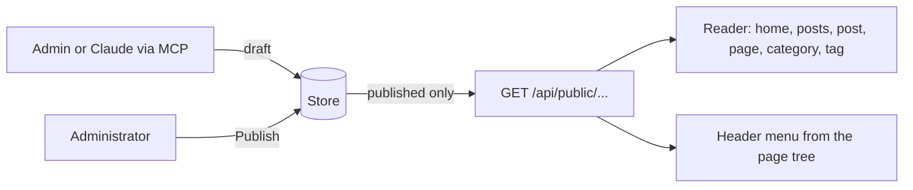

# Stage review: the public site, a blog you can post and read (2026-10-20)

Branch `public-site` in both repos. The missing half of the blog: visitors can now **read** what the admin and the MCP authoring tools write. Together with the Posts editor and Claude-as-author this is a working loop: write (admin or Claude), review and publish (admin), read (public site).

## What was built

- **The public API** (`api/public`, anonymous, read-only): the post list (newest first, paged, filtered by category or tag), one post by slug, one page by slug, the front page, the site menu, and the categories and tags with counts. It returns **published content only**: a draft, an unpublished page, an id, an e-mail address are never in a response, and page size is capped. The logic (`IPublicContent`) is in `Adventures.Entities` with tests, so any product built on the framework gets it.
- **The reader** (Angular, no login): `/` is the front page (the page marked as front page; a welcome with a link to the posts when none is set), `/posts` the list with Older and Newer, `/post/:slug`, `/page/:slug` (with a parent breadcrumb), `/category/:name`, `/tag/:name`. Markdown is rendered with `marked` and bound as HTML that Angular sanitises, so authored content cannot run script in a visitor's browser (a test pins it).
- **The site menu in the header**: Home, Posts, then the published pages marked "Show in list", with their sub-pages (the page tree you build in the admin), sorted by Sort order. Adding a page in the admin adds it to the menu without a client release. The title in the header links home.

## Tests

Foundation Entities 128 (new: drafts and unpublished pages never visible, slug lookup, the author's display name only, category and tag filters with counts, paging, the menu tree in sort order with unlisted and unpublished pages left out, front page). Angular 58 (new: Markdown sanitised, list with the category filter, post and not-found views, the home welcome, the menu). I also ran the real API on the local database: a draft post is a 404 publicly, publishing it makes it readable, and the front page and menu came back correct (the test content was deleted afterwards).

## How to test

After the deploy: open the site home page: with no published front page it shows the welcome and the menu; **Posts** is empty until you publish. In Admin > Posts publish the two drafts Claude wrote (*The MCP server in this app, end to end*, *Getting around the admin*); open **Posts** on the site: both appear, newest first; open one: the Markdown renders; click a category (MCP, Help) or a tag: the list filters. In Admin > Pages create a page, tick **Published** and **Show in list**: it appears in the menu; mark one **Front page** and the home address shows it; give another a **Parent**: it appears under it.

## Known limits (all in the backlog)

- Mermaid diagrams show as code blocks; a fuller editor with media upload; slug uniqueness (the reader takes the first of two equal slugs); caching of published content; RSS, search, comments; a way for an author to preview a draft before publishing.
- Published posts are edited in the admin only; the revision flow for Claude's updates comes later.
- The reader is deliberately plain: styling and layout are the next design pass.
