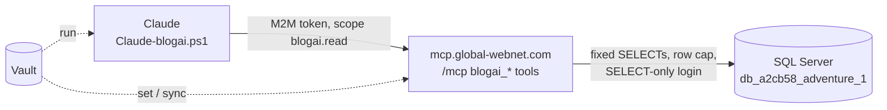

# Stage review: read-only eyes into the legacy BlogAI database (MCP `blogai_*` tools)

*2026-10-21. Branch `claude-blogai-eyes` here and in the workspace root. Built and tested offline; nothing deployed and nothing run against production yet (the SQL login does not exist).*

## Why and what

Claude needs to see the legacy BlogEngine.NET data (BlogAI, SQL Server) to port its features and plan the move from the `be_*` tables to the N-Quad store. The decision (human, 2026-10-21): our MCP server reads the legacy database directly through a **SELECT-only login**, using **named, parameterised queries**; the in-app legacy `mcp-webapi` of the target diagram (file system, hardening of the old app) is a later stage, so the live site is not touched yet.

## What was built

- **`BlogAiCatalog`** (McpServer.WebApi): 19 named SELECT queries: schema (`blogai_tables`, `blogai_columns`, `blogai_foreign_keys`, `blogai_count`), content (`blogai_blogs`, `blogai_posts`, `blogai_post`, `blogai_post_taxonomy`, `blogai_pages`, `blogai_page`, `blogai_categories`, `blogai_tags`, `blogai_comments`), identity (`blogai_users`, `blogai_roles`), configuration (`blogai_settings`, `blogai_extensions`, `blogai_custom_fields`) and the file store (`blogai_files`, metadata only).
- **`BlogAiReader`**: opens `ConnectionStrings:BlogAi`, binds every argument as a SQL parameter, clamps `limit` to 500, validates a table name as a plain identifier, 20 s timeout.
- **MCP**: scope `blogai.read` (a token without it does not even see the tools); `claude-research` M2M client appended at index 5 (inactive until its secret is set).
- **Workspace root**: `docs/Claude-blogai.ps1` (the caller, same pattern as `Claude-author.ps1`), `docs/Claude-blogai-reader-grants.sql` (the exact grants), two vault targets in `Claude-secret-targets.json`.

## What is deliberately not reachable

Password hashes (`be_Users.Password`: the grant is by column), the values in `be_DataStoreSettings` (extension settings hold keys such as the reCAPTCHA private key; column grant), file contents, comment e-mail and IP, settings whose name looks like a secret, and every table of the other applications sharing the database (a login with no grant on them cannot even see them). Tests assert every query is a single SELECT with no write keyword, uses exactly its declared parameters, and never names a secret column.

## Verified

McpServer tests: 64 pass (new: catalogue safety x19 queries, scope gating on `tools/list` and `tools/call`, the not-configured answer). Not verified: any query against the real database.

## Human steps (in order)

1. **SQL login.** In the SmarterASP panel create a database user `blogai_reader` on `db_a2cb58_adventure_1` with no role privileges (type its password there), then `.\docs\Claude-secret.ps1 set mssql/db_a2cb58_adventure_1/blogai_reader` (same value). If the panel names it differently, change the name in the `.sql` and the targets file.
2. **Grants.** Run `docs/Claude-blogai-reader-grants.sql` as the database admin. It grants SELECT on the tables above and nothing else.
3. **Research client secret.** `.\docs\Claude-secret.ps1 set m2m/claude-research/claude-research` (any long random value; `gen` cannot write the vault).
4. **Local trial (before any deploy):** `.\docs\Claude-secret.ps1 sync mssql/db_a2cb58_adventure_1/blogai_reader` and `sync m2m/claude-research/claude-research`, start `LocalTriage.slnx`, then Claude runs the tools against `https://localhost:7152/mcp` (script overrides `CLAUDE_RESEARCH_API` and `CLAUDE_RESEARCH_MCP`).
5. **Production** (after merge): mcp site secret `ConnectionStrings__BlogAi` (the same connection string), api site secret `M2MClients__Clients__5__Secret`; both sites restart. `sync` stops at the first target whose secret is missing, so run `sync <name>` per secret until all are stored.

## Next stages (not started)

1. Read the schema and data, write the migration map from `be_*` to N-Quad schemas (a `docs/Claude-decision-...-legacy-migration.md`), and the MEF candidate list.
2. Legacy `mcp-webapi` inside BlogAI (file system tools, our token validation, secrets from the vault flow); only with the diff-live-first routine and an explicit go from the human.
