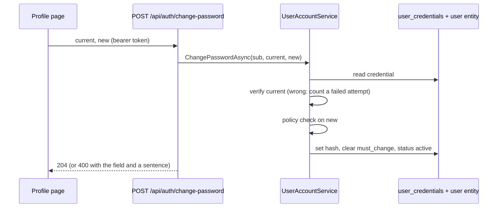

# Stage review: change your own password

*2026-10-21. Branch `claude-change-password` in `ai-research-blog` and `Adventures.Foundation` (keep the two in step). Not merged, not deployed.*

## What was built

- **Foundation, `Adventures.Identity`:** `IUserAccountService.ChangePasswordAsync(userId, current, new)`; `IUserCredentialStore.SetPasswordAsync`; `PasswordPolicy` (12 characters minimum, different from the current password); `ChangePasswordResult`.
- **API:** `POST /api/auth/change-password` (authorised). The user is the token subject, never a client-supplied id. Failures are a 400 with the field and a sentence the client already displays.
- **Client:** a "Change password" form on the profile page; login sends an account flagged "must change" straight to the profile, where a caption explains why; success clears the flag in the session.

## Rules the service enforces

1. The current password must verify; a wrong one counts toward the same 5-attempts / 15-minute lockout as a failed login.
2. A locked account is refused before the password is even checked.
3. The new password must meet the policy.
4. On success: new hash stored, `must_change_password` cleared on the credential row, the user entity's `status` returned to `active` (login reads either, so both must clear; a disabled account is left alone), failed attempts and lockout reset.

## Verified

- Foundation Identity tests: 30 pass (7 new). WebApi AuthController tests: 23 pass (5 new). Angular build clean, 60 client tests pass.
- Not run against a database or in a browser yet.

## What you do to test and deploy

1. Run locally (or after merge and deploy), sign in as `Admin` with its starting password: you land on the profile page with the caption.
2. Change the password: a short one, then the same one, then a wrong current one must each be refused with a clear sentence; a good one succeeds and the caption disappears.
3. Sign out and in with the new password; the old one must fail.
4. Merging to `main` deploys. A Foundation change deploys with the API push; this change touches `ai-research-blog` too, so the normal workflow runs.

## Known gaps

- No password-strength meter, no breached-password check, no "revoke other sessions" (tokens live until they expire).
- Changing someone else's password (an administrator reset) is not built; the Users editor does not carry it.
- The client's must-change flag is not kept across a page reload.
