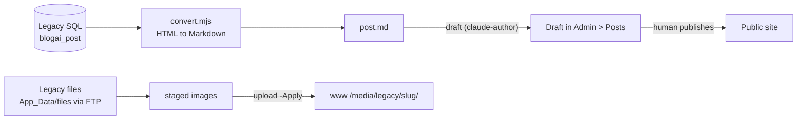

# Stage review: legacy import, stage 1 (one post, end to end)

*2026-10-21. Branch `claude-legacy-import` here and in the workspace root. The tooling is not merged; the draft and the images are already on the live site.*

## What was done

One legacy post, "How to publish your own blog [SmarterAsp]" (published on BlogAI, 6 images), was converted to Markdown, its images were copied to the new site, and it was created as a **draft** (id `e7709aae-8cda-49d4-89a4-eba2172e5544`, category Help, tag Blog). Nothing was published.

## Pieces (all small, all tested)

- `ai-research-blog/tools/legacy-migrate/convert.mjs` (+ 7 tests): turndown with GFM; `/image.axd?picture=` links become `/media/legacy/<slug>/<file>`, inline base64 images are written out as files, `<pre>` becomes fenced code with a language hint, external images are left alone.
- `docs/Claude-migrate-post.ps1` (workspace root): `convert` (reads through the MCP tools, fetches images over FTP, writes `post.md` and `images/` to `M:\Dev\Websites\global\migration\<slug>`), `upload` (dry run unless `-Apply`; creates `global/media/legacy/<slug>`), `draft` (drafts-only authoring surface).
- Staging folder is outside git, like the other site backups.

## Result you can check

- Open the draft in Admin > Posts (title, slug and body should match the live legacy post at https://adventuresontheedge.net/post/how-to-publish-your-own-blog-smarterasp).
- The 6 images render in the preview: they are served from `https://www.global-webnet.com/media/legacy/how-to-publish-your-own-blog-smarterasp/` (200, `image/png`, verified).
- Known differences: the numbered list is kept as a list; the line `In Visual Studio` stays inside item 3 as in the original; each figure caption sits on the line under its image; the `&nbsp;` spaces are gone; image alt text comes from the file name because the legacy markup had none.

## Open points for the review

1. Alt text is derived from file names ("create site"); better captions can be added by hand.
2. The `media/` folder must survive the next Angular deploy (the deploy action only removes files it uploaded itself). Please confirm after the next deploy by opening one image URL; I will re-check too.
3. The draft keeps the legacy slug. The legacy creation date (2025-02-13) cannot be set through the authoring surface; it will show the date it is published.
4. Stage 2 (the code-heavy MCP bridge series) is next.
