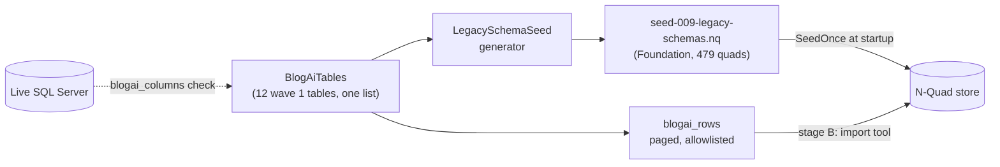

# Stage review: schema-faithful legacy migration, stage A (row tool and mirror schemas)

*2026-10-21. Branch `claude-legacy-stage-a` in `ai-research-blog`, `Adventures.Foundation` and the workspace root. Built and tested offline plus one read-only check against the live database. Not merged, not deployed. Plan: [Claude-decision-2026-10-legacy-table-migration-plan.md](../Claude-decision-2026-10-legacy-table-migration-plan.md); the human accepted its five recommendations (mirror layer plus projection, .NET import tool, `blogai_rows`, drop Contacts, UTC).*

## What was built

- **`BlogAiTables`**: the 12 wave 1 tables (Blogs, Users, Roles, UserRoles, Rights, RightRoles, Profiles, Posts, Pages, Categories, PostCategory, PostTag), every column with its N-Quad type and NOT NULL flag. `be_Users.Password` and the fork's `be_Users.Comment` are not listed, so neither the tool nor the schemas can carry them.
- **`blogai_rows`**: one page of one listed table (`table`, `offset`, `limit` up to 500), ordered by the identity column. Table and column names come only from the list; the page position is bound as parameters. An unlisted table (`AspNetUsers`, `be_Contact`, an injection attempt) is refused before any SQL.
- **Generator and seed**: `https://schema.global-webnet.com/legacy/<table>` per table, one field per column in table order, predicates under `https://global-webnet.com/ontology/legacy/<table>#<column>`, `schema#version` = `blogengine-3.3.6+gwn-2026.09.26`. The checked-in `seed-009-legacy-schemas.nq` is exactly the generator's output (a test fails if they differ; `REGENERATE_LEGACY_SEED=1` rewrites it), and every schema loads through the real `SchemaDal` with all its columns.
- **Wiring**: `EntityConstants.Legacy`; `Program.cs` applies the seed once, schemas only, no data.
- **Grants**: `Claude-blogai-reader-grants.sql` now also grants `be_Profiles` and the identity columns `UserID`, `BlogID` of `be_Users`.

## Checked against the live database

Every spec column and its NOT NULL flag were compared with the live columns (`blogai_columns`, production, read-only). Result: 10 of 12 tables matched on the first pass. Two findings, both fixed or flagged:

1. `be_Pages` has a column the `CREATE TABLE` does not show: `SortOrder int NOT NULL`, added by a later ALTER in `Setup.sql`. It is now in the spec (the live list, not the DDL, is the reference).
2. `be_Profiles` and the `UserID`/`BlogID` columns of `be_Users` are not readable yet: they need the extended grants below.

## Verified

McpServer tests: 76 pass (new: spec rules, page SQL, generator golden file, schema load, row tool arguments, unlisted tables refused, scope required). The API starts cleanly with seed 009 wired (local dev database). Not run: `blogai_rows` against production (the deploy and the grants come first).

## What you do

1. Run the extended `docs/Claude-blogai-reader-grants.sql` as the database admin (adds `be_Profiles` and two `be_Users` columns; it only adds grants).
2. After merging, the mcp site and the api site deploy as usual; no new secret is needed. Seed 009 applies on the api site's first start (schemas only).
3. Tell me when step 1 is done; I will run `blogai_rows` once per table and compare row counts with `blogai_tables`.

## Next (stage B)

The .NET import tool: reads each table through `blogai_rows`, writes the mirror entities and the live projection, first against the local Postgres, with a count and field report.
