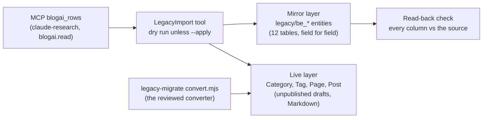

# Stage review: schema-faithful legacy migration, stage B (the import tool)

*2026-10-21. Branch `claude-legacy-stage-b` in `ai-research-blog`, `Adventures.Foundation` and the workspace root. Run against the LOCAL development database only (aiblog_dev on localhost); production has no mirror data and no projection yet. Not merged.*

## What was built

- **`tools/LegacyImport`** (.NET 10 console): reads each wave 1 table through `blogai_rows`, writes the mirror and the content projection into the Postgres N-Quad store, prints a report. Dry run by default; `--apply` writes. It refuses any database host that is not local, and takes the research client secret only from the environment (the vault run), never printing it.
- **Mirror layer:** every row becomes an entity of its `legacy/<table>` schema, column for column, under a stable id (the legacy GUID where the table has one, otherwise a name-based UUID, so a re-run addresses the same entity). Legacy `datetime` is read as UTC (the human's decision). A changed column supersedes the old value; the store keeps the history. After `--apply`, every stored row is read back and compared column by column with the source.
- **Live projection:** only legacy rows that were published and not deleted. Posts and pages arrive **unpublished** (the human publishes), as Markdown from the same converter that produced the reviewed drafts; categories are merged by name (`General` existed once per blog), tags by name; an entity that already exists is never touched, so edits made in the admin survive a re-run. Pages: only `disclaimer` (the rest are stubs or the design notes); posts: the BlogHelp "Welcome" post is skipped.
- **Seed 010 (Foundation):** the mirror schemas also need an `Id` field, which seed 009 lacked (found while writing this: the entity repository keeps an entity's id in its subject and needs the schema field to hold it). Seed 009 was already applied, and a named seed applies once, so the field ships as `seed-010-legacy-ids.nq`, generated and golden-tested like 009. Wired in the API's startup.

## Result of the local run

| Mirror table | Rows read | Created | Mismatches after read-back |
|---|---|---|---|
| be_Blogs, be_Users, be_Roles, be_UserRoles | 3, 6, 12, 11 | all | 0 |
| be_Rights, be_RightRoles, be_Profiles | 120, 240, 62 | all | 0 |
| be_Posts, be_Pages, be_Categories | 30, 8, 9 | all | 0 |
| be_PostCategory, be_PostTag | 17, 34 | all | 0 |

Live projection created 8 categories, 14 tags, 1 page, 18 posts. A second `--apply` run created and changed nothing (every mirror row "same", 41 live entities "already there"). The skipped list names the 6 pages not migrated and the Welcome post.

## Tests

`test/LegacyImport.Tests` (6 pass, in-memory store with the real seeds): the name-based ids against the RFC 4122 example, mirror create / re-run unchanged / dry run writes nothing / changed column supersedes / derived ids, projection of drafts only (draft, deleted and skipped rows excluded, categories and tags merged) and a re-run that leaves an admin edit untouched. McpServer tests still pass (seed golden files included).

## Things to know before production

1. **Personal data in the mirror.** `be_Users` (names and e-mail addresses) and `be_Profiles` are mirrored. This run was local only. Whether the production store should hold them is your call; the tool can be limited with `--tables`.
2. **The 18 drafts already on the live site** were created through the authoring surface with random ids, so a production projection would create 18 more. Options: (a) run the projection in production only after deleting those drafts (you lose any edits you made to them), or (b) a small adoption step that rewrites the existing drafts' ids. I recommend (a) after you have published the ones you want, or (b) if you edited them.
3. Users, roles and rights are mirrored but not projected into the live identity model yet: that is stage C (the login uses the JSONB identity tables; there are no password hashes to migrate).
4. The tool writes with the audit actor `legacy-import`, so the history shows these rows came from the import.

## What to check

Nothing in the admin yet: the local database is the development one. If you run the local API against it you will see 18 drafts, 8 categories, 14 tags and the Disclaimer page; they match the drafts on the live site. Decide the production approach (point 2) and whether the mirror of users and profiles goes to production (point 1).

## Production run (2026-10-21, after the human published the drafts)

Decisions: option (a) for the existing drafts (the human published all 18, so no authoring drafts were left to delete), skip `be_Users` and `be_Profiles` (no other users until beta). Target: `<db-name>`, the only PostgreSQL database of the account, i.e. the live site's store (reached on port 6432 from the development machine; no allow-list was needed).

- **Dry run, then apply.** The dry run wrote nothing. The apply wrote the 10 mirror tables (3, 12, 11, 120, 240, 30, 8, 9, 17 and 34 rows) with zero mismatches on the read-back, and created the Disclaimer page as an unpublished draft. The 18 posts were recognised by slug and left untouched; no category or tag was duplicated.
- **Second apply:** every row "same", nothing created, result ok.
- **What changed for visitors:** nothing (the mirror is not read by the site; the Disclaimer is unpublished).
- **Not in production:** the mirror of users and profiles; roles, rights and role assignments are mirrored but not yet projected into the live identity model (stage C).
- **Tooling:** `--production` mode and its warning line were merged afterwards; the importer now adopts existing posts and pages by slug and categories and tags by name.
