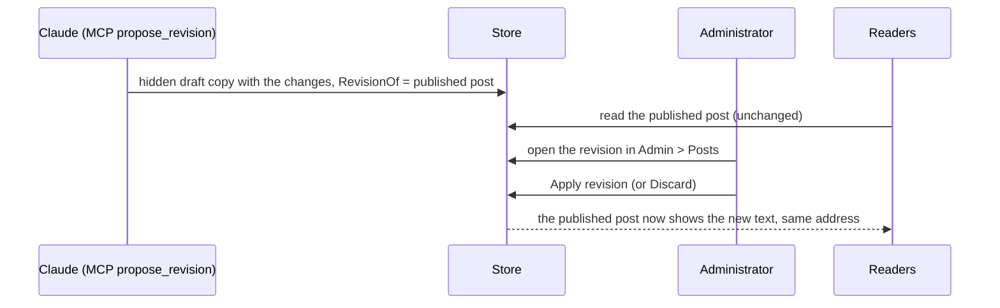

# Stage review: revisions, keeping published posts current (2026-10-21)

Branch `post-revisions` in both repos, plus fixes made on the way (the menu alignment and the health badge moved to the header's top right). This is the "edit as applicable when it changes" half of Claude as an author, built so that a published post can still only be changed by a human decision.

## What was built

- **Revision = a hidden draft copy.** A new post field **RevisionOf** (seed 008, set only by the server, never by a form) links a draft to the published post it proposes to change. Readers keep seeing the published text; the public API never returns a revision.
- **Proposing.** `ContentAuthoring.ProposeRevisionAsync`, the API `POST api/author/posts/{id}/revision` and the MCP tool **`propose_revision`** (and `Claude-author.ps1 -Action revise`): name only what changes (content, title, description, categories, tags, comments); everything else is copied from the published post, and the slug never changes. Only the author's own published posts qualify; a draft is edited directly, someone else's post is refused. One open revision per post: asking again updates it.
- **Applying and discarding (admin only).** A revision's form offers **Apply revision** and **Discard revision** (no Publish). Apply copies title, content, description, comments setting, categories and tags onto the original, keeps its slug, date, author and published state, and removes the revision; Discard removes it. The generic screen returns to the list afterwards. A revision cannot be published (refused with the reason).
- **In the admin list** a revision shows its original in the **Revision of** column.
- **Header fixes (also deployed with this):** the WebApi health badge sits at the top right of the header (administrators, interim until the Dashboard) so it no longer pushes the menu; the menu links were uneven because only the active link carried an underline, so every link now reserves the same space.

## Tests

Foundation Entities 132 (new: a revision is a hidden copy that carries untouched fields and leaves the original alone; asking again updates the one open revision; applying keeps the address and published state, removes the revision and merges categories; a revision cannot be published, can be discarded, and drafts, foreign posts and non-revisions are refused). App: MCP 21 (new: `propose_revision` posts to the revision route without the id; tool list now 11 with both scopes) and the authoring controller; Angular 60 (new: the screen returns to the list when an action removes the entry); all .NET projects pass.

## How to test

Claude proposes a revision of a published post (I will do this to add the revision flow to the Help post once it is deployed). In **Admin > Posts** a row with a value in **Revision of** is the proposal; open it: the form shows the changed text and two buttons, **Apply revision** and **Discard revision**. Apply, and open the public post: it shows the new text at the same address, and the revision row is gone. The header: the menu items sit on one line; as administrator the health badge is at the top right.

## Not done / later

- Applying does not carry a changed slug (by design); a published post is renamed in the admin.
- A side-by-side view of the revision against the published text (today you read both).
- Revisions of someone else's posts, and of pages (pages are edited in the admin).
