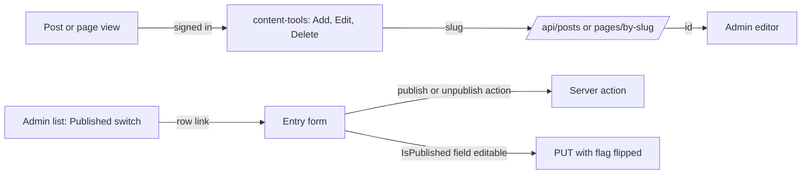

# Stage review: admin conveniences (2026-10-22)

Three human-convenience changes for the current phase. Nothing is deployed yet; the branch is `claude-admin-convenience`.

## What was built

1. **Add / Edit / Delete on the public page and post** (signed-in users only). Icon buttons sit at the right of the date and author line of a post (under the title on a page). Add opens the empty admin form; Edit opens the entry in the admin; Delete asks first, deletes, then returns to the post list (or the home page). The public API carries no ids by design, so Edit and Delete ask a new admin endpoint, `GET /api/posts/by-slug/{slug}` and `GET /api/pages/by-slug/{slug}` (administrators only), for the id when the button is used.
2. **Publish switch in the Posts and Pages lists.** The Published column is a switch. It reads the entry's form and does what the server offers: the Publish or Unpublish action (posts, where the state is server-managed), otherwise saves the page with the flag flipped. The list page is then read again, so the row shows what the server holds; on a failure the message appears above the list and the switch returns to its stored state. A proposed revision (apply or discard only) refuses with a message.
3. **Buttons at the top of the editor**, with Material icons, and sticky so they follow a long form: back, Save, the server's actions (Publish, Unpublish, Apply and Discard revision) and Delete. Save status and errors appear there too. The list's New button has an icon.

## Test steps

1. Sign in, open a post: the three icons show at the right of the date line; sign out and they are gone.
2. Edit opens the post in Admin > Posts; Add opens the new-post form; Delete asks, then lists the posts.
3. Admin > Pages: flip the Disclaimer switch; the row stays on after the list reloads. Open the page address to see it public. Repeat with a post.
4. Open a long post in the admin: Save and the actions stay in view while scrolling.

## Gaps and notes

- The public page itself returns 404 for a draft, so the tools appear only on published content; edit a draft from the admin list.
- The slug lookup lists the whole collection (the store has no query by slug yet); fine at this size.
- No server unit test for `by-slug` yet; the client switch and build are covered by the grid spec.
