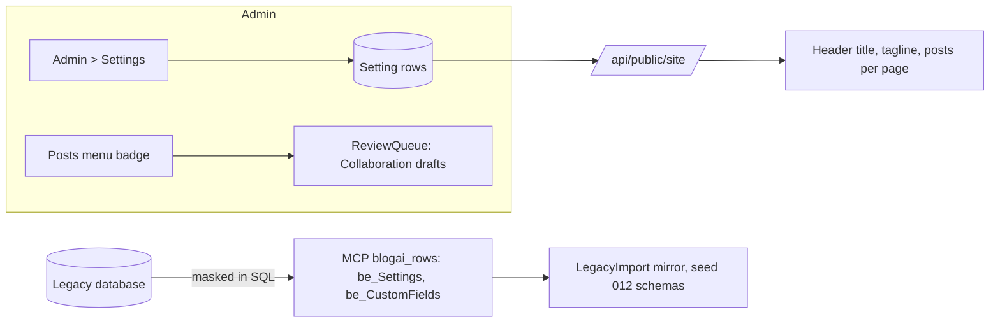

# Stage review: the collaboration slice (2026-10-22)

Branch `claude-collab-slice` in `ai-research-blog` and in `Adventures.Foundation`, not merged. It answers the four decisions in the first Collaboration draft (all four yes) and the one observation from the last user edit.

## What was built

1. **A Publish eye in the editor for entities whose published flag is a plain field (Pages).** Posts keep the server's Publish action; a page has none, so the editor flips the `IsPublished` field and saves, with the same eye and hover text. Not offered on a new, unsaved entry or when the caller may not update.
2. **A "needs your review" count on Posts in the admin menu.** The number of Collaboration drafts, shown like the Exceptions count. `ReviewQueue.CountAsync` pages through the category with drafts included and counts the drafts.
3. **Site settings (Stage D, decision 1).** A new entity `Setting` (seed 011, four defaults: SiteTitle, Tagline, PostsPerPage, TimeZone) edited in **Admin > Settings** with the ordinary grid and form. The site reads them through the anonymous `GET /api/public/site`: the header and the browser tab take the title, the tagline shows under it when set, and the post list uses the page size (1 to 50, ten when unset or invalid). Any bad or missing value falls back to the default, so a typo cannot break the site. The time zone is stored for the migration (how to read the legacy dates) and is not used by the site.
4. **The MCP table list (Stage D, decision 2).** The legacy read tool can now read `be_Settings` and `be_CustomFields` (wave 2). A setting whose name contains password, pwd, secret, token, key or connectionstring is returned as `[masked]`, **in the SQL**, so the value never leaves the database. `be_CustomFields` has no identity column, so it pages and derives its ids from four key columns. The mirror schemas are a new seed 012 (generated and checked by a test), separate from the applied seeds 009 and 010.

## Verification

- Foundation: 140 Entities tests (4 new for settings: defaults, edits, range, fallbacks).
- WebApi 67, MCP server 81 (4 new: masking SQL, key ordering, wave separation, seed 012 generated), LegacyImport 16 (1 new: composite-key ids and an idempotent re-run), client 69 (new: site service, the Publish eye, page size from settings, the review count has its own WebApi tests). Production build clean.
- Smoke run: the API started with the in-memory store, applied seed 011, `/api/public/site` answered with the defaults, `/api/settings` answered 401 to an anonymous caller.
- **Not verified:** the new screens in a browser as an administrator, the masking against the real legacy database (the SQL is tested as text only), and the wave 2 import (it needs the MCP deploy first).

## Decisions this leaves, and the order of things after the merge

1. Merging deploys the API, the client and the **MCP server** (its table list changed). The import tool reads the new tables through the deployed MCP server, so the wave 2 dry run comes after the deploy: `LegacyImport --tables be_Settings,be_CustomFields` (read-only without `--apply`).
2. Applying wave 2 to production is a write: it needs your go after you have seen the dry run's counts.
3. The `Name` of a setting is editable in the admin. Renaming SiteTitle would make the site fall back to the default title; a read-only name is a small follow-up if it bites.
4. Still open from the Collaboration draft: the Collaborators role with an approval field (decision 4, second half).

## Test steps once deployed

1. Admin > Settings: change SiteTitle; leave the screen; the header and the browser tab show it.
2. Change PostsPerPage to 3; the post list shows three per page.
3. Open a Page in the admin: the eye publishes it; the eye again unpublishes it.
4. Create a draft in the category Collaboration: the count on Posts goes up.

## After the merge (2026-10-22, evening): deployed and checked

- Merged to `main` in both repos; the API, client and MCP deploys all succeeded; `/api/health` is Healthy; `/api/public/site` answers the defaults; `/api/settings` answers 401 to an anonymous caller.
- **Wave 2 dry run, read-only, through the deployed MCP tool** (nothing was written anywhere; values were never printed):
  - `be_Settings`: 315 rows, 105 per blog, no duplicate (blog, name) pair. **9 names look secret** (`enablepasswordreset`, `securityvalidationkey`, `smtppassword`, per blog); **all 9 came back masked, none leaked**.
  - `be_CustomFields`: 690 rows (THEME 678, PAGE 6, POST 5, PROFILE 1); the four key columns are unique across all 690 rows, so the derived ids cannot collide; the keys in use outside themes are AllUsers, HeadBanger, Role and Test; 9 rows are `Role` restrictions on posts and pages (matches the migration map).
  - The import tool's own dry run reads without error but reports "schema not in the store yet" for both tables: the first `--apply` seeds 012. It was not applied anywhere (local or production).
- **Next, your decision:** apply wave 2 to production (`LegacyImport --production ... --tables be_Settings,be_CustomFields --apply`), which seeds the schemas and writes 1,005 mirror rows into the live store. Nothing reads them yet, so it is safe but also not urgent.

## Wave 2 applied to production (2026-10-22, evening)

Run on the human's explicit go: `LegacyImport --production ... --mirror-only --apply --tables be_Settings,be_CustomFields` (the recipe in `AGENTS.md`, password only through the vault). It seeded the 012 schemas and mirrored **315 `be_Settings` rows and 690 `be_CustomFields` rows: 315 and 690 new, 0 changed, 0 mismatches.** A second, read-only run over every mirrored table then showed wave 2 as 315 and 690 **same, 0 new**, i.e. a re-run changes nothing; the live API stayed Healthy and `/api/public/site` kept answering. Secret-named settings are in the mirror as `[masked]` only (the masking happens in the legacy database query, so the real values never reached the store).

For the record, that run still lists `be_Users` (6) and `be_Profiles` (62) as "new": they are deliberately not mirrored in production (the human's earlier decision, the importer's `--tables` skips them), so those two lines are expected.
