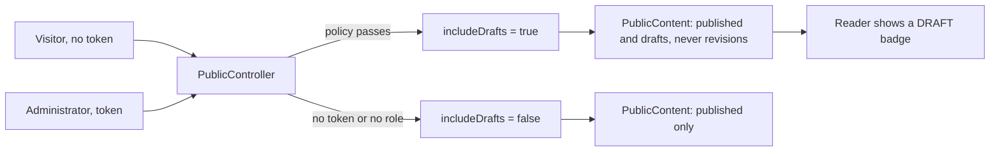

# Stage review: administrators see drafts, flagged as DRAFT (2026-10-22)

Branches `claude-draft-visibility` in `ai-research-blog` and `Adventures.Foundation`, not merged. This is phase 1 of the collaboration channel (backlog, Features): until a Collaborators role exists, Claude posts review summaries as drafts in the category `Collaboration`, the human reads them signed in, and nothing is published.

## What was built

- **Server (Foundation, `PublicContent`):** every read takes an `includeDrafts` flag. When it is true, unpublished posts and pages are returned and carry `IsDraft`; a proposed revision of a published post is never listed (it is a hidden copy, not a post); a draft page never becomes the front page. Drafts also count in the category and tag lists of that view and appear in the menu when the page is set to show in the list.
- **Server (WebApi, `PublicController`):** the public controller stays anonymous, but asks the existing administrator policy about the caller's token and passes `includeDrafts` only when it passes. A visitor, or a signed-in non-administrator, gets published content only. The reader already sends the same token as the admin, so no client change was needed to ask.
- **Client:** a `Draft` badge (a label from the key table, with a hover note "Not published: only administrators can see this") beside the title in the post list, on the post and page, and on menu entries.

## What it means for the collaboration process

Claude's review summaries become draft posts with the category `Collaboration` through the author client. They are visible to the signed-in human on the site with the DRAFT flag, in the list, the menu (for pages) and the post. Nothing is public until the human publishes, and the human has agreed not to publish them before the Collaborators role exists.

One consequence to know: the **draft is visible only while signed in as an administrator**. A visitor or a search engine never sees it, which is the point.

## Verification

- Foundation: 136 Entities tests pass (2 new: drafts in posts, categories, menu and pages; revisions never listed; a draft never the front page).
- WebApi: 64 tests pass (3 new: an administrator's token gets drafts on every read and the admin policy is the one asked; a visitor gets none and the policy is not even asked; a signed-in non-administrator gets none).
- Client: 65 tests pass (1 new: badges in the list and in the menu, none on published items), production build clean.
- Not yet seen in a browser against production: it needs the API deploy and an administrator sign-in.

## Test steps once deployed

1. Signed in as administrator, open Posts: a draft you wrote shows a DRAFT badge; sign out and it disappears.
2. Open a draft page by its address (Admin > Pages shows the slug): it opens, flagged, for you and gives "not found" to a visitor.
3. A proposed revision never appears in the post list.
