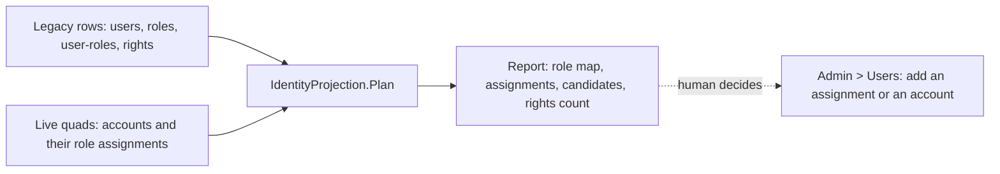

# Stage review: legacy migration stages C and D (2026-10-22)

Branch `claude-legacy-stage-c-d`, not merged. Worked through unattended: everything here is read-only against the legacy data and the local database; nothing was written to production.

## Stage C: roles, rights and assignments - built as a report, and why

The plan was to project roles, rights and assignments into the live identity model. The data made a different answer obvious, so stage C is a **planner and report** (`tools/LegacyImport/IdentityProjection.cs`, run with `--identity`), and it writes nothing.

What the legacy data holds (read through the MCP tools, which never return password hashes):

- 3 blogs (Primary, BlogAI, BlogHelp), 6 legacy role names (Administrators, Admin, Editors, Viewers, Viewer, Anonymous), 4 people with 11 role rows, 40 distinct rights over 240 role-right rows.
- The live model has the roles Admin, Editor, Reviewer and Developer, and the accounts Admin and Claude.

The result of the plan against that data:

| Legacy | Becomes | Why |
|---|---|---|
| Administrators, Admin | live **Admin** | the same meaning |
| Editors | live **Editor** | the same meaning |
| Viewers, Viewer, Anonymous | dropped | the new site has no signed-in reader tier; anonymous is implicit |
| the 40 rights, 240 role-right rows | stay in the mirror only | the BlogEngine rights matrix is deliberately not ported |
| legacy user **Admin** | already holds live Admin | nothing to do |
| legacy users **BillKrat, Root, AI Systems Author** | account candidates, none created | no password hash crosses over; the human decides who is a real person |

So the honest finding is that stage C has **nothing to write**: the one legacy person with a live account already has the right role. The code and tests exist so that the day a candidate is wanted the same plan lists exactly what to add, and `AlreadyAssigned = false` rows name the assignment to add in **Admin > Users**. Three tests cover the role map, the candidate rule and reading live assignments from the quads.

## Stage D: settings and custom fields - findings and a proposal, not built

Why not built: the live app has **no place for site settings**, so there is nothing to project into yet, and building one is a feature with decisions that are yours.

What the data holds:

- `be_Settings`: 315 rows, about 105 per blog. The named MCP tool `blogai_settings` returns them with secret-looking names left out (it caps at 100 rows, so a full read needs the paged tool, see below). Sampled keys include the site description ("Keeping up with technologies"), author name, culture ("Auto"), comments per page, contact-form messages, feed and blogroll options, and Disqus options.
- `be_CustomFields` (columns CustomType, ObjectId, BlogId, Key, Value, Attribute): 690 rows, of which only the PAGE, POST and PROFILE types matter. The `Role` custom field restricts 5 pages and 4 posts to a role.

Proposal (for your decision):

1. **A small Site settings entity** (a key and a value per row, one screen in the admin, the generic grid and form already do it) holding only what the new site would use: site title, tagline, posts per page, and the time zone used to read the legacy dates. The public site then reads them instead of the hard-coded title. Everything else (blogroll, Disqus, contact form, comment moderation) is dropped or waits for the feature that needs it, and stays in the mirror.
2. **The `Role` custom field is not ported.** The items that carried it are imported as drafts and not published until you look at them, as the migration map recommended. The new app has no role-restricted content.
3. **To carry the full settings and custom fields into the mirror** (lossless, like the other tables), the paged `blogai_rows` tool needs `be_Settings` and `be_CustomFields` in its table list, with secret-named settings masked on the server. That is a change to the MCP server (a deploy), plus a new mirror seed. It is a small, well-understood change, but it touches production, so it waits for your go.

## What I need from you

- Stage C: nothing, unless you want one of BillKrat, Root or AI Systems Author as an account.
- Stage D: yes or no on the Site settings entity (point 1), and a go on the MCP table-list change (point 3).

## Verification

- `dotnet test test/LegacyImport.Tests`: 18 pass (3 new).
- `LegacyImport --identity` run against the local database and the production legacy rows: the report above. Not run with a write option: stage C has no write path.
