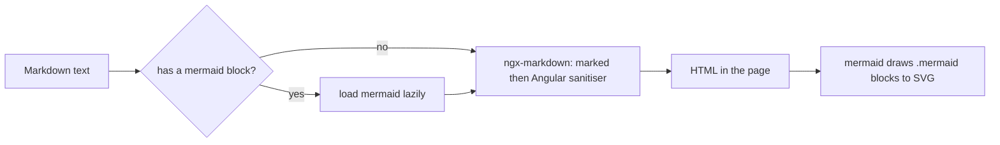

# Stage review: Markdown rendering with ngx-markdown and Mermaid diagrams (2026-10-22)

Branch `claude-markdown-mermaid`, not merged. The human asked for ngx-markdown "or an equivalent" because it also supports Mermaid.

## What was built

- **One renderer for the public reader and the editor preview.** `app-markdown-content` now wraps `ngx-markdown` (marked underneath). The editor's Preview button uses it too, so what you preview is what a reader sees. HTML-typed fields still preview as sanitised HTML.
- **Mermaid diagrams.** A fenced block with the language `mermaid` is drawn as an SVG. The Mermaid library is large, so it is loaded only when the text contains such a block (posts without a diagram never download it). Strict security level; dark theme when the app is in dark mode, read when the post is shown.
- **Sanitising kept.** ngx-markdown passes the HTML through Angular's sanitiser, so scripts, event handlers and unsafe URLs are still stripped (the existing test passes unchanged in intent).



## What this is not

ngx-markdown is a renderer, not an editor with a toolbar. The text area plus Preview stays; a toolbar or WYSIWYG editor is still the "fuller editor" backlog item.

## Findings worth knowing

- ngx-markdown expects a global `mermaid`; it does not load it itself, so the component imports it lazily and sets the global before rendering.
- Its optional import of `marked-katex-extension` breaks the Angular dev server (Vite cannot resolve it, the page does not load), so that small package is installed to satisfy it; the production build is unaffected. KaTeX math is not enabled.
- Cost: the initial bundle grew by about 60 kB (the renderer); Mermaid and its diagram types are separate lazy chunks.
- A diagram that does not parse shows Mermaid's own error drawing, not the source text. Showing the source instead is a small follow-up.
- Mermaid is drawn in the theme active at load; toggling the theme does not redraw an open post until it is shown again.
- `npm audit`: before this change two advisories, both in dev tooling (Vite and launch-editor, via `@angular/build`). This change adds two low-severity ones that ship to browsers: KaTeX "prototype pollution can bypass trust restrictions", reached through Mermaid. We do not enable KaTeX math, and the fix needs Mermaid 12, which ngx-markdown 22 does not yet allow (peer range below 12). Revisit when ngx-markdown allows Mermaid 12.

## Test steps

1. Admin > Posts > open a post, put a ` ```mermaid ` block in Content, press Preview: the diagram appears.
2. Open the published post "A PowerShell-native secret vault..." on the site: its diagram is drawn (checked locally against the live data).
3. Open a post without a diagram: the browser network log shows no Mermaid chunk.
