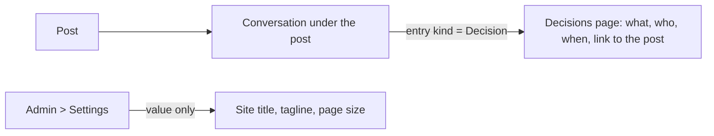

# Stage review: the Decisions page and the settings polish (2026-10-23)

Branch `claude-decisions-page` in `ai-research-blog` and `Adventures.Foundation`, not merged. These are the next steps on the path I proposed in the second review summary and that you told me to proceed with, done after the collaboration post and the README pointer.

## What was built

1. **The Decisions page** (Admin > Content > Decisions). A read-only list of every entry recorded as a **decision** in the Conversation under a post, newest first, each with who recorded it, when, the Markdown text and a link to the post it was recorded under. Administrators only. A decision is recorded where the conversation happens: tick **Record as a decision** under a post. The data was already being collected; this is the page that reads it back.
2. **Site settings: only the value is editable.** Name and Description of a setting are read-only, no new setting can be created from the form and the Delete button is not offered, because the site reads the four settings by name and falls back to a default for a missing one: renaming SiteTitle would have silently dropped the title.

## Decisions I made (for your review; any can be reversed)

1. The Decisions page lists **only** entries of kind Decision; ordinary comments stay in their thread.
2. It lives in the **Content** section of the admin menu, after Blogs, and is for administrators for now. When the Collaborators role exists it becomes visible to that role, as you described.
3. The settings form shows the name and the description as read-only text and edits the value; the description explains what each setting does, so it is worth seeing.
4. **I did not change the site tagline.** The old site's description ("Keeping up with technologies") is in the mirror I loaded, and could be the tagline, but what the site says about itself is your call: edit Tagline in Admin > Settings if you want it.

## Verification

- Foundation: 149 Entities tests (new: decisions only, newest first with their post; settings cannot be renamed, created from the form, and the form shows the name read-only with no delete).
- WebApi 72 (new: the decisions controller is admin-only and returns the decisions), MCP server 82, LegacyImport 16, client 75 (new: the page lists decisions with links to their posts, and the empty state), production build clean.
- Smoke run: the API started and `GET /api/decisions` answers 401 to an anonymous caller.
- **Not verified:** the page in the browser as an administrator, and the server refusing a rename through the real controller (covered at the presenter level).

## Next (my proposal)

1. **Quick replies** under a post (Approve / Redirect / Ask in one tap), so a short visit can move several threads.
2. **The Collaborators role** and hiding Collaboration posts from non-collaborators, when a second person needs to sign in.
3. **An e-mail when a Collaboration draft appears** (the SmarterASP mail service), so a visit starts from a prompt rather than a habit.

## Deployed and checked (2026-10-23)

Merged to `main` in both repos; the API and client deploys succeeded; `/api/health` is Healthy; `GET /api/decisions` and `GET /api/settings` answer 401 to an anonymous caller; the site settings endpoint still answers the defaults. The collaboration post is public (the human published it), so the link in the README works. Not checked by me: the Decisions page and the read-only setting names in the browser as an administrator.
