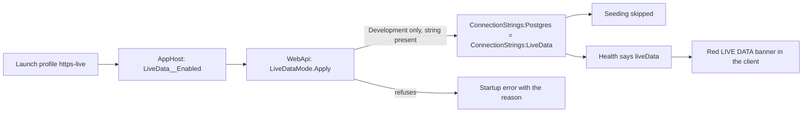

# Stage review: running the app locally on the live data (2026-10-23)

Branch `claude-live-data-profile` (stacked on `claude-reply-toolbar`; root repo branch of the same name for the secret-target entry). Asked by the human: a local run has its own database, so the conversation under a post there is not the one Claude reads; replies had to be made on the deployed site, which lacks the new features.

**What it is:** an opt-in mode in which the local API uses the production PostgreSQL store, so a reply written in the local app lands where Claude reads it through the MCP tools.



**Guards (the point of the design)**
- Off unless `LiveData:Enabled` is `true`; the only switch is the `https-live` launch profile of the AppHost, so the normal profiles are unchanged.
- Refuses to start outside the Development environment, and without `ConnectionStrings:LiveData` (error says what to do).
- The connection string lives in the WebApi's user-secrets under `ConnectionStrings:LiveData` (from the vault; never a repo file). The ordinary `ConnectionStrings:Postgres` is left alone, so switching profiles switches databases.
- **All startup seeding and table creation is skipped**, so a branch with a new seed or schema cannot write it into the live store.
- A red banner "LIVE DATA ..." shows to everyone on every page while it is on; the health response carries `liveData`.

**Limits to know**
- Every click is real: publish, delete, approve, upload change the live site. Exceptions the local run logs go to the live exception log.
- A branch that needs a new seed or table will not work in this mode (its schema is not in the store). Review posts must say whether a branch can be tried this way.
- Sign in with your real production Admin account (the seeded local one does not exist there).

**One-time setup (the human; I do not run it)**
1. The secret `postgres/aiblogdv/a2cb58_aiblogdv` is already in the vault.
2. From the workspace root, in PowerShell (do not run a bare `sync`: it also rewrites `ConnectionStrings:Postgres`):

```
.\docs\Claude-secret.ps1 usersecret postgres/aiblogdv/a2cb58_aiblogdv -Project ai-research-blog\src\AiBlogResearch.WebApi\AiBlogResearch.WebApi.csproj -Key ConnectionStrings:LiveData -Template "Host=pg8001.site4now.net;Port=6432;Database=db_a2cb58_aiblogdv;Username=a2cb58_aiblogdv;Password=[PASSWORD];SSL Mode=Require;Trust Server Certificate=true"
```

3. Start the AppHost with the launch profile **https-live** (Visual Studio: pick it in the profile list; CLI: `dotnet run --project ai-research-blog\AiBlogResearch.AppHost --launch-profile https-live`).
4. Open the Angular app on `http://localhost:4200`; the red banner must show. Stop and restart with the normal `https` profile to go back to the local database.

**Verified:** WebApi 80 tests (4 new: off by default; enabled in Development switches the connection; refuses outside Development; refuses without a connection string), client 91 (2 new: banner shown only when the API says so), production build.
**Not verified:** the mode against the real production database and the AppHost profile in Visual Studio (needs the human's secret and a launch).
