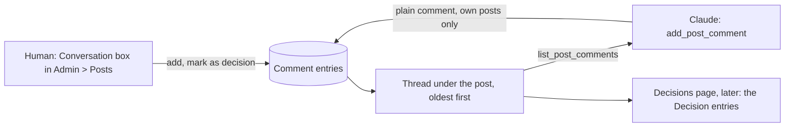

# Stage review: the conversation under a post, and View in the same tab (2026-10-23)

Branch `claude-post-conversation` in `ai-research-blog`, `Adventures.Foundation` and the workspace repo, not merged. It is the first piece of phase 3 of the collaboration channel, the step I recommended and the human told me to proceed with. It also carries the small fix for the View icon.

## What was built

1. **View on the site opens in the same tab.** The cause of the problem you saw: a new browser tab starts a fresh sign-in session, and a draft is shown only to a signed-in administrator, so the new tab said "not found". Published posts opened fine in a new tab; drafts could not. The icon is now a **preview** icon and navigates inside the same tab, where you are still signed in.
2. **A conversation under every post.** A new entity, `Comment` (seed 014: the post it belongs to, who wrote it, when, whether it is a plain comment or a **decision**, and the Markdown text). Entries are only ever **added**: the thread reads as it happened, oldest first, and nothing is edited or removed.
   - **In the admin:** open a saved post and a **Conversation** section sits under the editor: the entries, each with author, time and a *Decision* badge where one was recorded, and a box to add one, with a "Record as a decision" check box and a send icon. The author and the time are the server's, never the caller's.
   - **For Claude:** two new MCP tools, `list_post_comments` and `add_post_comment`, and `Claude-author.ps1 -Action comments -Id <post>` / `-Action comment -Id <post> -Text "..."`. They work only on **my own** posts. I can add plain comments; **I can never record a decision**, only you can.
   - **Why it matters:** the Q&A about a review summary no longer lives only in chat. At the start of a session I read the thread (your answers and decisions) before anything else.

## Decisions I made (for your review; any can be reversed)

1. **Append-only.** No editing or deleting entries, so the record can be trusted as a record. A correction is a new entry.
2. **Only the human records a decision.** Claude's tool cannot set the kind; the endpoint ignores a kind sent by it.
3. **Administrators only** (the same policy as the admin). It is not shown on the public site; comments from readers are a different feature (the post's "comments enabled" flag is untouched).
4. **Same-tab View**, rather than moving the sign-in to a store shared by tabs: the session token stays in the tab (the earlier security review accepted that trade), and a new tab simply starts signed out.
5. **A text limit of 8,000 characters** per entry; longer answers belong in a post.

## Verification

- Foundation: 147 Entities tests (2 new: the thread is ordered, kinds and authors are right, and Claude can only use its own posts; refusals for an empty text, a too long text, an unknown kind, a missing post and another author's post).
- WebApi 71 (new: the conversation controller sets the author from the token and defaults the kind; the authoring routes ignore a kind), MCP server 82 (the tool list and the forwarding of both tools), client 73 (new: the thread, adding a decision, the refusal message), production build clean.
- Smoke run: the API started with seed 014; both comment routes answer 401 to an anonymous caller.
- **Not verified:** the thread in the browser as an administrator, and a round trip from my tools to the deployed API (that needs the deploy; I will do it as the live check after the merge: add a comment to the review summary draft and read it back).

## Still to build (backlog)

The **Decisions page**: a page, visible only to collaborators, that lists the Decision entries across posts with their date, who recorded them and a link to the post. The data is now collected; the page is a read-only list.
