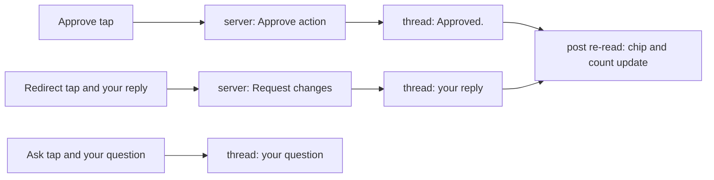

# Stage review: quick replies under a post (2026-10-23)

Branch `claude-quick-replies` in `ai-research-blog` (client only; no server change), not merged. The first item on the path I proposed: make a short visit enough to move a thread.

## What was built

Under the Conversation of a post there are three buttons above the reply box:

- **Approve** (thumbs up): approves the post and writes "Approved." in the thread, in one tap. It appears only while the server offers the Approve action for that post (a post under review).
- **Redirect** (review icon): starts a reply ("Redirect: ...") that, when you send it, also sends the post back with a request for changes. You type why; one send does both. It appears only while the server offers Request changes.
- **Ask** (question mark): starts a question ("Question: ..."). It is a plain comment and does not change the review state. Always available.

After Approve or a Redirect the post is read again, so the review chip and the menu count update at once. The buttons use the action links the server supplies for that post; the client holds no URL templates.

## A defect found by a test, and fixed

My first version cleared the "redirecting" flag before checking it, so after a Redirect the post would not have been re-read and the review chip would have stayed stale. The test for Redirect failed on it; the flag is now read before the reply is sent. (Noted because it is the kind of bug that only shows on a second look at a screen.)

## Decisions I made (for your review)

1. **Approve writes "Approved." in the thread**, so the conversation shows when and by whom, in addition to the recorded who-and-when on the post.
2. **Redirect needs your words**: the button only starts the reply; nothing is sent until you add your reason and send. A request for changes without a reason helps nobody.
3. **No server change**: the existing approve and request-changes actions and the comment endpoint are used, so this deploys with the client only.

## Verification

- Client: 78 tests pass (new: which buttons appear for which actions; Approve runs the action, notes it and signals the host; Redirect sends the reply with the request for changes and signals the host; Ask does not change the state), production build clean.
- **Not verified:** the buttons in the browser as an administrator. The API side is unchanged and already live.

## What the rest of the queue needs from you

- **An e-mail when a Collaboration draft appears.** It needs a mailbox to send from and its credential kept in the vault (you run the `set` step) and as a site secret. The code is small; the decision is which mailbox and whether you want the e-mail at all.
- **The Collaborators role.** Worth building when a second person needs to sign in; until then it adds nothing but the ability to test it.
