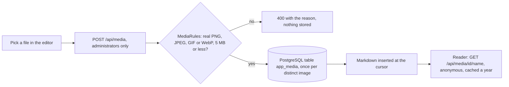

# Stage review: one address per entry, and image upload (2026-10-23)

Branch `claude-slug-and-media` in `ai-research-blog` and `Adventures.Foundation`, not merged. The two items the human chose ("functionality over features not used until beta; security highest as beta nears").

## 1. One address (slug) per post and per page

**The gap:** two posts (or two pages) could share a slug; the public reader finds content by slug and took the first, so a link could show the wrong text.

**The rule** (`SlugRules`, used by the post and page rules):
- A slug made from the **title** gets a numeric suffix when taken: `release-notes`, `release-notes-2`, `release-notes-3`.
- A slug an author **typed** that another entry has is **refused**, naming the holder: *The address "about" is already used by "About us". Choose another address.* (A conflict is a 409 with that sentence, in the admin and through Claude's tool.)
- Comparison ignores case, as the reader does. Proposed revisions never block an address (they are hidden copies). An update that leaves an existing slug unchanged is always allowed, so an old duplicate cannot make an entry impossible to save.
- Checked first: there are **no duplicate slugs** among the published posts today, so nothing existing is affected.

## 2. Image upload (the first media slice)

A blog user can now put a picture in a post without FTP: in a Markdown field, the **add-photo icon** opens a file picker; the image is uploaded and the Markdown that shows it is inserted **at the cursor**.

**Where images live:** a table `app_media` in the same PostgreSQL database as the content (created on first use). They survive a redeploy, travel with the database backup, and an installation needs no writable folder. The in-memory development store keeps them in memory.

### Security (the part that matters)

An upload is trusted for **nothing it claims**:
- **The bytes decide the type.** Only PNG, JPEG, GIF and WebP are accepted, and the first bytes must really be that format; a script, an HTML page or a renamed file is refused whatever its name or `Content-Type`. A file whose bytes are a JPEG but that says it is a PNG is refused.
- **No SVG** (it can carry script).
- **Size cap** 5 MB (checked in the controller, in the request limit and again on the bytes).
- **The stored name is rebuilt** from letters and digits plus the real extension (`..\..\<script>.html.png` becomes a plain name); the name in the address is for readers only, the id selects the file.
- **Served hardened:** `X-Content-Type-Options: nosniff`, `Content-Security-Policy: default-src 'none'; sandbox`, an ETag from the content hash, cached for a year (the address holds the id and an id never changes its bytes).
- **Only administrators upload or list**; anyone may read an image (a post is public).
- **The same bytes are stored once** (SHA-256): re-uploading returns the first copy.

## Decisions I made (for your review; any can be reversed)

1. **Database, not a folder.** Chosen for installs and backups; the trade-off is database size, which the 5 MB cap and one-copy-per-image keep modest. A folder or object store can replace `IMediaStore` later without touching the editor.
2. **Markdown field only** for now (not HTML fields), and only administrators.
3. **Absolute image addresses** (`https://api...`), because the site and the API are different hosts.
4. **No deletion and no media library screen yet**: `GET /api/media` lists the images for a library to be built next, and deleting needs a decision on posts that still show an image.

## Verification

- Foundation: 161 Entities tests (5 for slugs, 7 for media: the type, name, size and one-copy rules).
- WebApi 76 (new: the upload returns the address and Markdown, a fake image is refused and nothing stored, serving headers, who may upload), client 79 (new: the picture is inserted at the cursor and a refusal shows in the server's words), production build clean.
- **End-to-end on a local instance** (the documented seed account on localhost): uploading a PNG returned 201 with an address and Markdown; **an HTML file named `.png` was refused (400, "Only PNG, JPEG, GIF and WebP images are accepted.")**; an anonymous upload got 401; the image was served anonymously with the hardening headers and the **bytes identical**; the same bytes uploaded again under another name returned the same id.
- **Not verified:** the PostgreSQL store against a real database (it is exercised only through the same interface; the first production upload creates the table, which needs the application's database user to be allowed to create it, as it was for the other tables) and the button in the browser as an administrator.

## After the merge

Merging deploys the API and the client (the Foundation merge goes first; the API deploy clones the Foundation `main`). Live check: upload a small image from a post's editor, confirm it shows in Preview and on the public post, and tell me if the first upload fails (the table creation is the one thing I could not test).

## Next

A media library screen (list and pick an existing image, delete with the "still used by" check), then the security items on the beta checklist.
