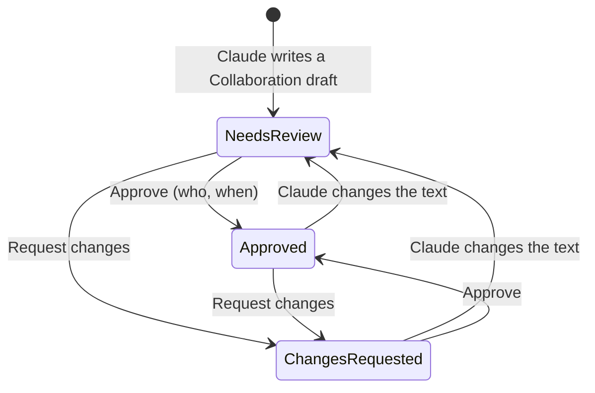

# Stage review: View on the site, and the approval field (2026-10-23)

Branch `claude-view-and-approval` in `ai-research-blog`, `Adventures.Foundation` and the workspace repo, not merged. The human asked for the view icon, said to continue with the approval field, and delegated the open decisions to me to present for review (below).

## What was built

1. **View on the site.** In the Posts and Pages list, an expanded row now has an **open-in-new** icon that opens the post or page on the public site in a new tab (it works for drafts too, now that administrators see drafts). The old icon at that spot opened the editor; it is now an **edit** pencil, so each icon means what it looks like. The same View icon is in the editor's top bar for a saved post or page.
2. **The approval field.** A post now has a review state: **Needs review**, **Approved** or **Changes requested** (empty means "not under review"), plus who approved it and when.
   - It is set **only by the server**: no form can write it (like Published). Approving records the administrator's name and the time; any other state clears both.
   - A post written through the authoring surface (Claude's tool) into the category **Collaboration** starts as *Needs review*. If Claude later changes that draft, an earlier approval or request for changes is reset to *Needs review*, so an approval always describes the text that was approved.
   - In **Admin > Posts** the post's editor offers **Approve** (thumbs up) and **Request changes** (review icon) while the post is under review, next to Publish. A proposed revision is not reviewed this way (it is applied or discarded).
   - The **count on Posts** in the admin menu is now the number of Collaboration posts whose state is *Needs review*. Approving or sending one back lowers it.
   - A chip with the state shows beside the title in the list and on the post, in the administrator's view only. A visitor's response carries no review state.
   - Claude sees the state: `list_my_posts` (and `Claude-author.ps1 -Action list`) now reports it, so at the start of a session I read what you approved or sent back.

## Decisions I made (you delegated them; please review, any can be reversed)

1. **Review states are three fixed words**, not a free field. Reason: the count, the chips and Claude's reading of them all need a closed set.
2. **Only the server writes the state** (two actions), never a form field, so an approval cannot be edited by accident or by a tool.
3. **A change by the author resets the state to Needs review.** Reason: an approval of version 1 must not carry over to version 2.
4. **Collaboration-category posts are the review queue**, set automatically when Claude files a draft there. Posts you write yourself are not under review unless that is added later.
5. **The Collaborators role and hiding Collaboration posts from non-collaborators are deliberately not in this slice.** Today you are the only person who signs in, drafts are already hidden from visitors, and the role only matters once other people (beta testers) sign in. It stays the next step in the backlog; this slice does not pretend to enforce it.
6. **Approval is shown only in the administrator's view** of the public API, so the review state of a published post cannot leak.
7. **The Open icon became an edit pencil** and the new open-in-new icon is the public view; say so if you want the old arrangement back.

## Verification

- Foundation: 145 Entities tests (5 new: approval set by the server only and clearing rules, refusal of unknown states and revisions, Collaboration drafts start under review, a change resets it, the state is in the administrator's view only).
- WebApi 67 (the review queue tests now count by state), MCP server 81, LegacyImport 16, client 70 (new: the View icon rules, the approval chip), production build clean.
- Smoke run: the API started with seed 013 applied, public endpoints answered, `approve` answers 401 to an anonymous caller.
- **Not verified:** the Approve and Request changes buttons as an administrator in the browser (they call `POST /api/posts/{id}/approve` and `/request-changes`, covered by the business-layer tests but not by an HTTP test), and the new seed on the production database (it applies at startup like the others).

## After the merge

Merging deploys the API and the client (the MCP server has no change). Then Claude posts the next Collaboration draft through the author tool; it should arrive as *Needs review* and raise the count on Posts, which is the live check that this works end to end.
