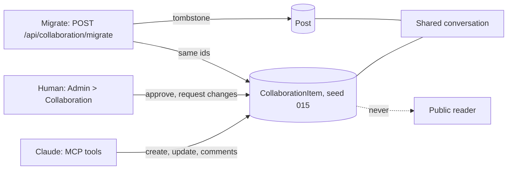

# Stage review: collaboration items as their own type (stage 1 of the collaboration plug-ins) (2026-10-24)

Branch `claude-collab-items` in `ai-research-blog` and `Adventures.Foundation`. Decision and stages: `docs/Claude-decision-2026-10-collaboration-plugins.md` (approved by the human 2026-10-24: one engine with two kinds, the conversation works everywhere, migrate the existing drafts).

**What changed**
- **Own type:** `CollaborationItem` (schema seed 015, graph `collaboration`, ids under `.../id/collaboration/`). It is not a post, so no public query can return one. Fields: title, Markdown content, kind, review state, author, created, branch, repositories, approved by and on.
- **Two kinds on one engine:** Developer (starts as Needs review, can be approved or sent back) and Research (no approval). The kind is fixed at creation; the review state is server-managed.
- **Conversation shared:** the existing conversation now accepts an item id as well as a post id, and the Decisions page lists decisions from both (with a link to the right screen).
- **Admin:** new Collaboration entry under Content (grid, form, Approve and Request changes, conversation under the form); the review count badge moved from Posts to Collaboration.
- **Claude's tools:** MCP `list_my_collaboration`, `create_collaboration_item`, `update_collaboration_item`, `list_collaboration_comments`, `add_collaboration_comment`; `Claude-author.ps1` actions `collab-list`, `collab-new`, `collab-update`, `collab-comments`, `collab-comment`. An AI can create, revise and comment on its own items; it cannot approve, and it cannot touch anything else.
- **Migration:** `POST /api/collaboration/migrate` (administrators; a dry run unless `apply=true`; safe to repeat) turns the unpublished Collaboration-category posts into items **with the same ids**, so conversations, decisions and review states carry over, then tombstones the old posts.

**Verified:** Foundation 167 Entities tests (6 new: kinds and approval, author rules, shared conversation and decisions, the migration dry run then apply); WebApi builds; client production build; MCP server builds.
**Not verified:** the screens in a browser; the migration against production data; the MCP tools end to end (they need the deploy).

**Run it locally** (the local database is empty of items, so create one): sign in, open Admin > Collaboration, New, fill the title and content, save, open it: Approve and Request changes appear, and the Conversation sits under the form.

**Test steps**
1. Admin > Collaboration > New: title and content, Save. Expect: an item with review state Needs review, kind Developer.
2. Open it, press Approve. Expect: state Approved with your name; Request changes still offered.
3. Add a comment, then a decision (tick Record as a decision). Expect: both in the conversation; the decision on Admin > Decisions, linking back to the item.
4. Admin > Posts. Expect: no collaboration entries (after the migration).

**Migration steps (after the deploy, as an administrator, in the browser console of the signed-in site)**
1. Dry run (changes nothing): `fetch('/api/collaboration/migrate', {method: 'POST', headers: {Authorization: 'Bearer ' + sessionStorage.getItem('auth.accessToken')}}).then(r => r.json()).then(console.log)` (on the deployed site use the API address in place of the leading slash path). Expect: a list of the draft posts that would move.
2. If the list is right, repeat with `/api/collaboration/migrate?apply=true`. Expect: the same list; Posts no longer shows them, Collaboration does.

**Decisions needed**
1. The migration moves only unpublished Collaboration posts; a published one stays a post. Recommendation: keep it so.
2. A Research item has no approval and no review count. Recommendation: keep.
