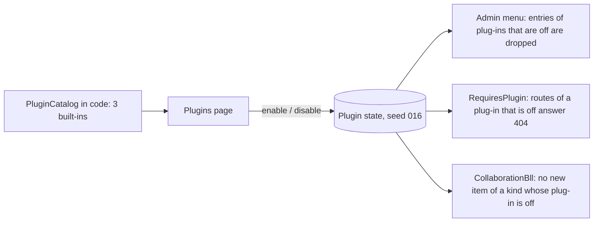

# Stage review: the Plugins page (stage 2 of the collaboration plug-ins) (2026-10-24)

Branch `claude-plugins-page` in `ai-research-blog` and `Adventures.Foundation` (stacked on the merged stage 1). Plan: `docs/Claude-decision-2026-10-collaboration-plugins.md`.

**What it is.** The three built-in plug-ins are declared in code (`PluginCatalog`): **Developer Collaboration**, **Research Collaboration** and **Decisions**. Admin > Plugins (System section) lists them with a switch each. A plug-in with no stored state is on, so nothing changes until someone flips a switch.

**What a switch does**
- **Menu:** the entry disappears (Collaboration while both collaboration plug-ins are off; Decisions with its plug-in). The Plugins entry itself is never hidden, so it cannot be switched off by accident.
- **Endpoints:** `api/collaboration`, the Claude authoring routes under `api/author/collaboration`, and `api/decisions` answer 404 while their plug-ins are off. The MCP tools forward to those routes, so they refuse too (the tool list is not filtered; a later step).
- **Kinds:** with Research Collaboration off, a new Research item is refused with a message that names the plug-in; the Developer kind keeps working.
- **Data is never touched:** items, conversations and decisions stay; switching back on restores everything.

**Not built yet (on purpose):** the Customize button (no plug-in has settings today), Priority ordering (stored, not used), per-blog state (the entity is ready for the tenant field when Blogs arrive), plug-ins loaded from outside the app.

**Verified:** Foundation 170 Entities tests (3 new: on by default, switching kept and unknown key refused, a disabled kind refuses new items while the other kind and the data are untouched); WebApi 91 (4 new: menu filter); client 98 (3 new: the page lists, switches and reports a refusal); production build.
**Not verified:** the page in a browser; production seed 016.
**Live data mode:** this branch needs seed 016, so it cannot be tried in live data mode before it is deployed (the startup check names the missing collaboration and plugin schemas instead of crashing).

**Run it locally** with the normal `https` profile (local database).

**Test steps**
1. Admin > Plugins. Expect: three plug-ins, all on.
2. Switch Decisions off. Expect: the Decisions entry leaves the menu at once; opening `/admin/decisions` shows nothing useful (the API answers 404).
3. Switch Research Collaboration off, open Admin > Collaboration, New, set Kind to Research, Save. Expect: a refusal naming Research Collaboration; a Developer item still saves.
4. Switch both collaboration plug-ins off. Expect: Collaboration leaves the menu; switch one on and it returns, with the existing items.

**Decisions needed**
1. A switched-off plug-in answers 404 rather than 403 (it is "not there"). Recommendation: keep.
2. Stage 3 (the Research kind's own fields and states) next, then the Customize button when a plug-in has a setting. Recommendation: that order.
