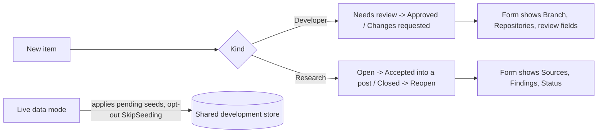

# Stage review: the Research kind and live seeding (stage 3 of the collaboration plug-ins) (2026-10-24)

Branches `claude-live-seeding` then `claude-research-kind` (stacked) in `ai-research-blog`, `claude-research-kind` in `Adventures.Foundation`, `claude-research-kind` in the workspace root (the script). Plan: `docs/Claude-decision-2026-10-collaboration-plugins.md`.

**Research kind (seed 017)**
- New fields: **Status**, **Sources** and **Findings** (Markdown). A Research item starts **Open**; the body (Content) is the question.
- Status moves only through actions: **Accept into a post**, **Close**, **Reopen** (never a form field). A Developer item refuses a status; a Research item refuses an approval.
- A saved item's form shows only its own kind's fields (Developer: Branch, Repositories and the review fields; Research: Sources, Findings, Status) and only its own actions. A new item (no kind yet) shows every field. Revising a Research item keeps its status.
- Claude's tools take `sources` and `findings` (`create_collaboration_item`, `update_collaboration_item`, and `sources:` / `findings:` in the `Claude-author.ps1` header).

**Live seeding (the question about schema changes)**: the store behind the local live-data run is the shared development environment, so live data mode now applies pending seeds and creates missing tables exactly like a normal start (a named seed applies once and only adds schema and defaults). A branch with a new schema therefore runs against it, and collaboration continues while the code is unmerged. `LiveData:SkipSeeding=true` restores the old read-only behaviour (the startup check then names a missing schema). Cost to know: a seed from an abandoned branch stays in the store; a change to an applied seed ships as a new seed, as always. The red LIVE DATA banner stays.

**Verified:** Foundation 172 Entities tests (2 new: the Research states and fields; a Developer item has no status, a revised Research item keeps it); WebApi 92 (1 new); builds of the WebApi and MCP server.
**Not verified:** the kind-aware form and the actions in a browser; seeds 016 and 017 against the shared store.

**Run it locally**: with live seeding on, `https-live` works for this branch (it will apply seeds 016 and 017 to the shared store on first start); or use `https` for the local database.

**Test steps**
1. Admin > Collaboration > New: type `Research` in Kind, a title, a question in Content, Save. Expect: status Open.
2. Reopen the item. Expect: the form shows Sources, Findings and Status but no Branch or Repositories; actions Accept into a post and Close.
3. Press Accept into a post. Expect: status Accepted; actions Close and Reopen.
4. Open a Developer item. Expect: Branch, Repositories and the review fields, no Sources; Approve and Request changes.

**Decisions needed**
1. The Kind is still a text field until the dropdown (backlog). Recommendation: do that next, with the last-used defaults and the Kind filter.
2. Live seeding on by default. Recommendation: keep.
