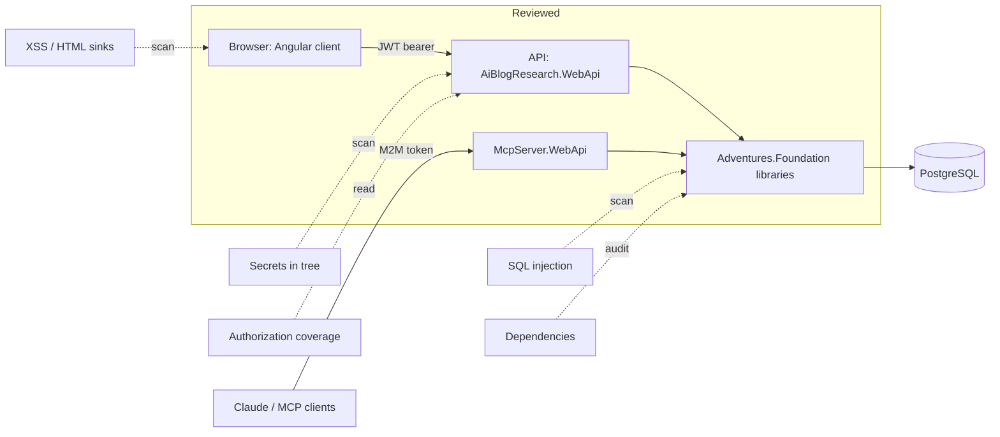

# Security, practices and patterns review (2026-10-24)

**Assessed:** 2026-10-24 by Claude. **Scope:** the tracked files of `ai-research-blog` and `Adventures.Foundation` as of the single-commit baseline. **Method:** automated pattern scans over every tracked file plus targeted reading of the security-relevant code (listed below). Not a penetration test; nothing was run against production.

**Status: no critical or high finding in our code or NuGet dependencies. F-1 to F-4 were fixed the same day (with tests); F-5 to F-8 are in the backlog with a priority order.**

## What was checked

| Area | How | Result |
|---|---|---|
| Secrets | Regex scan of all tracked files for passwords, keys, tokens, private keys, connection strings | None. Only fake test fixtures (`sk-ant-api03-TESTKEY...`) in tests |
| SQL injection | Scan for interpolated or concatenated SQL | Only table names are interpolated, and `NpgsqlNQuadStore` validates them with `^[a-z_][a-z0-9_]{0,62}$`; values use Dapper parameters |
| XSS | Scan of the Angular client for HTML sinks | One `[innerHTML]` (entity form preview), which Angular sanitizes; Mermaid runs with `securityLevel: 'strict'` |
| Authentication | Read JWT setup | Issuer, audience, signing key and lifetime validated; HS256; 30 s clock skew; password lockout (15 min) |
| Authorization | Every controller checked for `[Authorize]` or `[AllowAnonymous]` | All have one except the two `HealthController`s (intentionally open) |
| Uploads | Read `Media.cs` and `MediaController` | 5 MB cap; PNG, JPEG, GIF, WebP only (no SVG); served with `nosniff` and `Content-Security-Policy: default-src 'none'; sandbox` |
| Abuse limits | Read `ClientErrorsController` | Anonymous reporting is capped per minute, per day and per error kind |
| NuGet vulnerabilities | `dotnet list package --vulnerable --include-transitive` | None in either repo |
| npm vulnerabilities | `npm audit` | 4 low or dev-only items, see F-5 |
| Licenses | Package metadata | Nothing copyleft; see `Claude-decision-2026-10-licensing.md` |

## Findings

| # | Severity | Finding | Recommended fix |
|---|---|---|---|
| F-1 (fixed) | Medium | No fallback authorization policy, so a new controller that forgets `[Authorize]` is publicly open by default | Set `FallbackPolicy` to require an authenticated user and mark the intended public endpoints `[AllowAnonymous]`; add a test that lists every endpoint without one |
| F-2 (fixed) | Medium | No per-IP rate limit on `api/auth/token` and the M2M token endpoint. Per-account lockout does not stop password spraying and lets anyone lock a known account for 15 minutes | ASP.NET Core rate limiter on the two token endpoints, keyed by client IP |
| F-3 (fixed) | Low to medium | No HSTS, `X-Frame-Options`/`frame-ancestors`, `Referrer-Policy` or CSP on the API or the static client (only media has them). The host may add some; not verified | Security-headers middleware for the API; a `web.config` or host rule for the Angular site |
| F-4 (fixed) | Low to medium | Infrastructure identifiers in public files: the database host, database and user names, hosting site and account ids (`AGENTS.md`, several `docs/`, `api-webdeploy.pubxml`, `web.config`). No passwords | Replace with placeholders in the docs and drop the publish profile (deploys use GitHub Actions). Confirm the database only accepts allow-listed IPs; the local-database doc says it does, another note says port 6432 is reachable from the dev machine |
| F-5 | Low | `npm audit`: `vite` (high, `launch-editor` on Windows; development server only, not shipped), `katex` and `mermaid` (low, prototype pollution; Mermaid is in strict mode) | Resolve with the planned Angular upgrade (`@angular/build` 22.1.9) and a Mermaid bump; schedule it |
| F-6 | Low | The app repo's deploy workflows build and deploy without running tests (Foundation's `build.yml` does run them) | Add a build-and-test job that the deploy jobs depend on |
| F-7 | Low | No `TreatWarningsAsErrors` and default analyzers only | Enable for new code, then tighten gradually |
| F-8 | Info | Seeded `Admin`/`Admin` and `Claude`/`Claude` accounts are documented as dev defaults and flagged to change on first login | Not verified for production in this review; confirm no default account exists there |

## Patterns and practices (what is good)

- Layering is consistent: Entities and rules are storage-agnostic; controllers are thin; SQL lives in the Data libraries.
- Server-side validation at the trust boundary (`ValidateCredentials`, `MediaRules`, `SlugRules`); error text never includes exception messages in health output.
- Observability is built in: correlation id on every request, redaction of keys and passwords in logs, an exception log with signatures.
- Tests: 71 test files in Foundation, 26 backend and 22 client test files in the app. 161 Entities tests passed at the last stage.
- Secrets handling follows one mechanism (vault, user-secrets, host secrets); nothing is committed.

## Not covered

Dynamic testing, per-endpoint role logic, MCP tool authorization in depth, password-hash parameters, the production configuration and infrastructure, and any secret that may have existed in the earlier, now archived history. A review of those is a separate stage.

## Source stamps

Every `.cs` and `.ts` source file carries a one-line comment with the assessment date, time and status. The stamp says only what was done: an automated scan, with a finding id where this review found something in that file. It is not a claim of line-by-line review.
