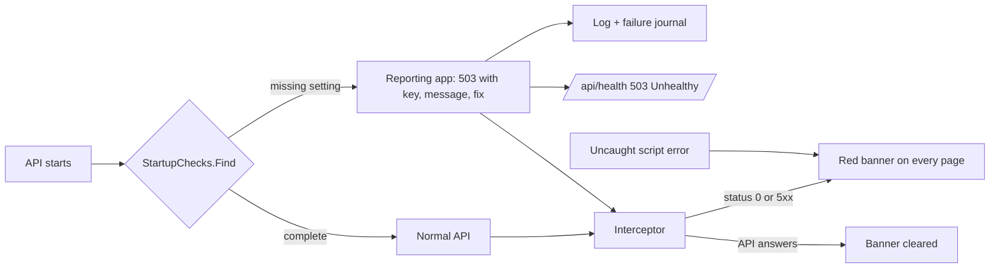

# Stage review: a missing setting is reported, the page shows API failures, Prompt Claude (2026-10-24)

Branch `claude-live-data-profile`. Asked by the human after a Live data run whose API died at startup (the page sat on "Loading..." with every `/api` call pending).

**What changed**
- **Startup checks** (`StartupChecks`): `Jwt:SigningKey` always; `ConnectionStrings:Postgres` outside Development (memory is the offline fallback in Development); `ConnectionStrings:LiveData` when `LiveData:Enabled` is on, and live data outside Development is refused. A missing setting no longer kills the process: a small reporting app answers every request with 503, the key, what is wrong and the fix (Development only; elsewhere a generic 503), and `/api/health` answers 503 Unhealthy with `configuration` as the failed dependency. The failure is logged and written to the failure journal, so it shows in the exception log at the next healthy start.
- **Banner** (`ApiProblemService`, `apiProblemInterceptor`): status 0 or 5xx on an `/api/` call, and any uncaught script error, show a red dismissible banner under the LIVE DATA one; it clears when an API call succeeds.
- **Prompt Claude**: on every exception row, an editable, copyable prompt for a Claude Code session (message, ids, the vault command for `Claude-diagnose.ps1`); nothing is sent from the page. It works for rows with no correlation id.
- **Why Ask Claude was missing:** it sits under Diagnose, which needs a correlation id. Startup failures happen before any request, so their rows have none (the same on the dev site: the data, not the code). Prompt Claude covers those rows.

**Verified:** WebApi 86 tests (5 new for the checks), client 95 (4 new), production build. Ran the API with a blank signing key: `/api/health` 503 with `Jwt:SigningKey missing`, every other route 503 with the fix.
**Not verified:** the banner in a browser against the reporting app; the production behaviour of the reporting app (generic 503).

**Test steps**
1. Remove the key: `dotnet user-secrets remove ConnectionStrings:LiveData --project src\AiBlogResearch.WebApi\AiBlogResearch.WebApi.csproj`, start `https-live`: the page loads, the red banner names `ConnectionStrings:LiveData` and the fix, the header badge says unhealthy. Store the key again and restart.
2. Open Admin > Exceptions, open a startup row: Prompt Claude shows a prompt; edit, copy, paste into Claude Code.
3. Stop the API while the page is open and click a menu item: the banner says the API isn't answering.
