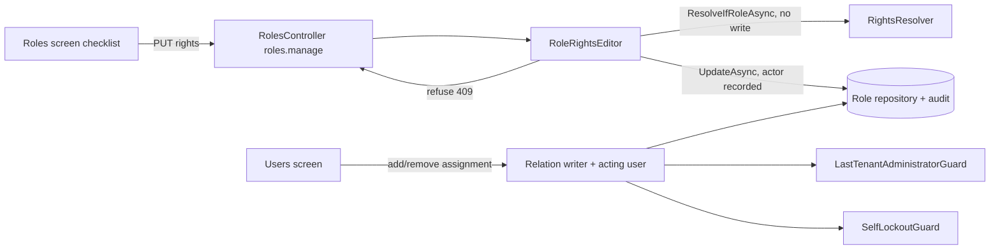

# Stage review: S3 role administration (2026-10-26)

**What was built.** Role changes are now safe to make and traceable. Branch `claude-s3-role-assignments` in both repos; nothing merged or deployed.

- **S3a, assignments.** The relation writer takes the acting user, so adding or removing a role assignment is audited against the person who did it (it was recorded as "system"). A `SelfLockoutGuard` refuses removing your own assignment of a role that holds `users.manage` or `roles.manage`. The existing last-administrator guard still applies.
- **S3b, rights editor.** `RoleRightsEditor` stores a role's rights once each, in catalog order. It refuses an unknown right, taking away your own ability to manage users and roles, and leaving nobody with it (skipped when the data names nobody today). `IRightsResolver.ResolveIfRoleAsync` projects the result without saving. Endpoints: `GET api/roles/rights-catalog`, `PUT api/roles/{id}/rights`, both behind `roles.manage`; refusals are 409.
- **S3c, checklist.** A saved role's screen shows every right as a checkbox with its description and a Save rights button; a refusal appears in the server's words.

**Threats addressed.** Administrator lock-out by a role edit or assignment removal; unknown rights reaching storage; role changes with no named actor.

**Verified.** Foundation suites all pass (Entities 207, WebApi 75, NQuad 86). App API 104, McpServer 82, client 127. **Not verified:** the checklist has not been clicked through in a browser; user testing waits for a better session (small screen this session).

**Open.** Backlogged user test of S3 (sign in as an administrator, try to strip your own roles.manage, expect the refusal). Next on the beta path: F-6 test gate before every deploy.
