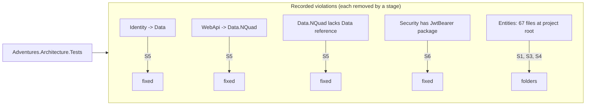

# Stage review: S0 architecture reference and guard tests (2026-10-31)

Branch `refactor-s0-guard` in `Adventures.Foundation` and `ai-research-blog`, cut from `main`. First stage of the decoupling refactor (plan: [Claude-architecture-reference.md](../Claude-architecture-reference.md), section 7). No production code changed.

## What was built

1. **The architecture reference** ([docs/Claude-architecture-reference.md](../Claude-architecture-reference.md)): rules R1-R19 from the four sources, the target dependency graph from the refactor UML, the facts found in the code, decisions D1-D7 (all resolved), and stages S0-S11. It is the document to read before any development work.
2. **Guard tests** (`Adventures.Foundation/test/Adventures.Architecture.Tests`, 8 tests). They read the library `.csproj` files, so they need no build of the libraries:
   - the project-reference graph is pinned (adding or removing an edge fails until the list is updated);
   - no reference cycles;
   - target rules as *ratchets*: Common/Entities stay at the bottom; Security and Identity reference no store; stores build on `Adventures.Data`; WebApi references no store; Security has no ASP.NET package; source files at project roots may not grow.
   Each rule lists today's violations and the stage that removes them. A new violation fails, and so does a listed violation that has gone: the stage that fixes it must delete its line (red, then green).

## Verified

- Guard tests 8 of 8 pass. Red proven: removing one recorded violation made two tests fail with the offending edge named; restored, green.
- Full Foundation suite passes (542 tests: Architecture 8, Data 24, Security 58, Identity 33, Ioc 5, Common 30, Entities 212, Data.NQuad 81, WebApi 91).
- App solution suites pass: AiBlogResearch.WebApi 124, McpServer 83, plus the Foundation projects referenced by the solution. The Angular client suite was not run (no client change).

## Not verified / limits

- The rules read project and package references only. They do not see a namespace dependency inside one project (for example Blog types inside Entities); those are caught by the folder and file-count ratchet and, later, by the project split itself.
- The app repository has no guard yet; the reuse proof for the NQuad browser (S8) adds the "no Blog reference" graph test.
- AppArch chapters 4-8, 13, 15 and 17 were not read; see section 1 of the reference.

## Decisions

All settled with the human on 2026-10-31: D1 keep `DynamicEntity` for the first SQL Dal; D2 reusable `Adventures.Blog.WebApi`; D3 WPF uses a remote Dal; D4 server-side presenters stay; D5 project references until after S9; D6 this refactor supersedes maintenance mode; D7 one branch per stage.
