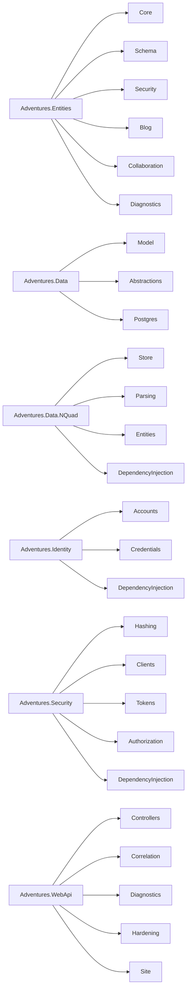

# Stage review: S1 folders and names (2026-10-31)

Branch `refactor-s1-folders` in `Adventures.Foundation` (app repo: one rename in `Program.cs` and this document). Second stage of the decoupling refactor ([reference](../Claude-architecture-reference.md), section 7). No behaviour change.

## What was built

1. **Every library project keeps its source in folders; none at a project root** (was 0 / 9 / 14 / 67 / 10 / 0 / 17 / 15 files). Files were moved with `git mv`, so history follows.
1b. **Project folders under src and test** (change request on the S1 item): `Adventures.Common` and `Adventures.Ioc` moved from the repository root into `src/`, and `Adventures.Common.Tests`, `Adventures.Ioc.Tests` and `Adventures.Tests` into `test/`; solution files, project references and the app's `.slnx` and `Program` project reference were updated. A new guard test fails if any project sits outside `src` or `test` (proven red with a stray project).
1c. **App repository cleanup** (change request on the S0 item): `AiBlogResearch.AppHost` and `AiBlogResearch.ServiceDefaults` moved from the repository root into `src/`; the solutions, project references, the AppHost path to the client, the deploy workflow path filters and `Claude-run.ps1` follow. The Angular `client/` stays at the root (recommendation below). New guard: `RepositoryLayoutTests` (every project under src, test, tools or client; no source file at the root; proven red with a stray project).
2. **Namespaces were left unchanged on purpose**: no C# consumer needed an edit (only project paths changed), and the later extraction stages (S3, S4, S5) move whole folders into new projects, which is the moment namespaces change.
3. **One name clash removed**: the Postgres-side `Adventures.Data.IEntityRepository` is now `IEntityRecordRepository` (it stores `Entity` records, not `DynamicEntity` types). `Adventures.Entities.IEntityRepository<TEntity>` keeps its name. The Postgres class `PostgresEntityRepository` keeps its name for now (renamed with the Dal work in S2).
4. **Guard tests** (10 now): root files must be 0 (was a recorded-counts ratchet), public type names must be unique across the libraries, and every project lives under `src` or `test`.

The Entities folders already mark the S3 and S4 cut lines: `Blog` leaves in S3, `Collaboration` in S4. `Security` holds the tenant, user and rights model (it joins Adventures.Security's concerns in S6).

## Verified

- Red: the old recorded-count test fails once files move; a duplicate public type name added to Security fails the new uniqueness test (removed again; green).
- Foundation: all suites pass (Architecture 9, Data 24, Security 58, Identity 33, Ioc 5, Common 30, Entities 212, Data.NQuad 81, WebApi 91).
- App: WebApi tests 124 pass; McpServer.WebApi and tools/LegacyImport build.

## Not verified / limits

- The McpServer test project was not run: your running dev server locks its output, and the scratch-output workaround makes those tests fail on the workspace lookup (known). Run it after stopping the server.
- Angular suite not run (no client change). The app was not started; start it with the Run line.
- Folder names inside Entities are a first cut; the S3 and S4 extractions may rebalance them.

## Decisions

None open. Next: S2 (Dal layer) on `refactor-s2-dal`.

## Recommendation: `client/` stays at the repository root

`src/` holds the .NET projects; the Angular project has its own toolchain (package.json, angular.json, node_modules, its own tests and lockfile), its own deploy workflow (`deploy-angular.yml`, path filters and FTP source directory) and its own VS Code launch and proxy settings. Moving it under `src/` changes all of those for no dependency benefit, and in S10 it becomes a set of Angular workspace libraries that will want their own top-level home anyway. Revisit it there.

Also verified after the cleanup: whole app solution and LocalTriage build, WebApi tests 126, McpServer tests 83, LegacyImport tests 16. Not verified: the Aspire AppHost was not started (the Run line is the check), and the deploy workflows' new path filters will first be exercised by the merge.
